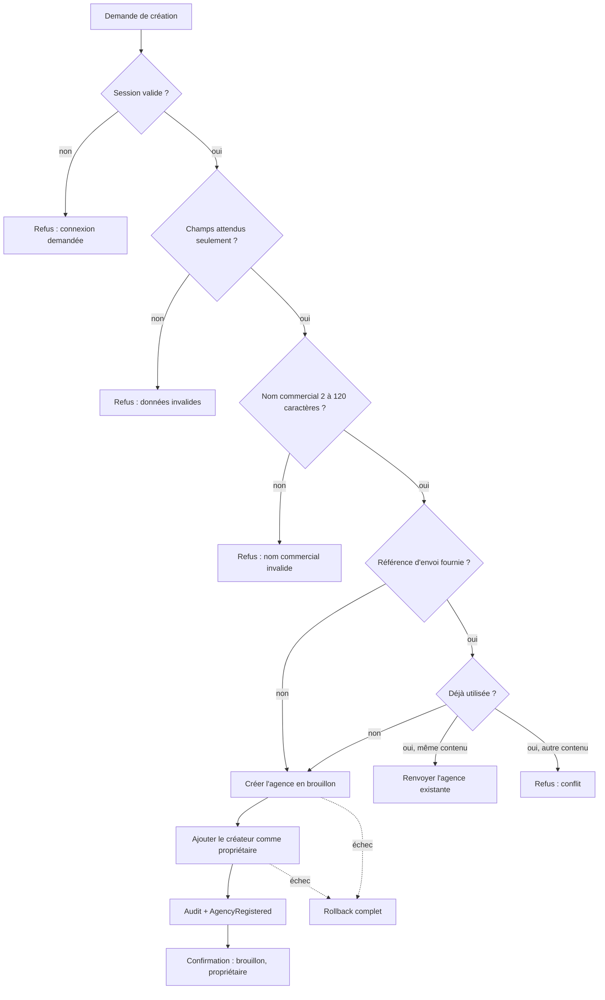

# UC-02-01 — Créer un brouillon d'agence

| Champ | Valeur |
|---|---|
| Statut | Brouillon (en attente des réponses Q-05, Q-06, Q-08, Q-10) |
| Priorité | Must |
| Domaine | `agencies` (`backend/docs/domains.md` §Agences) |
| Tâche | B2.1 |
| Date | 2026-11-03 |
| Use cases liés | UC-02-02 à UC-02-09 (supposent une agence créée) ; UC-01-09 Lister mes agences (affiche la nouvelle agence) |
| Exigences couvertes | UC-02-01, RM-02-01, EX-02-001, EX-02-003, EX-02-004, EX-02-005, EX-02-008, EX-02-009, EX-02-010, EX-02-011, EX-02-013 |

## 0. Traçabilité

| Exigence | Source | Où elle est traitée |
|---|---|---|
| UC-02-01 | F02 §Cas d'usage 1 ; PH B2.1 | §8, scénarios 1, 2 |
| RM-02-01 | F02 §Règles | RG-02-01-02 ; scénario 1 |
| EX-02-008 | ARC3 §Identités ; RM-01-01 | RG-02-01-01, RG-02-01-06 ; scénarios 1, 3 |
| EX-02-009 | RIA §Accès agence ; PH B2.1 | RG-02-01-03 ; scénario 1 ; tests 4, 5, 11 |
| EX-02-003 | CDX §Contraintes | RG-02-01-05 ; scénario 5 |
| EX-02-004 | F02 §1 ; ARC5 (idempotence) | RG-02-01-07 ; scénarios 8 à 11 |
| EX-02-005, EX-02-010 | F02 §1 ; ARC6 | RG-02-01-08 ; scénario 12 |
| EX-02-013 | RM-01-05 | scénarios 6, 7 |
| EX-02-011 | ARC5 | §10 ; tests 14, 15 |
| EX-02-001 | ARC3 | Non applicable à la création (aucune agence visée) ; vérifié par UC-02-02 et suivants sur l'agence créée. |

## 1. Objectif

Permettre à toute personne inscrite de démarrer son activité d'agence sur la plateforme : l'agence existe immédiatement en brouillon, sans approbation, et son créateur en est le premier propriétaire. Sans ce cas, aucune équipe ni aucune invitation (B1) n'est utilisable.

## 2. User story

> En tant que **personne connectée** (particulier ou commerçant), je veux **créer mon agence en brouillon**, afin de **la configurer avec mon équipe avant de la soumettre à vérification**.

## 3. Acteurs

- Principal : personne connectée, quel que soit son type de compte.
- Secondaires : aucun. L'admin plateforme n'intervient pas (B10).

## 4. Déclencheur

La personne demande la création d'une agence en indiquant son nom commercial.

## 5. Préconditions

- P1 : la personne est authentifiée par une session ouverte (non révoquée, non expirée).
- P2 : aucune autre condition : la personne peut déjà être membre ou propriétaire d'autres agences.

## 6. Postconditions

- Succès : une agence existe au statut **brouillon**, avec un identifiant attribué par le système et le nom commercial normalisé ; la personne en est **propriétaire active** ; une trace d'audit « agence créée » existe ; l'agence apparaît dans « mes agences ».
- Échec : aucune agence, aucun membership, aucune trace d'audit ne sont écrits (rollback complet).

## 7. Règles métier

| ID | Règle | Exemple | Source |
|---|---|---|---|
| RG-02-01-01 | Toute personne connectée peut créer une agence, qu'elle ait un compte particulier ou commerçant. | Marie Tchoua (compte commerçant) crée « Tchoua Logistique » et en devient propriétaire. | EX-02-008 (ARC3 §Identités) |
| RG-02-01-02 | L'agence naît au statut brouillon ; aucun autre statut initial n'est possible. | « Express Douala » créée → statut brouillon. | RM-02-01 ; RDM lot 2 |
| RG-02-01-03 | Le créateur devient propriétaire actif dans la même opération ; si l'un des deux enregistrements échoue, rien n'est créé. | Awa crée « Express Douala » → Awa propriétaire active ; panne pendant l'ajout du propriétaire → aucune agence. | EX-02-009 |
| RG-02-01-04 | Le nom commercial est obligatoire, débarrassé des espaces de bord, et compte de 2 à 120 caractères. **[HYPOTHÈSE]** (Q-01) | « A » refusé ; « QX » accepté ; « &nbsp;&nbsp;Express Douala&nbsp; » → « Express Douala » ; 121 caractères refusé. | D-04 |
| RG-02-01-05 | Le système attribue l'identifiant ; ni identifiant d'agence, ni statut, ni rôle ne peuvent être fournis. | Demande contenant « statut : soumise » → refusée, rien créé. | EX-02-003 |
| RG-02-01-06 | Une personne peut être propriétaire de plusieurs agences. | Awa, propriétaire d'« Express Douala », crée « Express Kribi » → deux agences, deux rôles propriétaire. | RM-01-01 |
| RG-02-01-07 | **[HYPOTHÈSE]** (Q-06) Une création peut porter une référence d'envoi (clé d'idempotence) propre à la personne : le même envoi rejoué renvoie la même agence sans nouvel effet ; la même référence avec un autre contenu est refusée pour conflit ; sans référence, chaque envoi crée une agence. | « cle-001 » envoyée deux fois pour « Express Douala » → une agence ; « cle-003 » réutilisée pour « Express Kribi » → conflit. | EX-02-004 ; ARC5 |
| RG-02-01-08 | La création est auditée (auteur, agence, action, date) et émet `AgencyRegistered` **[HYPOTHÈSE sur le moment : Q-10]** ; aucune notification n'est envoyée. | Trace « agence créée » par Awa pour « Express Douala ». | EX-02-005 ; EX-02-010 ; EX-02-014 |

## 8. Flux nominal

1. La personne demande la création d'une agence avec un nom commercial (et éventuellement une référence d'envoi).
2. Le système vérifie la session (P1).
3. Le système refuse tout champ autre que ceux attendus (RG-02-01-05).
4. Le système normalise et valide le nom commercial (RG-02-01-04).
5. Si une référence d'envoi est fournie, le système vérifie qu'elle n'a pas déjà servi (RG-02-01-07).
6. Le système attribue un identifiant et crée l'agence au statut brouillon (RG-02-01-02).
7. Le système enregistre la personne comme propriétaire active (RG-02-01-03).
8. Le système écrit la trace d'audit et émet `AgencyRegistered` (RG-02-01-08), dans la même transaction.
9. Le système confirme la création : identifiant, nom commercial, statut brouillon, rôle propriétaire.

## 9. Flux alternatifs

- A1 — Référence d'envoi déjà utilisée avec le même contenu (étape 5) : le système renvoie l'agence déjà créée, sans rien écrire ; fin.
- A2 — La personne possède déjà des agences (étape 6) : création identique ; les agences existantes ne changent pas.
- A3 — Pas de référence d'envoi (étape 5) : étape ignorée ; deux envois donnent deux brouillons (Q-06, Q-08).

## 10. Flux d'exception

- E1 — Session absente, expirée ou révoquée (étape 2) : refus, connexion demandée (401) ; rien n'est écrit ; fin.
- E2 — Champ non attendu (statut, identifiant d'agence, rôle…) (étape 3) : refus (400) ; message : « Données invalides » ; fin.
- E3 — Nom commercial absent, vide ou hors bornes (étape 4) : refus (400), erreur de champ sur le nom commercial ; fin.
- E4 — Référence d'envoi réutilisée avec un autre contenu (étape 5) : refus pour conflit (409) ; message : « Cette référence d'envoi a déjà servi pour une autre création » ; fin.
- E5 — Échec d'écriture de l'agence, du propriétaire ou de l'audit (étapes 6 à 8) : rollback complet ; base indisponible → « service indisponible » (503) ; fin.

## 11. Workflow



## 12. Scénarios d'acceptation (Gherkin)

Copie conforme de [features/creer-brouillon-agence.feature](features/creer-brouillon-agence.feature).

```gherkin
# language: fr
@UC-02-01 @B2.1
Fonctionnalité: Créer un brouillon d'agence
  Afin de préparer mon activité sur la plateforme
  En tant que personne connectée
  Je veux créer mon agence en brouillon et en devenir propriétaire

  @nominal @RG-02-01-01 @RG-02-01-02 @RG-02-01-03 @RM-02-01 @EX-02-008 @EX-02-009
  Plan du scénario: Une personne connectée crée une agence en brouillon et en devient propriétaire
    Étant donné "<personne>" connectée avec un compte <type de compte> et membre d'aucune agence
    Quand "<personne>" crée l'agence "<nom commercial>"
    Alors l'agence "<nom commercial>" existe au statut brouillon
    Et "<personne>" en est propriétaire active
    Et "<nom commercial>" figure dans les agences de "<personne>" avec le rôle propriétaire

    Exemples:
      | personne     | type de compte | nom commercial    |
      | Awa Ngono    | particulier    | Express Douala    |
      | Marie Tchoua | commerçant     | Tchoua Logistique |

  @nominal @RG-02-01-04
  Scénario: Le nom commercial est enregistré sans ses espaces de bord
    Étant donné "Awa Ngono" connectée et membre d'aucune agence
    Quand "Awa Ngono" crée l'agence "   Express Douala  "
    Alors l'agence créée porte le nom commercial "Express Douala"

  @alternatif @RG-02-01-06 @RM-01-01
  Scénario: Une propriétaire crée une seconde agence
    Étant donné "Awa Ngono" propriétaire active de "Express Douala"
    Quand "Awa Ngono" crée l'agence "Express Kribi"
    Alors l'agence "Express Kribi" existe au statut brouillon
    Et "Awa Ngono" est propriétaire active de "Express Douala" et de "Express Kribi"

  @erreur @RG-02-01-04
  Plan du scénario: Bornes de longueur du nom commercial
    Étant donné "Awa Ngono" connectée et membre d'aucune agence
    Quand "Awa Ngono" crée une agence dont le nom commercial compte <longueur> caractères utiles
    Alors la création est <résultat>

    Exemples:
      | longueur | résultat |
      | 0        | refusée  |
      | 1        | refusée  |
      | 2        | acceptée |
      | 120      | acceptée |
      | 121      | refusée  |

  @erreur @securite @RG-02-01-05 @EX-02-003
  Scénario: Le statut d'une agence ne peut pas être imposé à sa création
    Étant donné "Awa Ngono" connectée et membre d'aucune agence
    Quand "Awa Ngono" crée l'agence "Express Douala" en indiquant le statut "soumise"
    Alors la création est refusée
    Et "Awa Ngono" n'est membre d'aucune agence

  @erreur @securite @EX-02-013
  Scénario: Un visiteur non connecté ne peut pas créer d'agence
    Étant donné un visiteur non connecté
    Quand le visiteur crée l'agence "Express Douala"
    Alors la création est refusée
    Et une connexion lui est demandée

  @erreur @securite @EX-02-013 @RM-01-05
  Scénario: Une session fermée ne permet pas de créer une agence
    Étant donné "Awa Ngono" dont la session a été fermée
    Quand "Awa Ngono" crée l'agence "Express Douala" avec cette session
    Alors la création est refusée
    Et une connexion lui est demandée

  @alternatif @concurrence @RG-02-01-07 @EX-02-004
  Scénario: Une création rejouée avec la même référence d'envoi ne crée qu'une agence
    Étant donné "Awa Ngono" a créé l'agence "Express Douala" avec la référence d'envoi "cle-001"
    Quand "Awa Ngono" renvoie la création de "Express Douala" avec la référence d'envoi "cle-001"
    Alors elle obtient la même agence "Express Douala"
    Et "Awa Ngono" n'est propriétaire que d'une seule agence
    Et le journal d'audit ne contient qu'une seule création

  @concurrence @RG-02-01-07 @EX-02-004
  Scénario: Deux envois simultanés de la même création ne créent qu'une agence
    Étant donné "Awa Ngono" connectée et membre d'aucune agence
    Quand deux créations de "Express Douala" avec la référence d'envoi "cle-002" arrivent en même temps
    Alors une seule agence "Express Douala" existe
    Et les deux réponses désignent cette même agence

  @erreur @RG-02-01-07
  Scénario: Une référence d'envoi réutilisée pour un autre contenu est refusée
    Étant donné "Awa Ngono" a créé l'agence "Express Douala" avec la référence d'envoi "cle-003"
    Quand "Awa Ngono" crée l'agence "Express Kribi" avec la référence d'envoi "cle-003"
    Alors la création est refusée pour conflit
    Et "Awa Ngono" n'est propriétaire que de "Express Douala"

  @alternatif @RG-02-01-07
  Scénario: Sans référence d'envoi, deux créations donnent deux brouillons
    Étant donné "Awa Ngono" a créé l'agence "Express Douala" sans référence d'envoi
    Quand "Awa Ngono" crée de nouveau l'agence "Express Douala" sans référence d'envoi
    Alors "Awa Ngono" est propriétaire de deux agences au statut brouillon nommées "Express Douala"

  @nominal @RG-02-01-08 @EX-02-005 @EX-02-010
  Scénario: La création d'une agence est tracée dans le journal d'audit
    Étant donné "Awa Ngono" connectée et membre d'aucune agence
    Quand "Awa Ngono" crée l'agence "Express Douala"
    Alors le journal d'audit contient « agence créée » pour "Express Douala" par "Awa Ngono"
```

## 13. Plan de tests TDD

| # | Niveau | Comportement | Étant donné | Quand | Alors | Règle |
|---|---|---|---|---|---|---|
| 1 | unit (domaine) | Statut initial | horloge et UUID fixes | créer un brouillon « Express Douala » | statut brouillon, nom conservé | RG-02-01-02 |
| 2 | unit (domaine) | Normalisation et bornes du nom | — | créer avec 0, 1, 2, 120, 121 caractères utiles, espaces de bord | 0, 1, 121 → `invalid` ; 2, 120 acceptés ; espaces retirés | RG-02-01-04 |
| 3 | unit (domaine) | Événement | — | créer un brouillon | `AgencyRegistered` enregistré (agencyId, actorId) | RG-02-01-08 |
| 4 | unit (domaine) | Premier propriétaire | — | fonder l'équipe avec le créateur | un membership propriétaire actif, unique | RG-02-01-03 |
| 5 | unit (application) | Création nominale | fakes vides | `CreateAgencyDraft` par Awa | agence + membership propriétaire enregistrés, réponse id/statut/rôle | RG-02-01-01, 03 |
| 6 | unit (application) | Deuxième agence | Awa propriétaire d'une agence | créer « Express Kribi » | deux memberships propriétaire, première agence inchangée | RG-02-01-06 |
| 7 | unit (application) | Rejeu même référence | création « cle-001 » faite | rejouer à l'identique | même identifiant, aucune écriture ni événement supplémentaire | RG-02-01-07 |
| 8 | unit (application) | Référence, contenu différent | création « cle-003 » faite | créer « Express Kribi » avec « cle-003 » | `conflict`, rien écrit | RG-02-01-07 |
| 9 | unit (application) | Référence propre à la personne | Awa a utilisé « cle-001 » | Ibrahim crée avec « cle-001 » | agence distincte pour Ibrahim | RG-02-01-07 |
| 10 | unit (application) | Audit | fakes | créer | une ligne d'audit « agence créée » par le subscriber | RG-02-01-08 |
| 11 | feature (PostgreSQL) | Atomicité | échec forcé à l'écriture du propriétaire | créer | aucune agence, aucun membership, aucune trace | RG-02-01-03 |
| 12 | feature (PostgreSQL) | Unicité de la référence en concurrence | — | deux transactions simultanées « cle-002 » | une seule agence ; l'autre renvoie la même | RG-02-01-07 |
| 13 | E2E | 201 + liste de mes agences | compte particulier, compte commerçant | créer | 201 brouillon ; « mes agences » contient l'agence, rôle propriétaire | RG-02-01-01 |
| 14 | E2E | 400 | — | nom invalide ; champ `status` ou `agencyId` ajouté | 400 Problem Details, erreur de champ, rien créé | RG-02-01-04, 05 |
| 15 | E2E | 401 | sans jeton ; session déconnectée | créer | 401, rien créé | EX-02-013 |
| 16 | E2E | Idempotence et concurrence HTTP | — | même référence rejouée ; deux requêtes simultanées ; autre contenu | même id ; une seule agence ; 409 | RG-02-01-07 |

## 14. Données

Entrées :

| Champ | Type métier | Obligatoire | Contraintes |
|---|---|---|---|
| Nom commercial | texte | oui | 2 à 120 caractères après retrait des espaces de bord **[HYPOTHÈSE]** |
| Référence d'envoi | identifiant opaque (clé d'idempotence) | non | 8 à 128 caractères, propre à la personne **[HYPOTHÈSE]** |

Tout autre champ est refusé. Sortie : identifiant de l'agence, nom commercial, statut « brouillon », rôle « propriétaire ».

Jeux de test : Awa Ngono (particulier, aucune agence), Marie Tchoua (commerçant), Ibrahim Bello (propriétaire de « Rapide Yaoundé ») ; noms « Express Douala », « Express Kribi », « Tchoua Logistique », « QX », une chaîne de 120 et de 121 caractères.

## 15. Exigences non fonctionnelles

- Atomicité : agence, membership propriétaire et audit dans une seule transaction (test 11).
- Concurrence : deux envois simultanés avec la même référence → exactement une agence (tests 12, 16).
- Aucune donnée personnelle dans la trace d'audit au-delà des identifiants (ARC3 §Sécurité, logs).

## 16. Hors périmètre

Approbation par l'admin plateforme (B10) ; abandon ou archivage d'un brouillon (Q-08) ; limite du nombre d'agences par compte (Q-08) ; notification de bienvenue ; abonnement ou paiement à la création.

## 17. Questions ouvertes

| # | Question | Hypothèse retenue | Impact si différent |
|---|---|---|---|
| Q-01 | Quelles données sont exigées à la création ? | Nom commercial seul ; le reste à UC-02-02. | Formulaire de création plus long, validations déplacées. |
| Q-06 | Protéger la création contre le double envoi ? | Référence d'envoi facultative (RG-02-01-07). | Sans protection : brouillons en double impossibles à supprimer. |
| Q-08 | Abandon d'un brouillon, nombre maximal d'agences par compte ? | Non traité, aucune limite. | Nouvelle action « abandonner » (sans suppression physique) ou quota. |
| Q-10 | `AgencyRegistered` à la création ou à la soumission ? | À la création. | Événement déplacé vers UC-02-05. |

## 18. Notes pour le tech lead

- Deux agrégats sont créés dans la même transaction : l'agence (onboarding) et l'équipe (`AgencyTeam`, membership propriétaire). À trancher en S2 : exception assumée documentée comme pour `accept-invitation`, ou équipe fondée par l'agrégat `Agency` lui-même. `AgencyTeam` contient aujourd'hui « l'agence et tous ses memberships » : vérifier que la future table `agencies` enrichie (nom, statut, identité) ne casse pas le verrou `FOR UPDATE` existant.
- La table `agencies` ne contient aujourd'hui qu'un `id` : migration d'ajout des colonnes (nom commercial, statut, version, horodatages) ; contrainte `CHECK` sur le statut.
- Référence d'envoi : stockage `(user_id, key)` unique, empreinte du contenu, rétention 24 h **[HYPOTHÈSE]** ; ce sera le premier usage d'`Idempotency-Key` du projet, réutilisable en B4.12.
- Tranche verticale : domaine → handler → migration → `POST /agencies` → E2E.

Definition of Ready :
- [x] Chaque exigence de la section 0 a au moins un scénario
- [x] Chaque règle a un exemple
- [x] Chaque flux d'exception a un scénario (E5 couvert par le test 11, non observable en Gherkin)
- [ ] Aucune question bloquante (Q-06, Q-10 à confirmer)
- [x] Le plan TDD couvre chaque règle
- [x] Le `.feature` est synchronisé avec la section 12
