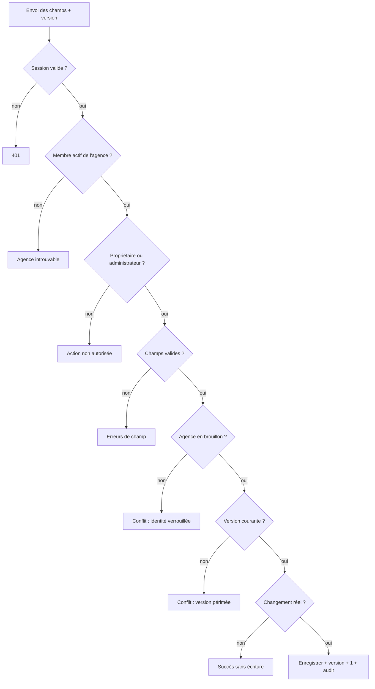

# UC-02-02 — Compléter l'identité de l'agence

| Champ | Valeur |
|---|---|
| Statut | Brouillon (en attente de D-04 : Q-01, Q-03 ; Q-05) |
| Priorité | Must |
| Domaine | `agencies` |
| Tâche | B2.2 |
| Date | 2026-11-03 |
| Use cases liés | UC-02-01 (précède) ; UC-02-05 (exige l'identité complète) ; UC-02-06 (profil, distinct — anomalie A-02) ; UC-02-09 (affiche les champs manquants) |
| Exigences couvertes | UC-02-02, RM-02-01, EX-02-001, EX-02-002, EX-02-003, EX-02-005, EX-02-011, EX-02-012, EX-02-013 |

## 0. Traçabilité

| Exigence | Source | Où elle est traitée |
|---|---|---|
| UC-02-02 | F02 §2 ; PH B2.2 (« raison sociale, contacts, ville… ») | §8 ; scénarios 1 à 3 |
| RM-02-01 | F02 §Règles | RG-02-02-06 (modifiable en brouillon) ; scénario 8 |
| EX-02-001 | ARC3 §Sécurité | scénario 11 |
| EX-02-002 | RIA §Accès agence | RG-02-02-07 ; scénario 10 |
| EX-02-003 | CDX | scénario 12 |
| EX-02-005 | F02 §2 | RG-02-02-09 ; scénario 13 |
| EX-02-012 | ARC5 (`If-Match`) | RG-02-02-08 ; scénario 9 |
| EX-02-013 | RM-01-05 | test 13 (E2E 401) |

## 1. Objectif

Réunir les données vérifiables de l'agence (qui elle est légalement, où elle se trouve, comment la joindre) afin que l'admin plateforme puisse l'examiner après soumission (B10).

## 2. User story

> En tant que **propriétaire ou administrateur d'agence**, je veux **compléter l'identité de mon agence**, afin de **pouvoir la soumettre à vérification**.

## 3. Acteurs

Principal : propriétaire ou administrateur actif **[HYPOTHÈSE]** (Q-05). Aucun acteur secondaire.

## 4. Déclencheur

Le responsable enregistre une ou plusieurs données d'identité.

## 5. Préconditions

- P1 : session valide.
- P2 : la personne est membre **actif** de l'agence visée.
- P3 : son rôle est propriétaire ou administrateur **[HYPOTHÈSE]**.
- P4 : l'agence est au statut brouillon **[HYPOTHÈSE]** (Q-03).
- P5 : la modification se fonde sur la version courante de l'agence **[HYPOTHÈSE]**.

## 6. Postconditions

- Succès : les champs transmis sont enregistrés, normalisés ; les champs non transmis sont inchangés ; la version de l'agence augmente de 1 ; une trace d'audit liste les **noms** des champs modifiés.
- Échec : aucune donnée modifiée, version inchangée, aucune trace.

## 7. Règles métier

| ID | Règle | Exemple | Source |
|---|---|---|---|
| RG-02-02-01 | **[HYPOTHÈSE]** (Q-01) L'identité comprend : raison sociale, ville du siège, adresse du siège, téléphone principal, e-mail de contact, numéro RCCM, NIU. Les quatre premiers sont exigés pour soumettre (UC-02-05), pas pour enregistrer. | Awa enregistre seulement la raison sociale « Express Douala SARL » → accepté ; l'état d'onboarding signale les trois autres manquants. | D-04 ; PH B2.2 |
| RG-02-02-02 | La modification est partielle : un champ absent reste inchangé ; un champ facultatif peut être vidé. | Changer le seul téléphone garde la raison sociale ; vider l'e-mail de contact → accepté. | [HYPOTHÈSE] |
| RG-02-02-03 | Raison sociale : 2 à 200 caractères utiles **[HYPOTHÈSE]**. | « X » refusé ; « Express Douala SARL » accepté. | D-04 |
| RG-02-02-04 | Téléphone principal : numéro camerounais, normalisé en `+237` suivi de 9 chiffres commençant par 2 ou 6 **[HYPOTHÈSE]** (Q-13). | « 6 77 12 34 56 » → « +237677123456 » ; « +237 2 33 42 11 00 » → « +237233421100 » ; « 677 12 34 » refusé ; « +33 6 12 34 56 78 » refusé. | [HYPOTHÈSE] |
| RG-02-02-05 | Ville et adresse du siège : 2 à 80 et 5 à 300 caractères utiles ; l'adresse accepte un repère (« face pharmacie du Rond-point Deïdo ») ; e-mail de contact : adresse valide, en minuscules ; RCCM : 5 à 40 caractères ; NIU : 14 caractères alphanumériques **[HYPOTHÈSE]**. | « Contact@Express.cm » → « contact@express.cm » ; « contact@ » refusé ; NIU « M0123456789A » (12) refusé. | D-04 |
| RG-02-02-06 | L'identité n'est modifiable qu'en brouillon ; après soumission elle est verrouillée **[HYPOTHÈSE]** (Q-03). | « Express Douala » soumise : changer la raison sociale → refus pour conflit. | RM-02-01 ; A-02, A-08 |
| RG-02-02-07 | Seuls le propriétaire et l'administrateur modifient l'identité **[HYPOTHÈSE]** ; un agent est refusé ; un ancien membre ou un membre d'une autre agence ne trouve pas l'agence. | Céline (agente) → refus ; Ibrahim (autre agence) → introuvable ; Jean (ancien admin) → introuvable. | EX-02-001, EX-02-002 ; Q-05 |
| RG-02-02-08 | Une modification fondée sur une version périmée est refusée pour conflit, sans rien écraser **[HYPOTHÈSE]**. | Awa et Paul lisent la version 3 ; Paul enregistre (version 4) ; Awa enregistre sur la version 3 → conflit. | EX-02-012 |
| RG-02-02-09 | Chaque modification effective est auditée avec la liste des champs changés, jamais leurs valeurs ; une demande sans changement réel n'écrit ni trace ni nouvelle version. | Trace « identité modifiée : téléphone principal » par Paul. | EX-02-005 ; ARC3 §Logs |

## 8. Flux nominal

1. Le responsable envoie les champs d'identité à enregistrer et la version sur laquelle il s'appuie.
2. Le système vérifie la session (P1), puis le membership actif dans l'agence (P2).
3. Le système vérifie le rôle (P3).
4. Le système refuse tout champ non attendu et valide chaque champ transmis (RG-02-02-03 à 05).
5. Le système vérifie que l'agence est en brouillon (P4) et que la version correspond (P5).
6. Le système enregistre les champs normalisés et incrémente la version.
7. Le système écrit la trace d'audit (RG-02-02-09).
8. Le système renvoie l'identité à jour et la nouvelle version.

## 9. Flux alternatifs

- A1 — Aucun changement réel (étape 6) : rien n'est écrit, la version reste la même ; succès.
- A2 — Champ facultatif vidé (étape 4) : accepté, le champ redevient vide (RG-02-02-02).

## 10. Flux d'exception

- E1 — Session invalide (étape 2) : 401 ; fin.
- E2 — Non membre, ancien membre, autre agence ou agence inexistante (étape 2) : « agence introuvable » (404), aucune donnée ; fin.
- E3 — Agent (étape 3) : « action non autorisée » (403) ; fin.
- E4 — Champ invalide ou non attendu (étape 4) : 400, erreurs de champ ; fin.
- E5 — Agence soumise (étape 5) : conflit (409) ; message : « L'identité d'une agence soumise ne peut plus être modifiée » ; fin.
- E6 — Version périmée (étape 5) : conflit (409) ; message : « L'agence a été modifiée entre-temps, rechargez-la » ; fin.

## 11. Workflow



## 12. Scénarios d'acceptation (Gherkin)

Copie conforme de [features/completer-identite-agence.feature](features/completer-identite-agence.feature).

```gherkin
# language: fr
@UC-02-02 @B2.2
Fonctionnalité: Compléter l'identité de l'agence
  Afin de pouvoir soumettre mon agence à vérification
  En tant que propriétaire ou administrateur d'agence
  Je veux compléter son identité

  Contexte:
    Étant donné l'agence "Express Douala" au statut brouillon
    Et "Awa Ngono" propriétaire active de "Express Douala"
    Et "Paul Mbarga" administrateur actif de "Express Douala"
    Et "Céline Fotso" agente active de "Express Douala"

  @nominal @RG-02-02-01 @UC-02-02
  Scénario: La propriétaire complète l'identité de son agence
    Quand "Awa Ngono" enregistre l'identité suivante pour "Express Douala" :
      | champ               | valeur                                  |
      | raison sociale      | Express Douala SARL                     |
      | ville du siège      | Douala                                  |
      | adresse du siège    | Rue Joss, face pharmacie du Rond-point  |
      | téléphone principal | 6 77 12 34 56                           |
    Alors l'identité de "Express Douala" comporte la raison sociale "Express Douala SARL"
    Et le téléphone principal enregistré est "+237677123456"
    Et la version de "Express Douala" a augmenté de 1

  @nominal @RG-02-02-07
  Scénario: Un administrateur complète l'identité de l'agence
    Quand "Paul Mbarga" enregistre la ville du siège "Douala" pour "Express Douala"
    Alors la ville du siège de "Express Douala" est "Douala"

  @alternatif @RG-02-02-02
  Scénario: Une modification partielle conserve les autres données
    Étant donné l'identité de "Express Douala" avec la raison sociale "Express Douala SARL"
    Quand "Paul Mbarga" enregistre seulement le téléphone principal "6 99 00 11 22"
    Alors le téléphone principal de "Express Douala" est "+237699001122"
    Et la raison sociale reste "Express Douala SARL"

  @alternatif @RG-02-02-04
  Plan du scénario: Le téléphone principal est enregistré sous sa forme normalisée
    Quand "Awa Ngono" enregistre le téléphone principal "<saisi>"
    Alors le téléphone principal enregistré est "<enregistré>"

    Exemples:
      | saisi              | enregistré    |
      | 6 77 12 34 56      | +237677123456 |
      | +237 2 33 42 11 00 | +237233421100 |

  @erreur @RG-02-02-04
  Plan du scénario: Un téléphone principal non camerounais ou incomplet est refusé
    Quand "Awa Ngono" enregistre le téléphone principal "<saisi>"
    Alors l'enregistrement est refusé
    Et le motif indiqué porte sur le téléphone principal

    Exemples:
      | saisi             |
      | 677 12 34         |
      | 5 77 12 34 56     |
      | +33 6 12 34 56 78 |

  @erreur @RG-02-02-03
  Plan du scénario: Bornes de longueur de la raison sociale
    Quand "Awa Ngono" enregistre une raison sociale de <longueur> caractères utiles
    Alors l'enregistrement est <résultat>

    Exemples:
      | longueur | résultat |
      | 1        | refusé   |
      | 2        | accepté  |
      | 200      | accepté  |
      | 201      | refusé   |

  @erreur @RG-02-02-05
  Scénario: Un e-mail de contact invalide est refusé
    Quand "Awa Ngono" enregistre l'e-mail de contact "contact@"
    Alors l'enregistrement est refusé
    Et le motif indiqué porte sur l'e-mail de contact
    Et l'identité de "Express Douala" est inchangée

  @erreur @RG-02-02-06 @RM-02-01
  Scénario: L'identité d'une agence soumise ne peut plus être modifiée
    Étant donné "Express Douala" soumise à vérification
    Quand "Awa Ngono" enregistre la raison sociale "Express Cameroun SARL"
    Alors l'enregistrement est refusé pour conflit
    Et la raison sociale de "Express Douala" est inchangée

  @erreur @concurrence @RG-02-02-08 @EX-02-012
  Scénario: Une modification fondée sur une version périmée est refusée
    Étant donné "Awa Ngono" et "Paul Mbarga" ont consulté la version 3 de "Express Douala"
    Et "Paul Mbarga" a enregistré la ville du siège "Douala" sur la version 3
    Quand "Awa Ngono" enregistre la ville du siège "Edéa" sur la version 3
    Alors l'enregistrement est refusé pour conflit
    Et la ville du siège de "Express Douala" reste "Douala"

  @erreur @securite @RG-02-02-07 @EX-02-002
  Scénario: Une agente ne peut pas modifier l'identité de l'agence
    Quand "Céline Fotso" enregistre la raison sociale "Fotso SARL"
    Alors l'action lui est refusée comme non autorisée
    Et l'identité de "Express Douala" est inchangée

  @erreur @securite @RG-02-02-07 @EX-02-001
  Plan du scénario: Une personne sans accès actif ne trouve pas l'agence
    Étant donné <situation>
    Quand "<personne>" enregistre la raison sociale "Autre SARL" pour "Express Douala"
    Alors l'agence "Express Douala" lui est introuvable
    Et aucune donnée de "Express Douala" ne lui est renvoyée

    Exemples:
      | personne      | situation                                                    |
      | Ibrahim Bello | "Ibrahim Bello" propriétaire de "Rapide Yaoundé" uniquement  |
      | Jean Etoa     | "Jean Etoa" ancien administrateur de "Express Douala"        |

  @erreur @securite @EX-02-003
  Scénario: Le statut ne peut pas être modifié avec l'identité
    Quand "Awa Ngono" enregistre la raison sociale "Express Douala SARL" en indiquant le statut "approuvée"
    Alors l'enregistrement est refusé
    Et "Express Douala" reste au statut brouillon

  @nominal @RG-02-02-09 @EX-02-005
  Scénario: La modification de l'identité est tracée sans ses valeurs
    Quand "Paul Mbarga" enregistre le téléphone principal "6 99 00 11 22"
    Alors le journal d'audit contient « identité modifiée : téléphone principal » par "Paul Mbarga"
    Et la trace ne contient pas le numéro de téléphone
```

## 13. Plan de tests TDD

| # | Niveau | Comportement | Étant donné | Quand | Alors | Règle |
|---|---|---|---|---|---|---|
| 1 | unit (domaine) | Compléter en brouillon | agence brouillon version 1 | compléter 4 champs | champs enregistrés, version 2 | RG-02-02-01 |
| 2 | unit (domaine) | Partiel et vidage | identité complète | changer le téléphone ; vider l'e-mail | autres champs intacts ; e-mail vide | RG-02-02-02 |
| 3 | unit (VO) | Téléphone | — | 5 exemples du Plan | normalisés ou `invalid` | RG-02-02-04 |
| 4 | unit (VO) | Raison sociale | — | 1, 2, 200, 201 caractères | bornes respectées | RG-02-02-03 |
| 5 | unit (VO) | E-mail, ville, adresse, RCCM, NIU | — | valeurs limites | normalisation, `invalid` hors bornes | RG-02-02-05 |
| 6 | unit (domaine) | Verrou après soumission | agence soumise | compléter | `conflict`, rien changé | RG-02-02-06 |
| 7 | unit (domaine) | Sans changement | identité donnée | renvoyer les mêmes valeurs | aucun événement, version inchangée | RG-02-02-09 |
| 8 | unit (application) | Rôles | fakes avec propriétaire, admin, agent, ancien membre, autre agence | compléter | propriétaire et admin OK ; agent `forbidden` ; autres `not_found` | RG-02-02-07 |
| 9 | unit (application) | Version périmée | version courante 4 | compléter sur version 3 | `conflict` | RG-02-02-08 |
| 10 | unit (application) | Audit sans valeurs | fakes | changer le téléphone | trace « identité modifiée », champs = [téléphone], aucune valeur | RG-02-02-09 |
| 11 | feature (PostgreSQL) | Version optimiste | deux transactions sur la version 3 | enregistrer en parallèle | une réussit, l'autre `conflict` | RG-02-02-08 |
| 12 | E2E | 200 et 400 | agence brouillon | propriétaire, admin ; champ invalide ; champ `status` | 200 ; 400 Problem Details avec erreurs de champ | RG-02-02-01, 05 ; EX-02-003 |
| 13 | E2E | 401, 403, 404, 409 | — | sans jeton ; agent ; autre agence ; ancien membre ; agence soumise ; version périmée | 401 ; 403 ; 404 ; 404 ; 409 ; 409 | RG-02-02-06 à 08 |

## 14. Données

| Champ | Type métier | Obligatoire à l'enregistrement | Exigé pour soumettre | Contraintes **[HYPOTHÈSE]** |
|---|---|---|---|---|
| Raison sociale | texte | non | oui | 2 à 200 caractères |
| Ville du siège | texte | non | oui | 2 à 80 caractères (référentiel des villes : Q-14) |
| Adresse du siège | texte | non | oui | 5 à 300 caractères, repère accepté |
| Téléphone principal | téléphone | non | oui | `+237` + 9 chiffres commençant par 2 ou 6 |
| E-mail de contact | e-mail | non | non | adresse valide, minuscules |
| RCCM | texte | non | non (Q-01) | 5 à 40 caractères |
| NIU | texte | non | non (Q-01) | 14 caractères alphanumériques |
| Version attendue | entier | oui | — | version courante de l'agence |

Sortie : identité complète à jour et nouvelle version. Données de contact de l'agence : données professionnelles, non publiées avant B3.

## 15. Exigences non fonctionnelles

- Aucune valeur d'identité dans les journaux ni les traces d'audit (seulement les noms de champs).
- Réponse « introuvable » identique pour une agence inexistante et une agence d'autrui (pas d'énumération).

## 16. Hors périmètre

Dépôt de justificatifs (A-14) ; vérification d'unicité du RCCM ou du NIU entre agences (Q-01) ; validation par l'admin plateforme (B10) ; publication publique des contacts (B3).

## 17. Questions ouvertes

| # | Question | Hypothèse retenue | Impact si différent |
|---|---|---|---|
| Q-01 | Champs et documents exigés, RCCM/NIU obligatoires, unicité entre agences ? | Voir §14 ; pas d'unicité ; aucun document. | Prérequis de soumission, contraintes SQL d'unicité, upload (CRITIQUE). |
| Q-03 | Identité modifiable après soumission ? | Non (verrouillée). | Retour en brouillon automatique ou modification soumise à revalidation. |
| Q-05 | Qui modifie l'identité ? | Propriétaire et administrateur. | Matrice des droits. |
| Q-13 | Accepter des numéros étrangers ? | Non, Cameroun uniquement. | Validation E.164 générique. |
| Q-14 | Ville en texte libre ou référentiel de villes ? | Texte libre. | Référentiel partagé avec les zones (UC-02-03) et la recherche (B3). |

## 18. Notes pour le tech lead

- Proposer une route d'identité distincte du profil (`PATCH /agencies/{id}` indicatif) pour que la règle de verrouillage reste lisible ; à trancher en S2.
- Version d'agrégat exposée en lecture et attendue en écriture (`If-Match` ou champ de version) ; conflit → catégorie `conflict`.
- Value objects partagés avec UC-02-08 (téléphone, ville, adresse).

Definition of Ready :
- [x] Chaque exigence de la section 0 a au moins un scénario (EX-02-013 : test E2E)
- [x] Chaque règle a un exemple
- [x] Chaque flux d'exception a un scénario (E1 : test 13)
- [ ] Aucune question bloquante (Q-01, Q-03 à trancher dans D-04)
- [x] Le plan TDD couvre chaque règle
- [x] Le `.feature` est synchronisé avec la section 12
