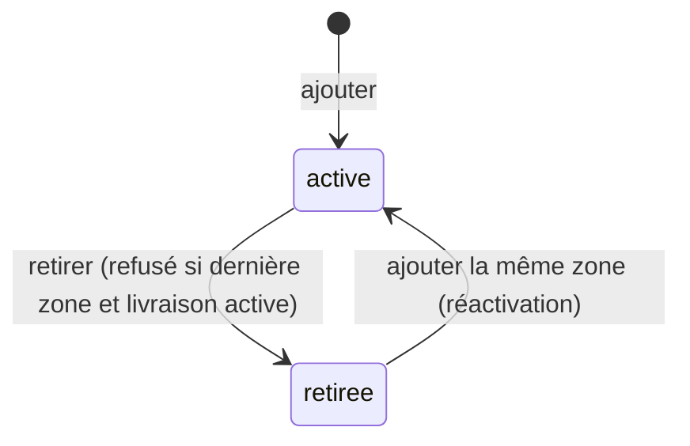

# UC-02-03 — Renseigner les zones desservies

| Champ | Valeur |
|---|---|
| Statut | Brouillon (en attente de Q-02, Q-03, Q-05, Q-07, Q-14) |
| Priorité | Must |
| Domaine | `agencies` |
| Tâche | B2.3 |
| Date | 2026-11-03 |
| Use cases liés | UC-02-04 (la livraison exige une zone active — hypothèse) ; UC-02-09 (affiche les zones) ; UC-05-01 Créer une zone tarifaire (B3, distinct — anomalie A-03) ; UC-03-03 Filtrer par zone (B3) |
| Exigences couvertes | UC-02-03, RM-02-02, EX-02-001, EX-02-002, EX-02-003, EX-02-004, EX-02-005, EX-02-006, EX-02-007, EX-02-011, EX-02-013 |

## 0. Traçabilité

| Exigence | Source | Où elle est traitée |
|---|---|---|
| UC-02-03 | F02 §3 ; PH B2.3 | §8 ; scénarios 1 à 4 |
| RM-02-02 | F02 §Règles | RG-02-03-05 ; scénarios 7, 8 |
| EX-02-001 | ARC3 | scénarios 12, 13 |
| EX-02-002 | RIA | scénario 11 |
| EX-02-004 | F02 §3 | scénario 10 |
| EX-02-005 | F02 §3 | scénario 15 |
| EX-02-006, EX-02-007 | CL ; ARC5 | RG-02-03-03, 04 ; scénarios 3, 4 |
| EX-02-003, EX-02-011, EX-02-013 | CDX ; ARC5 ; RM-01-05 | tests 13, 14 |

## 1. Objectif

Déclarer où l'agence intervient, pour préparer la capacité livraison et, plus tard, le filtrage par zone de la marketplace (B3).

## 2. User story

> En tant que **propriétaire ou administrateur d'agence**, je veux **déclarer et retirer les zones que mon agence dessert**, afin de **pouvoir activer la livraison et être trouvé sur ces zones**.

## 3. Acteurs

Principal : propriétaire ou administrateur actif **[HYPOTHÈSE]** (Q-05). Consultation de la liste : tout membre actif.

## 4. Déclencheur

Le responsable ajoute une zone, retire une zone ou consulte la liste des zones.

## 5. Préconditions

- P1 : session valide ; P2 : membre actif de l'agence ; P3 : rôle propriétaire ou administrateur pour ajouter ou retirer.
- P4 : l'agence est en brouillon ou soumise **[HYPOTHÈSE]** (Q-03).

## 6. Postconditions

- Succès (ajout) : une zone active existe pour l'agence ; trace « zone ajoutée ».
- Succès (retrait) : la zone est **retirée** (inactive), conservée avec sa date de retrait ; trace « zone retirée ».
- Échec : aucune zone créée, modifiée ou retirée ; aucune trace.

## 7. Règles métier

| ID | Règle | Exemple | Source |
|---|---|---|---|
| RG-02-03-01 | **[HYPOTHÈSE]** (Q-07, Q-14) Une zone desservie est une ville (2 à 80 caractères) et un quartier facultatif (2 à 80 caractères) ; sans quartier, elle couvre la ville entière. Elle n'est pas une zone tarifaire. | « Douala / Akwa » ; « Yaoundé » (ville entière). | A-03 |
| RG-02-03-02 | Une agence ne peut pas avoir deux zones actives identiques ; la comparaison ignore la casse, les accents et les espaces multiples **[HYPOTHÈSE]**. | « Douala / Akwa » existe → « douala /  AKWA » refusé pour doublon. | [HYPOTHÈSE] |
| RG-02-03-03 | Retirer une zone la rend inactive sans l'effacer ; sa date de retrait est conservée. | « Douala / Bonabéri » retirée le 2026-11-10 → toujours visible comme retirée. | EX-02-007 |
| RG-02-03-04 | Ajouter une zone identique à une zone retirée la réactive au lieu d'en créer une seconde. | « Douala / Bonabéri » retirée puis ajoutée → une seule zone, active, historique conservé. | EX-02-006, 007 ; [HYPOTHÈSE] |
| RG-02-03-05 | **[HYPOTHÈSE]** (Q-02) Tant que la capacité livraison est active, l'agence garde au moins une zone active : retirer la dernière est refusé pour conflit. | Livraison active, seule zone « Douala / Akwa » → retrait refusé ; livraison non activée → retrait accepté. | RM-02-02 |
| RG-02-03-06 | Une agence a au plus 100 zones actives **[HYPOTHÈSE]**. | 100 zones actives → la 101e est refusée. | [HYPOTHÈSE] |
| RG-02-03-07 | Seuls propriétaire et administrateur ajoutent ou retirent ; un agent est refusé ; un ancien membre, un membre d'une autre agence, ou une zone d'une autre agence → introuvable. | Céline → refus ; Ibrahim → introuvable ; Awa retire une zone de « Rapide Yaoundé » → introuvable. | EX-02-001, 002 |
| RG-02-03-08 | Ajouts et retraits sont possibles en brouillon et après soumission **[HYPOTHÈSE]** (Q-03). | « Express Douala » soumise ajoute « Douala / Bépanda » → accepté. | Q-03 |
| RG-02-03-09 | Chaque ajout, retrait ou réactivation est audité. | Trace « zone ajoutée : Douala / Akwa » par Paul. | EX-02-005 |

## 8. Flux nominal (ajout)

1. Le responsable indique une ville et, s'il le souhaite, un quartier.
2. Le système vérifie session, membership actif, rôle (P1 à P3).
3. Le système valide et normalise la ville et le quartier (RG-02-03-01).
4. Le système vérifie le statut de l'agence (P4) et la limite de 100 zones (RG-02-03-06).
5. Le système recherche une zone identique (RG-02-03-02).
6. Aucune : il crée la zone active.
7. Le système écrit la trace d'audit et renvoie la zone.

## 9. Flux alternatifs

- A1 — Zone identique retirée (étape 5) : réactivation (RG-02-03-04), trace « zone réactivée » ; fin.
- A2 — Retrait d'une zone : le responsable désigne la zone ; le système vérifie qu'elle appartient à l'agence, qu'elle est active et qu'elle n'est pas la dernière zone requise par la livraison (RG-02-03-05) ; il la retire et l'audite.
- A3 — Retrait d'une zone déjà retirée : refus pour conflit (« zone déjà retirée »), aucune trace.
- A4 — Consultation : tout membre actif obtient la liste des zones (actives d'abord, puis retirées), paginée par curseur.

## 10. Flux d'exception

- E1 — Session invalide : 401. E2 — Non membre, ancien membre, autre agence, zone d'une autre agence : introuvable (404). E3 — Agent : non autorisé (403).
- E4 — Ville ou quartier invalide, champ non attendu : 400.
- E5 — Zone active identique : conflit (409), « Cette zone est déjà desservie ».
- E6 — Limite de 100 zones atteinte : conflit (409), « Nombre maximal de zones atteint ».
- E7 — Dernière zone avec livraison active : conflit (409), « Suspendez la livraison ou ajoutez une autre zone avant de retirer celle-ci ».

## 11. Workflow



## 12. Scénarios d'acceptation (Gherkin)

Copie conforme de [features/renseigner-zones-desservies.feature](features/renseigner-zones-desservies.feature).

```gherkin
# language: fr
@UC-02-03 @B2.3
Fonctionnalité: Renseigner les zones desservies
  Afin de pouvoir activer la livraison
  En tant que propriétaire ou administrateur d'agence
  Je veux déclarer et retirer les zones desservies par mon agence

  Contexte:
    Étant donné l'agence "Express Douala" au statut brouillon
    Et "Awa Ngono" propriétaire active de "Express Douala"
    Et "Paul Mbarga" administrateur actif de "Express Douala"
    Et "Céline Fotso" agente active de "Express Douala"

  @nominal @RG-02-03-01
  Scénario: Un administrateur ajoute un quartier desservi
    Quand "Paul Mbarga" ajoute la zone "Douala" quartier "Akwa" à "Express Douala"
    Alors "Express Douala" dessert la zone active "Douala / Akwa"

  @nominal @RG-02-03-01
  Scénario: La propriétaire ajoute une ville entière
    Quand "Awa Ngono" ajoute la zone "Yaoundé" sans quartier à "Express Douala"
    Alors "Express Douala" dessert la zone active "Yaoundé"

  @alternatif @RG-02-03-03 @EX-02-007
  Scénario: Une zone retirée est conservée dans l'historique
    Étant donné "Express Douala" dessert les zones "Douala / Akwa" et "Douala / Bonabéri"
    Quand "Paul Mbarga" retire la zone "Douala / Bonabéri"
    Alors la zone "Douala / Bonabéri" apparaît comme retirée avec sa date de retrait
    Et "Express Douala" dessert toujours la zone active "Douala / Akwa"

  @alternatif @RG-02-03-04
  Scénario: Ajouter une zone retirée la réactive
    Étant donné la zone "Douala / Bonabéri" retirée de "Express Douala"
    Quand "Paul Mbarga" ajoute la zone "Douala" quartier "Bonabéri"
    Alors la zone "Douala / Bonabéri" est de nouveau active
    Et "Express Douala" ne compte qu'une seule zone "Douala / Bonabéri"

  @erreur @RG-02-03-02
  Plan du scénario: Une zone déjà desservie est refusée comme doublon
    Étant donné "Express Douala" dessert la zone active "Douala / Akwa"
    Quand "Paul Mbarga" ajoute la zone "<ville>" quartier "<quartier>"
    Alors l'ajout est refusé pour doublon
    Et "Express Douala" ne compte qu'une seule zone "Douala / Akwa"

    Exemples:
      | ville   | quartier |
      | Douala  | Akwa     |
      | douala  | AKWA     |
      | Douala  | Akwá     |

  @erreur @RG-02-03-01
  Plan du scénario: Bornes de longueur de la ville
    Quand "Paul Mbarga" ajoute une zone dont la ville compte <longueur> caractères utiles
    Alors l'ajout est <résultat>

    Exemples:
      | longueur | résultat |
      | 1        | refusé   |
      | 2        | accepté  |
      | 80       | accepté  |
      | 81       | refusé   |

  @erreur @RG-02-03-05 @RM-02-02
  Scénario: La dernière zone ne peut pas être retirée tant que la livraison est active
    Étant donné "Express Douala" dessert la seule zone active "Douala / Akwa"
    Et la capacité livraison de "Express Douala" est active
    Quand "Paul Mbarga" retire la zone "Douala / Akwa"
    Alors le retrait est refusé pour conflit
    Et la zone "Douala / Akwa" reste active

  @alternatif @RG-02-03-05
  Scénario: La dernière zone peut être retirée si la livraison n'est pas active
    Étant donné "Express Douala" dessert la seule zone active "Douala / Akwa"
    Et la capacité livraison de "Express Douala" n'est pas active
    Quand "Paul Mbarga" retire la zone "Douala / Akwa"
    Alors "Express Douala" ne dessert plus aucune zone active

  @erreur @RG-02-03-06
  Scénario: Une 101e zone active est refusée
    Étant donné "Express Douala" dessert 100 zones actives
    Quand "Paul Mbarga" ajoute la zone "Kribi" sans quartier
    Alors l'ajout est refusé pour conflit
    Et "Express Douala" dessert toujours 100 zones actives

  @concurrence @RG-02-03-02 @EX-02-004
  Scénario: Deux ajouts simultanés de la même zone n'en créent qu'une
    Quand "Awa Ngono" et "Paul Mbarga" ajoutent en même temps la zone "Douala" quartier "Deïdo"
    Alors "Express Douala" ne compte qu'une seule zone "Douala / Deïdo"
    Et l'un des deux ajouts est refusé pour doublon

  @erreur @securite @RG-02-03-07 @EX-02-002
  Scénario: Une agente ne peut pas modifier les zones desservies
    Quand "Céline Fotso" ajoute la zone "Douala" quartier "Bali"
    Alors l'action lui est refusée comme non autorisée
    Et "Express Douala" ne dessert pas la zone "Douala / Bali"

  @erreur @securite @RG-02-03-07 @EX-02-001
  Plan du scénario: Une personne sans accès actif ne trouve pas l'agence
    Étant donné <situation>
    Quand "<personne>" ajoute la zone "Douala" quartier "Bali" à "Express Douala"
    Alors l'agence "Express Douala" lui est introuvable

    Exemples:
      | personne      | situation                                                    |
      | Ibrahim Bello | "Ibrahim Bello" propriétaire de "Rapide Yaoundé" uniquement  |
      | Jean Etoa     | "Jean Etoa" ancien administrateur de "Express Douala"        |

  @erreur @securite @RG-02-03-07 @EX-02-001
  Scénario: Une zone d'une autre agence est introuvable
    Étant donné l'agence "Rapide Yaoundé" dessert la zone "Yaoundé / Bastos"
    Quand "Awa Ngono" retire, au nom de "Express Douala", la zone "Yaoundé / Bastos" de "Rapide Yaoundé"
    Alors la zone lui est introuvable
    Et la zone "Yaoundé / Bastos" de "Rapide Yaoundé" reste active

  @alternatif @RG-02-03-08
  Scénario: Une agence soumise peut encore ajouter une zone
    Étant donné "Express Douala" soumise à vérification
    Quand "Paul Mbarga" ajoute la zone "Douala" quartier "Bépanda"
    Alors "Express Douala" dessert la zone active "Douala / Bépanda"

  @nominal @RG-02-03-09 @EX-02-005
  Scénario: L'ajout d'une zone est tracé dans le journal d'audit
    Quand "Paul Mbarga" ajoute la zone "Douala" quartier "Akwa"
    Alors le journal d'audit contient « zone ajoutée : Douala / Akwa » par "Paul Mbarga"
```

## 13. Plan de tests TDD

| # | Niveau | Comportement | Étant donné | Quand | Alors | Règle |
|---|---|---|---|---|---|---|
| 1 | unit (VO) | Zone : bornes et normalisation | — | ville 1, 2, 80, 81 ; quartier vide, 1, 81 | bornes respectées ; clé de comparaison sans casse ni accents | RG-02-03-01, 02 |
| 2 | unit (domaine) | Ajout | agence sans zone | ajouter « Douala / Akwa » | une zone active | RG-02-03-01 |
| 3 | unit (domaine) | Doublon | zone active « Douala / Akwa » | ajouter les 3 variantes | `conflict` | RG-02-03-02 |
| 4 | unit (domaine) | Retrait conservé | deux zones actives | retirer une | zone inactive, date de retrait, toujours présente | RG-02-03-03 |
| 5 | unit (domaine) | Réactivation | zone retirée | ajouter la même | même zone, active ; aucune nouvelle zone | RG-02-03-04 |
| 6 | unit (domaine) | Retrait d'une zone déjà retirée | zone retirée | retirer | `conflict` | A3 |
| 7 | unit (domaine) | Dernière zone et livraison | livraison active, une zone | retirer | `conflict` ; sans livraison active : accepté | RG-02-03-05 |
| 8 | unit (domaine) | Limite | 100 zones actives | ajouter | `conflict` ; 99 → accepté | RG-02-03-06 |
| 9 | unit (application) | Rôles et isolation | fakes | ajouter/retirer par chaque acteur ; zone d'une autre agence | propriétaire, admin OK ; agent `forbidden` ; autres `not_found` | RG-02-03-07 |
| 10 | unit (application) | Statut soumise | agence soumise | ajouter | accepté | RG-02-03-08 |
| 11 | unit (application) | Audit | fakes | ajouter, retirer, réactiver | une trace par action | RG-02-03-09 |
| 12 | feature (PostgreSQL) | Unicité en concurrence | — | deux ajouts simultanés de la même zone | une ligne active (contrainte unique partielle sur la clé normalisée des zones actives, ou verrou agence) | RG-02-03-02 |
| 13 | E2E | 201, 200, 400, 401 | — | ajouter, retirer, réactiver ; entrées invalides ; sans jeton | codes attendus, Problem Details | RG-02-03-01 à 04 |
| 14 | E2E | 403, 404, 409, liste | — | agent ; autre agence ; ancien membre ; zone d'autrui ; doublon ; dernière zone ; liste paginée | 403 ; 404 ×3 ; 409 ×2 ; `{ items, nextCursor, hasMore }` | RG-02-03-02, 05, 07 ; A4 |

## 14. Données

| Champ | Type métier | Obligatoire | Contraintes **[HYPOTHÈSE]** |
|---|---|---|---|
| Ville | texte | oui | 2 à 80 caractères (référentiel : Q-14) |
| Quartier | texte | non | 2 à 80 caractères |

Sortie : zone (identifiant, ville, quartier, statut actif/retiré, date d'ajout, date de retrait). Liste : `{ items, nextCursor, hasMore }`, au plus 100 éléments par page.

## 15. Exigences non fonctionnelles

- Unicité garantie aussi en concurrence (test 12).
- La règle « dernière zone » et l'activation de la livraison (UC-02-04) doivent être sérialisées sur la même agence, sinon un retrait et une activation simultanés contourneraient RM-02-02.

## 16. Hors périmètre

Zones tarifaires, prix par zone (B3) ; géométrie, polygones, coordonnées GPS ; affichage public des zones (B3).

## 17. Questions ouvertes

| # | Question | Hypothèse retenue | Impact si différent |
|---|---|---|---|
| Q-02 | La livraison exige-t-elle une zone active ? | Oui (RG-02-03-05). | Règle de la dernière zone supprimée. |
| Q-03 | Zones modifiables après soumission ? | Oui. | Verrou comme l'identité. |
| Q-05 | Qui gère les zones ? | Propriétaire et administrateur. | Matrice des droits. |
| Q-07 | Zone desservie = zone tarifaire du lot 3 ? | Non, notions distinctes. | Fusion des modèles en B3, migration des données. |
| Q-14 | Villes et quartiers en texte libre ou référentiel ? | Texte libre normalisé. | Référentiel administré, validation par liste. |
| Q-15 | Limite de 100 zones actives ? | 100. | Constante à ajuster. |

## 18. Notes pour le tech lead

- Les zones vivent dans l'agrégat de l'agence (petite cardinalité) ou dans un agrégat séparé verrouillé par l'agence : à trancher en S2 ; la règle RG-02-03-05 impose de voir capacités et zones dans la même transaction.
- Retrait = action dédiée (pas de `DELETE`) ; identifiant de zone dans le chemin toujours vérifié contre l'`agencyId` du chemin.

Definition of Ready :
- [x] Chaque exigence de la section 0 a au moins un scénario
- [x] Chaque règle a un exemple
- [x] Chaque flux d'exception a un scénario (E1 : test 13 ; A3 : test 6)
- [ ] Aucune question bloquante (Q-02, Q-07)
- [x] Le plan TDD couvre chaque règle
- [x] Le `.feature` est synchronisé avec la section 12
