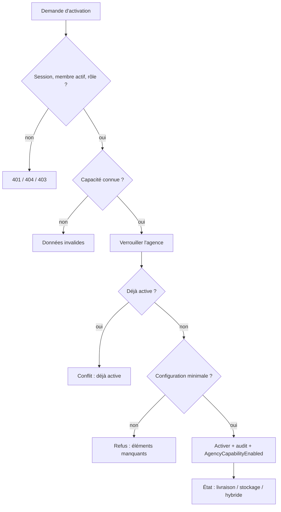

# UC-02-04 — Activer une capacité livraison ou stockage

| Champ | Valeur |
|---|---|
| Statut | Brouillon (en attente de Q-02, Q-03, Q-05, Q-11) |
| Priorité | Must |
| Domaine | `agencies` |
| Tâche | B2.4 |
| Date | 2026-11-03 |
| Use cases liés | UC-02-03 et UC-02-08 (fournissent la configuration minimale — hypothèse) ; UC-02-07 (suspendre, inverse) ; UC-02-05 (exige une capacité active) ; UC-03-01 (projection publique alimentée par l'événement, B3) ; UC-10-01 (entrepôt réservé au stockage, B7) |
| Exigences couvertes | UC-02-04, RM-02-02, EX-02-001, EX-02-002, EX-02-003, EX-02-004, EX-02-005, EX-02-006, EX-02-010, EX-02-011, EX-02-013 |

## 0. Traçabilité

| Exigence | Source | Où elle est traitée |
|---|---|---|
| UC-02-04 | F02 §4 ; PH B2.4 ; ARC1 ADR-04 (« capacités activables séparément ») | §8 ; scénarios 1 à 4 |
| RM-02-02 | F02 §Règles | RG-02-04-03 ; scénarios 5, 13 |
| EX-02-004 | F02 §4 (« effet concurrent ») | RG-02-04-05 ; scénarios 6, 7, 13 |
| EX-02-006 | CL | RG-02-04-04 (action dédiée) |
| EX-02-010 | ARC6 (`AgencyCapabilityEnabled`) | RG-02-04-08 ; scénario 12 |
| EX-02-001, 002 | ARC3 ; RIA | scénarios 9, 10 |
| EX-02-003, 011, 013 | CDX ; ARC5 ; RM-01-05 | scénario 8 ; tests 12, 13 |

## 1. Objectif

Déclarer les services réellement offerts par l'agence (livraison, stockage, ou les deux pour une agence hybride), avec la garantie qu'une capacité active repose sur un minimum de configuration.

## 2. User story

> En tant que **propriétaire ou administrateur d'agence**, je veux **activer la livraison, le stockage ou les deux**, afin de **recevoir plus tard des demandes pour ces services**.

## 3. Acteurs

Principal : propriétaire ou administrateur actif **[HYPOTHÈSE]** (Q-05). Secondaire : aucun (la projection publique du lot 3 consommera l'événement plus tard).

## 4. Déclencheur

Le responsable demande l'activation d'une capacité.

## 5. Préconditions

- P1 : session valide ; P2 : membre actif ; P3 : propriétaire ou administrateur.
- P4 : agence en brouillon ou soumise **[HYPOTHÈSE]** (Q-03).
- P5 : la capacité n'est pas déjà active.
- P6 : la configuration minimale de la capacité est remplie **[HYPOTHÈSE]** (Q-02).

## 6. Postconditions

- Succès : la capacité est active, avec la date et l'auteur de l'activation ; une trace « capacité activée » ; un événement `AgencyCapabilityEnabled`.
- Échec : état des capacités inchangé, aucune trace, aucun événement.

## 7. Règles métier

| ID | Règle | Exemple | Source |
|---|---|---|---|
| RG-02-04-01 | Deux capacités existent : livraison et stockage. Elles s'activent séparément ; une agence est « hybride » quand les deux sont actives (état dérivé, pas une troisième capacité). | « Express Douala » active la livraison puis le stockage → hybride. | ARC1 ADR-04 ; README (« livraison, stockage, hybrides ») |
| RG-02-04-02 | Toute autre capacité est refusée. | « transport aérien » → refusée. | ADR-04 |
| RG-02-04-03 | **[HYPOTHÈSE]** (Q-02) Configuration minimale : livraison = au moins une zone desservie active ; stockage = au moins un site actif. En cas de manque, le refus liste ce qui manque. | Livraison sans zone → refus « au moins une zone desservie active ». Stockage avec le site « Dépôt Bonabéri » actif → accepté. | RM-02-02 ; A-05, A-11 |
| RG-02-04-04 | Une capacité suspendue se réactive par la même action, sous les mêmes conditions ; l'historique de suspension est conservé. | Stockage suspendu le 2026-11-10 (motif « inventaire ») puis réactivé le 2026-11-12 → actif, les deux événements restent visibles. | RM-02-03 ; EX-02-006 ; [HYPOTHÈSE] |
| RG-02-04-05 | **[HYPOTHÈSE]** (Q-11) Activer une capacité déjà active est refusé pour conflit, sans nouvelle trace ni nouvel événement ; deux activations simultanées ne produisent qu'une activation. | Paul et Awa activent la livraison au même instant → une activation, une trace. | EX-02-004 |
| RG-02-04-06 | L'activation et le retrait de la configuration minimale (dernière zone, dernier site) sont sérialisés : la livraison n'est jamais active sans zone, ni le stockage sans site. | Retrait de la dernière zone et activation de la livraison simultanés → l'un des deux est refusé. | RM-02-02 ; EX-02-004 |
| RG-02-04-07 | Seuls propriétaire et administrateur activent ; agent refusé ; autres introuvable. Activation possible en brouillon et soumise **[HYPOTHÈSE]**. | Céline → refus ; Ibrahim → introuvable. | EX-02-001, 002 ; Q-03, Q-05 |
| RG-02-04-08 | L'activation est auditée et émet `AgencyCapabilityEnabled` (agence, capacité, auteur) ; aucun canal externe. | Trace « capacité activée : livraison » par Paul. | EX-02-005, 010, 014 |

## 8. Flux nominal

1. Le responsable demande l'activation de la livraison (ou du stockage).
2. Le système vérifie session, membership actif, rôle (P1 à P3).
3. Le système vérifie que la capacité demandée est connue (RG-02-04-02).
4. Le système verrouille l'agence, vérifie le statut (P4) et que la capacité n'est pas active (P5).
5. Le système vérifie la configuration minimale (RG-02-04-03).
6. Le système active la capacité (date, auteur).
7. Le système écrit la trace et émet `AgencyCapabilityEnabled`.
8. Le système renvoie l'état des capacités de l'agence (livraison, stockage, hybride oui/non).

## 9. Flux alternatifs

- A1 — Capacité suspendue (étape 4) : réactivation (RG-02-04-04), reprise à l'étape 5.
- A2 — L'autre capacité est déjà active (étape 6) : l'agence devient hybride.

## 10. Flux d'exception

- E1 — Session invalide : 401. E2 — Non membre, ancien membre, autre agence : introuvable (404). E3 — Agent : non autorisé (403).
- E4 — Capacité inconnue ou champ non attendu : 400.
- E5 — Capacité déjà active : conflit (409), « Cette capacité est déjà active ».
- E6 — Configuration minimale absente : refus (400), « Configuration minimale incomplète » avec la liste des éléments manquants.

## 11. Workflow



## 12. Scénarios d'acceptation (Gherkin)

Copie conforme de [features/activer-capacite.feature](features/activer-capacite.feature).

```gherkin
# language: fr
@UC-02-04 @B2.4
Fonctionnalité: Activer une capacité livraison ou stockage
  Afin de recevoir des demandes pour les services que j'offre
  En tant que propriétaire ou administrateur d'agence
  Je veux activer la livraison, le stockage ou les deux

  Contexte:
    Étant donné l'agence "Express Douala" au statut brouillon
    Et "Awa Ngono" propriétaire active de "Express Douala"
    Et "Paul Mbarga" administrateur actif de "Express Douala"
    Et "Céline Fotso" agente active de "Express Douala"

  @nominal @RG-02-04-01 @RG-02-04-03
  Scénario: Activer la livraison quand une zone est desservie
    Étant donné "Express Douala" dessert la zone active "Douala / Akwa"
    Quand "Paul Mbarga" active la capacité livraison
    Alors la capacité livraison de "Express Douala" est active

  @nominal @RG-02-04-01 @RG-02-04-03
  Scénario: Activer le stockage quand un site est actif
    Étant donné "Express Douala" possède le site actif "Dépôt Bonabéri"
    Quand "Awa Ngono" active la capacité stockage
    Alors la capacité stockage de "Express Douala" est active

  @alternatif @RG-02-04-01
  Scénario: Une agence qui active ses deux capacités devient hybride
    Étant donné la capacité livraison de "Express Douala" active
    Et "Express Douala" possède le site actif "Dépôt Bonabéri"
    Quand "Paul Mbarga" active la capacité stockage
    Alors les capacités livraison et stockage de "Express Douala" sont actives
    Et "Express Douala" est présentée comme hybride

  @alternatif @RG-02-04-04 @RM-02-03
  Scénario: Réactiver une capacité suspendue conserve l'historique de suspension
    Étant donné la capacité stockage de "Express Douala" suspendue le "2026-11-10" pour le motif "Inventaire annuel"
    Et "Express Douala" possède le site actif "Dépôt Bonabéri"
    Quand "Paul Mbarga" active la capacité stockage
    Alors la capacité stockage de "Express Douala" est active
    Et l'historique du stockage montre la suspension du "2026-11-10" pour "Inventaire annuel"

  @erreur @RG-02-04-03 @RM-02-02
  Plan du scénario: Une capacité sans configuration minimale n'est pas activée
    Étant donné "Express Douala" <situation>
    Quand "Paul Mbarga" active la capacité <capacité>
    Alors l'activation est refusée
    Et le motif indique qu'il manque <élément manquant>
    Et la capacité <capacité> de "Express Douala" n'est pas active

    Exemples:
      | capacité  | situation                        | élément manquant                     |
      | livraison | ne dessert aucune zone active    | au moins une zone desservie active   |
      | stockage  | ne possède aucun site actif      | au moins un site actif               |

  @erreur @RG-02-04-05
  Scénario: Activer une capacité déjà active est refusé
    Étant donné la capacité livraison de "Express Douala" active
    Quand "Paul Mbarga" active la capacité livraison
    Alors l'activation est refusée pour conflit
    Et le journal d'audit ne contient qu'une seule activation de la livraison

  @concurrence @RG-02-04-05 @EX-02-004
  Scénario: Deux activations simultanées ne produisent qu'une activation
    Étant donné "Express Douala" dessert la zone active "Douala / Akwa"
    Quand "Awa Ngono" et "Paul Mbarga" activent en même temps la capacité livraison
    Alors la capacité livraison de "Express Douala" est active
    Et une seule activation de la livraison est enregistrée
    Et l'une des deux demandes est refusée pour conflit

  @erreur @RG-02-04-02
  Scénario: Une capacité inconnue est refusée
    Quand "Paul Mbarga" active la capacité "transport aérien"
    Alors l'activation est refusée
    Et aucune capacité de "Express Douala" n'est modifiée

  @erreur @securite @RG-02-04-07 @EX-02-002
  Scénario: Une agente ne peut pas activer une capacité
    Étant donné "Express Douala" dessert la zone active "Douala / Akwa"
    Quand "Céline Fotso" active la capacité livraison
    Alors l'action lui est refusée comme non autorisée
    Et la capacité livraison de "Express Douala" n'est pas active

  @erreur @securite @RG-02-04-07 @EX-02-001
  Plan du scénario: Une personne sans accès actif ne trouve pas l'agence
    Étant donné <situation>
    Quand "<personne>" active la capacité livraison de "Express Douala"
    Alors l'agence "Express Douala" lui est introuvable

    Exemples:
      | personne      | situation                                                    |
      | Ibrahim Bello | "Ibrahim Bello" propriétaire de "Rapide Yaoundé" uniquement  |
      | Jean Etoa     | "Jean Etoa" ancien administrateur de "Express Douala"        |

  @alternatif @RG-02-04-07
  Scénario: Une agence soumise peut activer une capacité
    Étant donné "Express Douala" soumise à vérification
    Et "Express Douala" possède le site actif "Dépôt Bonabéri"
    Quand "Paul Mbarga" active la capacité stockage
    Alors la capacité stockage de "Express Douala" est active

  @nominal @RG-02-04-08 @EX-02-005 @EX-02-010
  Scénario: L'activation d'une capacité est tracée dans le journal d'audit
    Étant donné "Express Douala" dessert la zone active "Douala / Akwa"
    Quand "Paul Mbarga" active la capacité livraison
    Alors le journal d'audit contient « capacité activée : livraison » par "Paul Mbarga"

  @concurrence @RG-02-04-06 @RM-02-02
  Scénario: Le retrait de la dernière zone et l'activation de la livraison simultanés restent cohérents
    Étant donné "Express Douala" dessert la seule zone active "Douala / Akwa"
    Quand "Awa Ngono" active la livraison pendant que "Paul Mbarga" retire la zone "Douala / Akwa"
    Alors l'une des deux actions est refusée
    Et "Express Douala" n'a jamais la livraison active sans zone desservie active
```

## 13. Plan de tests TDD

| # | Niveau | Comportement | Étant donné | Quand | Alors | Règle |
|---|---|---|---|---|---|---|
| 1 | unit (domaine) | État initial | agence neuve | lire les capacités | aucune active, non hybride | RG-02-04-01 |
| 2 | unit (domaine) | Livraison avec zone | une zone active | activer livraison | active, événement `AgencyCapabilityEnabled` | RG-02-04-03, 08 |
| 3 | unit (domaine) | Stockage avec site | un site actif | activer stockage | active | RG-02-04-03 |
| 4 | unit (domaine) | Configuration manquante | aucune zone ; aucun site | activer livraison ; stockage | `invalid` avec élément manquant | RG-02-04-03 |
| 5 | unit (domaine) | Hybride | livraison active | activer stockage | hybride = vrai | RG-02-04-01 |
| 6 | unit (domaine) | Déjà active | livraison active | activer livraison | `conflict`, aucun événement | RG-02-04-05 |
| 7 | unit (domaine) | Réactivation | stockage suspendu | activer stockage | actif, historique de suspension présent | RG-02-04-04 |
| 8 | unit (domaine) | Capacité inconnue | — | construire « transport aérien » | `invalid` | RG-02-04-02 |
| 9 | unit (application) | Rôles et isolation | fakes | activer par chaque acteur | propriétaire, admin OK ; agent `forbidden` ; autres `not_found` | RG-02-04-07 |
| 10 | unit (application) | Audit et événement | fakes | activer | une trace, un événement publié | RG-02-04-08 |
| 11 | feature (PostgreSQL) | Concurrence | une zone active | deux activations simultanées ; activation + retrait de la dernière zone simultanés | une activation ; jamais livraison active sans zone | RG-02-04-05, 06 |
| 12 | E2E | 200/201, 400, 401 | — | activer ; capacité inconnue ; config manquante ; sans jeton | codes attendus, éléments manquants dans Problem Details | RG-02-04-02, 03 |
| 13 | E2E | 403, 404, 409 | — | agent ; autre agence ; ancien membre ; déjà active | 403 ; 404 ; 404 ; 409 | RG-02-04-05, 07 |

## 14. Données

| Champ | Type métier | Obligatoire | Contraintes |
|---|---|---|---|
| Capacité | énumération | oui | `livraison` ou `stockage` |

Sortie : état des capacités (pour chacune : active / suspendue / jamais activée, date et auteur de la dernière transition) et indicateur hybride.

## 15. Exigences non fonctionnelles

- Sérialisation par agence (verrou sur l'agence ou version) pour RG-02-04-05 et RG-02-04-06 (test 11).

## 16. Hors périmètre

Paramétrage détaillé des capacités (tarifs : B3 ; entrepôts : B7 ; livreurs : B6) ; publication sur la marketplace (B3) ; abonnements ou quotas par capacité.

## 17. Questions ouvertes

| # | Question | Hypothèse retenue | Impact si différent |
|---|---|---|---|
| Q-02 | Configuration minimale ? | Livraison : 1 zone ; stockage : 1 site. | Autres prérequis (tarif, livreur, entrepôt) : dépendances vers B3/B6/B7, risque de cycle (A-11). |
| Q-03 | Activation après soumission ? | Autorisée. | Verrou comme l'identité. |
| Q-11 | Second envoi : conflit ou succès sans effet ? | Conflit. | Réponse 200 idempotente, même absence d'effet. |

## 18. Notes pour le tech lead

- Agrégat candidat `Capability` (fiche) : son invariant dépend des zones et des sites ; un agrégat unique `Agency` (capacités + zones + sites) ou un verrou agence commun évite les écritures multi-agrégats. À trancher en S2.
- Contrainte SQL suggérée : unicité `(agency_id, kind)` sur les capacités ; historique des transitions en table append-only ou dans l'audit.

Definition of Ready :
- [x] Chaque exigence de la section 0 a au moins un scénario
- [x] Chaque règle a un exemple
- [x] Chaque flux d'exception a un scénario (E1 : test 12)
- [ ] Aucune question bloquante (Q-02)
- [x] Le plan TDD couvre chaque règle
- [x] Le `.feature` est synchronisé avec la section 12
