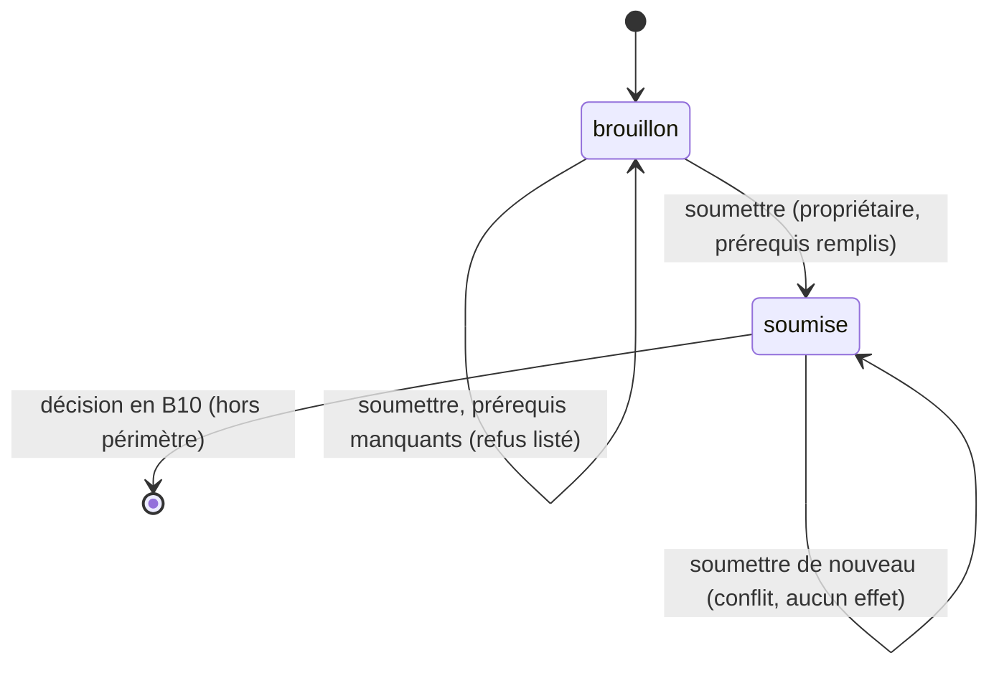

# UC-02-05 — Soumettre l'agence à vérification

| Champ | Valeur |
|---|---|
| Statut | Brouillon (en attente de D-04 : Q-01, Q-02, Q-03, Q-04 ; Q-05, Q-10, Q-11) |
| Priorité | Must |
| Domaine | `agencies` |
| Tâche | B2.5 |
| Date | 2026-11-03 |
| Use cases liés | UC-02-02, UC-02-04, UC-02-08 (fournissent les prérequis) ; UC-02-09 (montre ce qui manque) ; UC-15-01 et UC-15-03 (examen et décision, B10) |
| Exigences couvertes | UC-02-05, RM-02-01, RM-02-02, RM-02-04, EX-02-001 à EX-02-006, EX-02-010, EX-02-011, EX-02-013 |

## 0. Traçabilité

| Exigence | Source | Où elle est traitée |
|---|---|---|
| UC-02-05 | F02 §5 ; PH B2.5 ; RDM lot 2 (« agence brouillon → soumise ») | §8 ; scénario 1 |
| RM-02-01 | F02 §Règles | RG-02-05-01 ; scénario 1 |
| RM-02-02 | F02 §Règles | RG-02-05-02 (capacité active = configurée) ; scénarios 3, 5 |
| RM-02-04 | F02 §Règles | RG-02-05-06 ; scénario 2 |
| EX-02-004 | F02 §5 | RG-02-05-04 ; scénarios 6, 7 |
| EX-02-006 | CL | RG-02-05-01 (action dédiée) ; scénario 10 |
| EX-02-001, 002 | ARC3 ; RIA | scénarios 8, 9 |
| EX-02-005, 010 | F02 §5 ; ARC6 | RG-02-05-07 ; scénario 11 |
| EX-02-003, 011, 013 | CDX ; ARC5 ; RM-01-05 | scénario 10 ; tests 11, 12 |

## 1. Objectif

Faire passer l'agence de la préparation à l'examen par la plateforme, une seule fois, et seulement quand le dossier minimal est complet. La décision (approbation, rejet) n'appartient pas à ce lot.

## 2. User story

> En tant que **propriétaire d'agence**, je veux **soumettre mon agence à vérification**, afin que **la plateforme puisse l'examiner**.

## 3. Acteurs

Principal : propriétaire actif **[HYPOTHÈSE]** (Q-05). Secondaire futur : admin plateforme (B10), hors périmètre.

## 4. Déclencheur

Le propriétaire demande la soumission de l'agence.

## 5. Préconditions

- P1 : session valide ; P2 : membre actif ; P3 : propriétaire.
- P4 : agence au statut brouillon.
- P5 : prérequis de soumission remplis **[HYPOTHÈSE]** (Q-01, Q-02).

## 6. Postconditions

- Succès : statut **soumise**, date et auteur de la soumission enregistrés ; identité verrouillée (UC-02-02) ; trace « agence soumise à vérification » ; événement `AgencySubmittedForVerification` **[HYPOTHÈSE]** (Q-10).
- Échec : statut inchangé (brouillon), aucune trace, aucun événement.

## 7. Règles métier

| ID | Règle | Exemple | Source |
|---|---|---|---|
| RG-02-05-01 | La soumission est la seule transition livrée en B2 : brouillon → soumise, par une action dédiée ; aucun autre moyen ne change le statut. | « Express Douala » brouillon → soumise le 2026-11-15. | RM-02-01 ; EX-02-006 ; RDM |
| RG-02-05-02 | **[HYPOTHÈSE]** (Q-01, Q-02) Prérequis : raison sociale, ville et adresse du siège, téléphone principal renseignés ; au moins une capacité **active** (une capacité suspendue ne compte pas) ; au moins un site actif. | Livraison suspendue, stockage jamais activé → refus « au moins une capacité active ». | D-04 ; RM-02-02 |
| RG-02-05-03 | Un refus liste **tous** les prérequis manquants, pas seulement le premier. | Sans téléphone et sans site → deux éléments listés. | [HYPOTHÈSE] |
| RG-02-05-04 | **[HYPOTHÈSE]** (Q-11) Soumettre une agence déjà soumise est refusé pour conflit ; deux soumissions simultanées ne produisent qu'une soumission, une trace et un événement. | Awa clique deux fois → une soumission, date du premier envoi. | EX-02-004 |
| RG-02-05-05 | Seul le propriétaire soumet **[HYPOTHÈSE]** ; administrateur et agent refusés ; ancien membre et autre agence : introuvable. | Paul (admin) → refus ; Ibrahim → introuvable. | EX-02-001, 002 ; Q-05 |
| RG-02-05-06 | La soumission n'attribue aucune mention « vérifiée », « certifiée », « assurée » ou « garantie » ; l'agence est présentée comme « soumise à vérification ». | Après soumission, l'état d'onboarding affiche « soumise à vérification » et aucune garantie. | RM-02-04 |
| RG-02-05-07 | La soumission est auditée et émet un événement (audit seul, aucune notification à la plateforme ni au propriétaire). | Trace « agence soumise à vérification » par Awa. | EX-02-005, 010, 014 |
| RG-02-05-08 | **[HYPOTHÈSE]** (Q-03, Q-04) Une agence soumise ne revient pas en brouillon en B2 ; aucun retrait de soumission. Les statuts suivants (approuvée, rejetée…) relèvent de B10. | Awa ne peut pas « annuler la soumission ». | A-08 |

## 8. Flux nominal

1. Le propriétaire demande la soumission de l'agence.
2. Le système vérifie session, membership actif, rôle propriétaire (P1 à P3).
3. Le système verrouille l'agence et vérifie qu'elle est en brouillon (P4).
4. Le système évalue tous les prérequis (RG-02-05-02).
5. Tous remplis : le statut passe à soumise, avec la date et l'auteur.
6. Le système écrit la trace et émet l'événement.
7. Le système renvoie le nouvel état d'onboarding (statut « soumise à vérification »).

## 9. Flux alternatifs

Aucun : la soumission réussit ou échoue.

## 10. Flux d'exception

- E1 — Session invalide : 401. E2 — Non membre, ancien membre, autre agence : introuvable (404). E3 — Administrateur ou agent : non autorisé (403).
- E4 — Contenu non attendu (statut imposé…) : 400.
- E5 — Agence déjà soumise : conflit (409), « Cette agence est déjà soumise à vérification ».
- E6 — Prérequis manquants : refus (400), « Dossier incomplet » avec la liste complète des éléments manquants.

## 11. Workflow



## 12. Scénarios d'acceptation (Gherkin)

Copie conforme de [features/soumettre-verification.feature](features/soumettre-verification.feature).

```gherkin
# language: fr
@UC-02-05 @B2.5
Fonctionnalité: Soumettre l'agence à vérification
  Afin que la plateforme examine mon agence
  En tant que propriétaire d'agence
  Je veux soumettre mon agence à vérification

  Contexte:
    Étant donné l'agence "Express Douala" au statut brouillon
    Et "Awa Ngono" propriétaire active de "Express Douala"
    Et "Paul Mbarga" administrateur actif de "Express Douala"
    Et "Céline Fotso" agente active de "Express Douala"

  @nominal @RG-02-05-01 @RG-02-05-02 @RM-02-01
  Scénario: La propriétaire soumet une agence dont le dossier est complet
    Étant donné "Express Douala" a une identité complète
    Et la capacité livraison de "Express Douala" est active
    Et "Express Douala" possède le site actif "Agence Akwa"
    Quand "Awa Ngono" soumet "Express Douala" à vérification le "2026-11-15"
    Alors "Express Douala" est au statut soumise
    Et la soumission est datée du "2026-11-15" et attribuée à "Awa Ngono"

  @nominal @RG-02-05-06 @RM-02-04
  Scénario: Une agence soumise n'est présentée ni comme vérifiée ni comme assurée
    Étant donné "Express Douala" soumise à vérification
    Quand "Awa Ngono" consulte l'état d'onboarding de "Express Douala"
    Alors l'état indique « soumise à vérification »
    Et aucune mention de vérification acquise, de certification ou d'assurance n'apparaît

  @erreur @RG-02-05-02 @RM-02-02
  Plan du scénario: Une agence dont un prérequis manque n'est pas soumise
    Étant donné "Express Douala" a un dossier complet sauf <élément manquant>
    Quand "Awa Ngono" soumet "Express Douala" à vérification
    Alors la soumission est refusée
    Et le motif liste « <élément manquant> »
    Et "Express Douala" reste au statut brouillon

    Exemples:
      | élément manquant          |
      | raison sociale            |
      | ville du siège            |
      | adresse du siège          |
      | téléphone principal       |
      | au moins une capacité active |
      | au moins un site actif    |

  @erreur @RG-02-05-03
  Scénario: Tous les prérequis manquants sont listés en une fois
    Étant donné "Express Douala" n'a ni téléphone principal ni site actif
    Et la capacité livraison de "Express Douala" est active
    Quand "Awa Ngono" soumet "Express Douala" à vérification
    Alors la soumission est refusée
    Et le motif liste « téléphone principal » et « au moins un site actif »

  @erreur @RG-02-05-02 @RM-02-03
  Scénario: Une capacité suspendue ne permet pas de soumettre
    Étant donné "Express Douala" a une identité complète et le site actif "Agence Akwa"
    Et la capacité livraison de "Express Douala" est suspendue
    Et la capacité stockage de "Express Douala" n'a jamais été activée
    Quand "Awa Ngono" soumet "Express Douala" à vérification
    Alors la soumission est refusée
    Et le motif liste « au moins une capacité active »

  @erreur @RG-02-05-04 @RG-02-05-08
  Scénario: Une agence déjà soumise ne peut pas être soumise de nouveau
    Étant donné "Express Douala" soumise à vérification le "2026-11-15"
    Quand "Awa Ngono" soumet "Express Douala" à vérification le "2026-11-16"
    Alors la soumission est refusée pour conflit
    Et la soumission reste datée du "2026-11-15"

  @concurrence @RG-02-05-04 @EX-02-004
  Scénario: Deux soumissions simultanées ne produisent qu'une soumission
    Étant donné "Express Douala" a un dossier complet
    Quand deux soumissions de "Express Douala" par "Awa Ngono" arrivent en même temps
    Alors "Express Douala" est au statut soumise
    Et le journal d'audit ne contient qu'une seule soumission
    Et l'une des deux demandes est refusée pour conflit

  @erreur @securite @RG-02-05-05 @EX-02-002
  Plan du scénario: Seule la propriétaire peut soumettre l'agence
    Étant donné "Express Douala" a un dossier complet
    Quand "<personne>" soumet "Express Douala" à vérification
    Alors l'action lui est refusée comme non autorisée
    Et "Express Douala" reste au statut brouillon

    Exemples:
      | personne     |
      | Paul Mbarga  |
      | Céline Fotso |

  @erreur @securite @RG-02-05-05 @EX-02-001
  Plan du scénario: Une personne sans accès actif ne trouve pas l'agence
    Étant donné <situation>
    Quand "<personne>" soumet "Express Douala" à vérification
    Alors l'agence "Express Douala" lui est introuvable
    Et "Express Douala" reste au statut brouillon

    Exemples:
      | personne      | situation                                                    |
      | Ibrahim Bello | "Ibrahim Bello" propriétaire de "Rapide Yaoundé" uniquement  |
      | Jean Etoa     | "Jean Etoa" ancien administrateur de "Express Douala"        |

  @erreur @securite @RG-02-05-01 @EX-02-003 @EX-02-006
  Scénario: La soumission ne permet pas d'imposer un autre statut
    Étant donné "Express Douala" a un dossier complet
    Quand "Awa Ngono" soumet "Express Douala" en indiquant le statut "approuvée"
    Alors la soumission est refusée
    Et "Express Douala" reste au statut brouillon

  @nominal @RG-02-05-07 @EX-02-005 @EX-02-010
  Scénario: La soumission est tracée dans le journal d'audit
    Étant donné "Express Douala" a un dossier complet
    Quand "Awa Ngono" soumet "Express Douala" à vérification
    Alors le journal d'audit contient « agence soumise à vérification » par "Awa Ngono"
```

## 13. Plan de tests TDD

| # | Niveau | Comportement | Étant donné | Quand | Alors | Règle |
|---|---|---|---|---|---|---|
| 1 | unit (domaine) | Soumission nominale | brouillon complet, horloge fixe | soumettre | statut soumise, date, auteur, événement | RG-02-05-01, 07 |
| 2 | unit (domaine) | Chaque prérequis manquant | dossier complet moins un élément (×6) | soumettre | `invalid`, élément listé | RG-02-05-02 |
| 3 | unit (domaine) | Liste complète | deux éléments manquants | soumettre | les deux listés | RG-02-05-03 |
| 4 | unit (domaine) | Capacité suspendue | seule capacité suspendue | soumettre | `invalid` « capacité active » | RG-02-05-02 |
| 5 | unit (domaine) | Déjà soumise | agence soumise | soumettre | `conflict`, date inchangée, aucun événement | RG-02-05-04 |
| 6 | unit (domaine) | Identité verrouillée ensuite | agence soumise | compléter l'identité | `conflict` (lien UC-02-02) | RG-02-05-08 |
| 7 | unit (domaine) | Aucune garantie | agence soumise | lire l'état | aucun attribut vérifiée/assurée | RG-02-05-06 |
| 8 | unit (application) | Rôles et isolation | fakes | soumettre par chaque acteur | propriétaire OK ; admin, agent `forbidden` ; autres `not_found` | RG-02-05-05 |
| 9 | unit (application) | Audit | fakes | soumettre | une trace, un événement | RG-02-05-07 |
| 10 | feature (PostgreSQL) | Double soumission concurrente | brouillon complet | deux soumissions simultanées | une réussit, l'autre `conflict`, une trace | RG-02-05-04 |
| 11 | E2E | 200, 400, 401 | — | soumettre complet ; incomplet ; corps avec `status` ; sans jeton | 200 ; 400 avec liste ; 400 ; 401 | RG-02-05-01 à 03 |
| 12 | E2E | 403, 404, 409 | — | admin, agent ; autre agence, ancien membre ; déjà soumise | 403 ; 404 ; 409 | RG-02-05-04, 05 |

## 14. Données

Entrée : aucune donnée métier (action dédiée sur l'agence désignée) ; tout contenu non attendu est refusé.
Sortie : état d'onboarding (UC-02-09) avec statut « soumise », date et auteur de la soumission.
Jeu de test « dossier complet » : raison sociale « Express Douala SARL », ville « Douala », adresse « Rue Joss, Akwa », téléphone « +237677123456 », livraison active avec la zone « Douala / Akwa », site actif « Agence Akwa ».

## 15. Exigences non fonctionnelles

- Une seule soumission en concurrence (verrou de l'agence ou version) : test 10.
- Aucune notification à l'admin plateforme : la file d'examen B10 lira le statut.

## 16. Hors périmètre

Approbation, rejet, demande de justificatif, retour en brouillon (B10, UC-15-02, UC-15-03) ; critères de certification et expiration (EX-02-015) ; notification de la plateforme ou du propriétaire ; frais de vérification.

## 17. Questions ouvertes

| # | Question | Hypothèse retenue | Impact si différent |
|---|---|---|---|
| Q-01 | Prérequis d'identité et documents ? | §7 RG-02-05-02, aucun document. | Liste des prérequis, upload (CRITIQUE). |
| Q-02 | Configuration minimale des capacités ? | Voir UC-02-04. | Prérequis « capacité active ». |
| Q-03 | Retrait de soumission ? Ce qui reste modifiable ? | Pas de retrait ; identité verrouillée. | Nouvelle transition soumise → brouillon. |
| Q-04 | Statuts après soumission et décideurs ? | approuvée / rejetée / suspendue, admin plateforme (B10). | Machine à états B10. |
| Q-05 | Qui soumet ? | Propriétaire seul. | Administrateur autorisé. |
| Q-10 | Événement de soumission ? | `AgencySubmittedForVerification` (hors catalogue). | `AgencyRegistered` émis ici plutôt qu'à la création. |
| Q-11 | Second envoi : conflit ou succès sans effet ? | Conflit. | Réponse 200 idempotente. |

## 18. Notes pour le tech lead

- Action dédiée `POST /agencies/{id}/submit` (indicatif) sans corps métier ; schéma Zod `.strict()` vide.
- Le calcul des prérequis est partagé avec UC-02-09 (même règle, une seule implémentation dans le domaine).
- Ajouter `AgencySubmittedForVerification` à `backend/docs/events.md` si Q-10 est validée.

Definition of Ready :
- [x] Chaque exigence de la section 0 a au moins un scénario
- [x] Chaque règle a un exemple
- [x] Chaque flux d'exception a un scénario (E1 : test 11)
- [ ] Aucune question bloquante (Q-01, Q-02, Q-04 : D-04)
- [x] Le plan TDD couvre chaque règle
- [x] Le `.feature` est synchronisé avec la section 12
