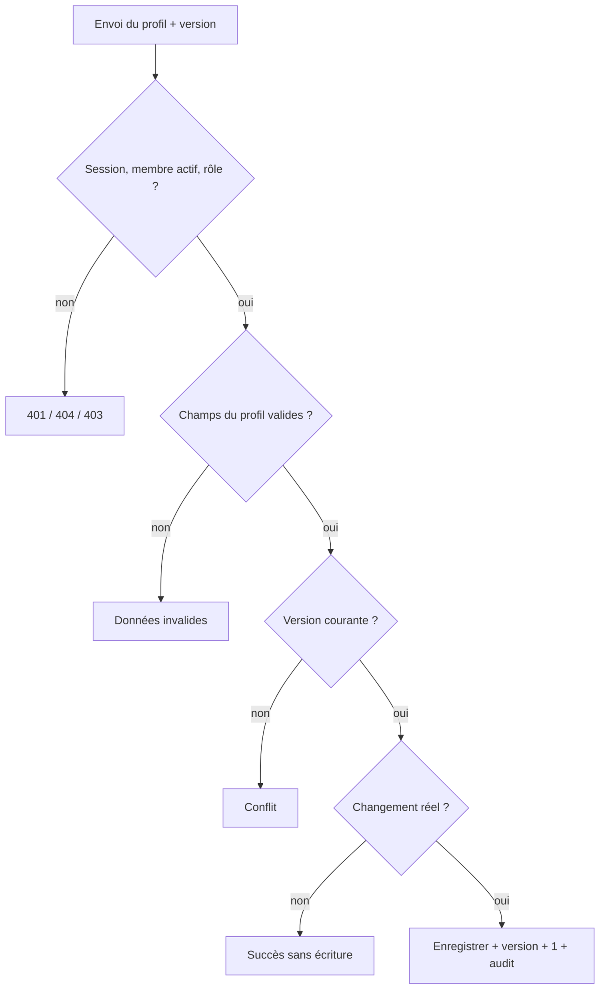

# UC-02-06 — Modifier le profil de l'agence

| Champ | Valeur |
|---|---|
| Statut | Brouillon (en attente de Q-03, Q-05, Q-16) |
| Priorité | Should |
| Domaine | `agencies` |
| Tâche | B2.6 |
| Date | 2026-11-04 |
| Use cases liés | UC-02-01 (nom commercial initial) ; UC-02-02 (identité, distincte — anomalie A-02) ; UC-03-01 Publier la fiche publique (B3, réutilisera le profil) |
| Exigences couvertes | UC-02-06, EX-02-001, EX-02-002, EX-02-003, EX-02-005, EX-02-011, EX-02-012, EX-02-013 |

## 0. Traçabilité

| Exigence | Source | Où elle est traitée |
|---|---|---|
| UC-02-06 | F02 §6 ; PH B2.6 | §8 ; scénarios 1 à 4 |
| EX-02-012 | ARC5 (`If-Match`) | RG-02-06-04 ; scénario 7 |
| EX-02-001, 002 | ARC3 ; RIA | scénarios 8, 9 |
| EX-02-003 | CDX | RG-02-06-05 ; scénario 10 |
| EX-02-005 | F02 §6 | RG-02-06-06 ; scénario 11 |
| EX-02-011, 013 | ARC5 ; RM-01-05 | tests 9, 10 |

## 1. Objectif

Tenir à jour la présentation de l'agence (nom commercial, description) pendant toute sa vie, sans toucher aux données vérifiées.

## 2. User story

> En tant que **propriétaire ou administrateur d'agence**, je veux **modifier le nom commercial et la description de mon agence**, afin que **sa présentation reste exacte**.

## 3. Acteurs

Principal : propriétaire ou administrateur actif **[HYPOTHÈSE]** (Q-05).

## 4. Déclencheur

Le responsable enregistre un nouveau nom commercial ou une nouvelle description.

## 5. Préconditions

- P1 : session valide ; P2 : membre actif ; P3 : propriétaire ou administrateur.
- P4 : agence en brouillon ou soumise **[HYPOTHÈSE]** (Q-03).
- P5 : modification fondée sur la version courante **[HYPOTHÈSE]**.

## 6. Postconditions

- Succès : champs transmis enregistrés, version + 1, trace « profil modifié » avec les noms de champs.
- Échec : profil et version inchangés, aucune trace.

## 7. Règles métier

| ID | Règle | Exemple | Source |
|---|---|---|---|
| RG-02-06-01 | **[HYPOTHÈSE]** (A-02, Q-16) Le profil comprend le nom commercial (2 à 120 caractères, obligatoire, jamais vide) et une description facultative (au plus 1 000 caractères). Modification partielle. | Description « Livraison express dans Douala, 7j/7 » ajoutée, nom inchangé. | A-02 |
| RG-02-06-02 | Le profil reste modifiable après soumission **[HYPOTHÈSE]** (Q-03), contrairement à l'identité. | « Express Douala » soumise renomme son nom commercial « Express Douala & Littoral » → accepté. | Q-03 |
| RG-02-06-03 | La description peut être vidée ; le nom commercial non. | Vider la description → accepté ; nom vide → refusé. | [HYPOTHÈSE] |
| RG-02-06-04 | Une modification sur une version périmée est refusée pour conflit. | Paul enregistre sur la version 5 alors que la version courante est 6 → conflit. | EX-02-012 |
| RG-02-06-05 | Seuls les champs du profil sont acceptés ; un champ d'identité ou de statut est refusé. Rôles : propriétaire et administrateur ; agent refusé ; autres introuvable. | Envoyer « raison sociale » par le profil → refusé. | EX-02-001 à 003 |
| RG-02-06-06 | Chaque modification effective est auditée (noms des champs) ; sans changement réel, rien n'est écrit. | Trace « profil modifié : description » par Paul. | EX-02-005 |

## 8. Flux nominal

1. Le responsable envoie le nom commercial et/ou la description, avec la version.
2. Le système vérifie session, membership actif, rôle.
3. Le système refuse tout champ hors profil et valide les champs (RG-02-06-01).
4. Le système vérifie statut (P4) et version (P5).
5. Le système enregistre, incrémente la version, écrit la trace.
6. Le système renvoie le profil et la nouvelle version.

## 9. Flux alternatifs

- A1 — Aucun changement réel (étape 5) : succès sans écriture.
- A2 — Description vidée (étape 3) : acceptée.

## 10. Flux d'exception

- E1 — Session invalide : 401. E2 — Non membre, ancien membre, autre agence : introuvable (404). E3 — Agent : non autorisé (403).
- E4 — Champ invalide ou hors profil : 400. E5 — Version périmée : conflit (409).

## 11. Workflow



## 12. Scénarios d'acceptation (Gherkin)

Copie conforme de [features/modifier-profil-agence.feature](features/modifier-profil-agence.feature).

```gherkin
# language: fr
@UC-02-06 @B2.6
Fonctionnalité: Modifier le profil de l'agence
  Afin que la présentation de mon agence reste exacte
  En tant que propriétaire ou administrateur d'agence
  Je veux modifier son nom commercial et sa description

  Contexte:
    Étant donné l'agence "Express Douala" au statut brouillon
    Et "Awa Ngono" propriétaire active de "Express Douala"
    Et "Paul Mbarga" administrateur actif de "Express Douala"
    Et "Céline Fotso" agente active de "Express Douala"

  @nominal @RG-02-06-01
  Scénario: Un administrateur ajoute une description
    Quand "Paul Mbarga" enregistre la description "Livraison express dans Douala, 7j/7"
    Alors la description de "Express Douala" est "Livraison express dans Douala, 7j/7"
    Et le nom commercial reste "Express Douala"

  @nominal @RG-02-06-01
  Scénario: La propriétaire change le nom commercial
    Quand "Awa Ngono" enregistre le nom commercial "Express Douala & Littoral"
    Alors le nom commercial de l'agence est "Express Douala & Littoral"

  @alternatif @RG-02-06-02
  Scénario: Le profil d'une agence soumise reste modifiable
    Étant donné "Express Douala" soumise à vérification
    Quand "Paul Mbarga" enregistre la description "Livraison et stockage à Douala"
    Alors la description de l'agence est "Livraison et stockage à Douala"
    Et l'agence reste au statut soumise

  @alternatif @RG-02-06-03
  Scénario: La description peut être vidée
    Étant donné la description de "Express Douala" est "Livraison express"
    Quand "Paul Mbarga" vide la description
    Alors "Express Douala" n'a plus de description

  @erreur @RG-02-06-01
  Plan du scénario: Bornes de longueur de la description
    Quand "Paul Mbarga" enregistre une description de <longueur> caractères
    Alors l'enregistrement est <résultat>

    Exemples:
      | longueur | résultat |
      | 1000     | accepté  |
      | 1001     | refusé   |

  @erreur @RG-02-06-03
  Scénario: Le nom commercial ne peut pas être vidé
    Quand "Awa Ngono" enregistre un nom commercial vide
    Alors l'enregistrement est refusé
    Et le nom commercial reste "Express Douala"

  @erreur @concurrence @RG-02-06-04 @EX-02-012
  Scénario: Une modification du profil fondée sur une version périmée est refusée
    Étant donné "Express Douala" est en version 6
    Quand "Paul Mbarga" enregistre la description "Ancienne présentation" sur la version 5
    Alors l'enregistrement est refusé pour conflit
    Et la description de "Express Douala" est inchangée

  @erreur @securite @RG-02-06-05 @EX-02-002
  Scénario: Une agente ne peut pas modifier le profil
    Quand "Céline Fotso" enregistre la description "Meilleure agence de Douala"
    Alors l'action lui est refusée comme non autorisée
    Et la description de "Express Douala" est inchangée

  @erreur @securite @RG-02-06-05 @EX-02-001
  Plan du scénario: Une personne sans accès actif ne trouve pas l'agence
    Étant donné <situation>
    Quand "<personne>" enregistre la description "Autre présentation" pour "Express Douala"
    Alors l'agence "Express Douala" lui est introuvable

    Exemples:
      | personne      | situation                                                    |
      | Ibrahim Bello | "Ibrahim Bello" propriétaire de "Rapide Yaoundé" uniquement  |
      | Jean Etoa     | "Jean Etoa" ancien administrateur de "Express Douala"        |

  @erreur @securite @RG-02-06-05 @EX-02-003
  Scénario: Une donnée d'identité ne peut pas être modifiée par le profil
    Étant donné "Express Douala" soumise à vérification
    Quand "Paul Mbarga" enregistre par le profil la raison sociale "Autre SARL"
    Alors l'enregistrement est refusé
    Et la raison sociale de "Express Douala" est inchangée

  @nominal @RG-02-06-06 @EX-02-005
  Scénario: La modification du profil est tracée dans le journal d'audit
    Quand "Paul Mbarga" enregistre la description "Livraison express dans Douala"
    Alors le journal d'audit contient « profil modifié : description » par "Paul Mbarga"
```

## 13. Plan de tests TDD

| # | Niveau | Comportement | Étant donné | Quand | Alors | Règle |
|---|---|---|---|---|---|---|
| 1 | unit (domaine) | Modification partielle | profil donné | changer la description | nom inchangé, version + 1 | RG-02-06-01 |
| 2 | unit (VO) | Bornes | — | description 0, 1000, 1001 ; nom vide, 2, 120, 121 | bornes respectées | RG-02-06-01, 03 |
| 3 | unit (domaine) | Agence soumise | agence soumise | modifier le profil | accepté, statut inchangé | RG-02-06-02 |
| 4 | unit (domaine) | Sans changement | profil donné | mêmes valeurs | aucun événement, version inchangée | RG-02-06-06 |
| 5 | unit (application) | Rôles et isolation | fakes | modifier par chaque acteur | propriétaire, admin OK ; agent `forbidden` ; autres `not_found` | RG-02-06-05 |
| 6 | unit (application) | Version périmée | version 6 | modifier sur 5 | `conflict` | RG-02-06-04 |
| 7 | unit (application) | Audit | fakes | modifier la description | trace avec le nom du champ, sans valeur | RG-02-06-06 |
| 8 | feature (PostgreSQL) | Version optimiste | deux transactions sur la même version | modifier en parallèle | une réussit, l'autre `conflict` | RG-02-06-04 |
| 9 | E2E | 200, 400, 401 | — | profil valide ; description 1001 ; champ `legalName` ou `status` ; sans jeton | 200 ; 400 ; 400 ; 401 | RG-02-06-01, 05 |
| 10 | E2E | 403, 404, 409 | — | agent ; autre agence ; ancien membre ; version périmée | 403 ; 404 ; 404 ; 409 | RG-02-06-04, 05 |

## 14. Données

| Champ | Type métier | Obligatoire | Contraintes **[HYPOTHÈSE]** |
|---|---|---|---|
| Nom commercial | texte | non (partiel), jamais vide | 2 à 120 caractères |
| Description | texte | non | 0 à 1 000 caractères, texte brut (aucun HTML) |
| Version attendue | entier | oui | version courante |

## 15. Exigences non fonctionnelles

- Description en texte brut : tout balisage est conservé comme texte et échappé à l'affichage (contenu destiné à être publié en B3).

## 16. Hors périmètre

Logo, photos, horaires (aucun upload en B2 ; Q-16) ; publication et modération de la fiche publique (B3, B10).

## 17. Questions ouvertes

| # | Question | Hypothèse retenue | Impact si différent |
|---|---|---|---|
| Q-03 | Profil modifiable après soumission ? Le changement de nom commercial doit-il être revérifié ? | Oui, sans revérification. | Verrou ou retour en vérification. |
| Q-05 | Qui modifie le profil ? | Propriétaire et administrateur. | Matrice des droits. |
| Q-16 | Contenu du profil (logo, horaires, réseaux…) ? | Nom commercial et description seulement. | Champs et upload supplémentaires (CRITIQUE). |

## 18. Notes pour le tech lead

- Même mécanisme de version que UC-02-02 ; deux routes distinctes ou deux schémas distincts pour garder le verrou de l'identité lisible.

Definition of Ready :
- [x] Chaque exigence de la section 0 a au moins un scénario
- [x] Chaque règle a un exemple
- [x] Chaque flux d'exception a un scénario (E1 : test 9)
- [x] Aucune question bloquante (hypothèses non structurantes)
- [x] Le plan TDD couvre chaque règle
- [x] Le `.feature` est synchronisé avec la section 12
