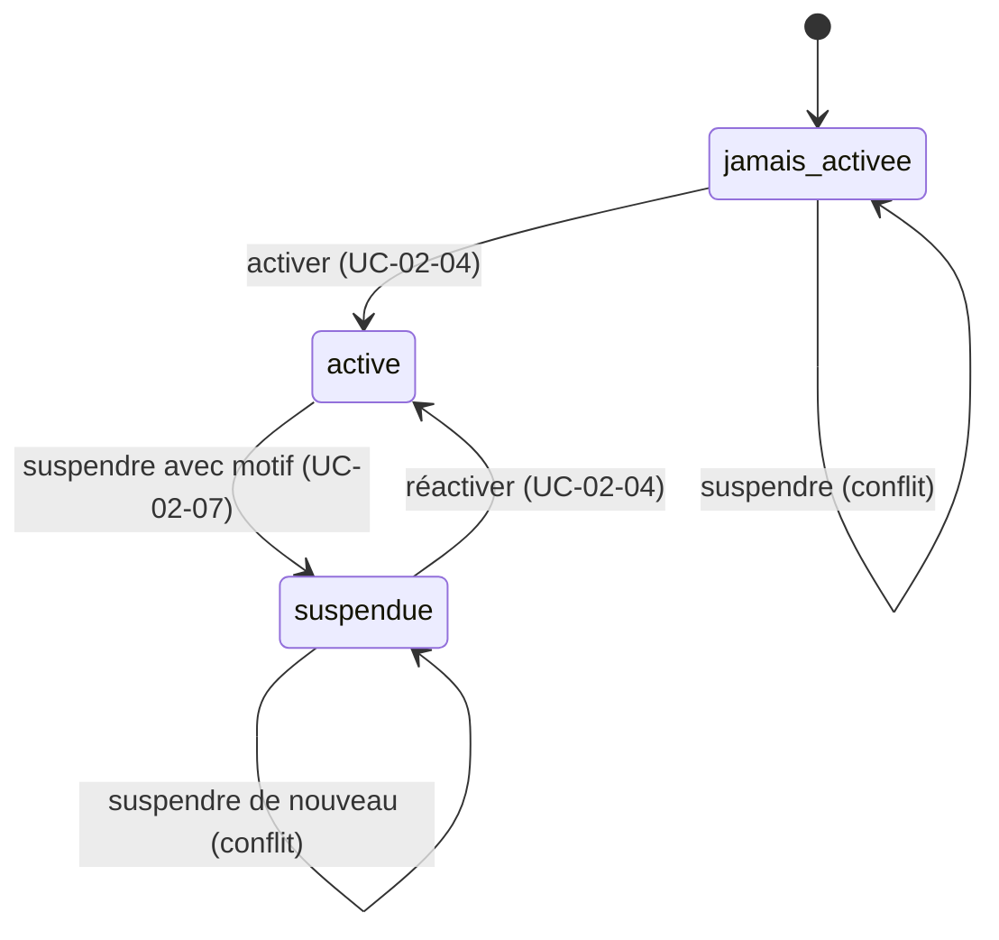

# UC-02-07 — Suspendre une capacité

| Champ | Valeur |
|---|---|
| Statut | Brouillon (en attente de Q-05, Q-09, Q-11) |
| Priorité | Must |
| Domaine | `agencies` |
| Tâche | B2.7 |
| Date | 2026-11-04 |
| Use cases liés | UC-02-04 (activer et réactiver) ; UC-02-05 (une capacité suspendue ne compte pas) ; UC-02-09 (affiche l'état) ; UC-03-05 Demander une prestation (B4, appliquera le blocage) ; UC-15-04 Suspendre une agence (B10, distinct) |
| Exigences couvertes | UC-02-07, RM-02-03, EX-02-001 à EX-02-007, EX-02-010, EX-02-011, EX-02-013 |

## 0. Traçabilité

| Exigence | Source | Où elle est traitée |
|---|---|---|
| UC-02-07 | F02 §7 ; PH B2.7 | §8 ; scénarios 1, 2 |
| RM-02-03 | F02 §Règles | RG-02-07-02, 03 ; scénarios 3, 12 (blocage effectif vérifié en B4, UC-03-05) |
| EX-02-004 | F02 §7 | RG-02-07-05 ; scénarios 6, 8 |
| EX-02-006, 007 | CL ; ARC5 | RG-02-07-01, 03 ; scénario 3 |
| EX-02-001, 002 | ARC3 ; RIA | scénarios 9, 10 |
| EX-02-005, 010 | F02 §7 ; ARC6 | RG-02-07-07 ; scénario 11 |
| EX-02-003, 011, 013 | CDX ; ARC5 ; RM-01-05 | tests 10, 11 |

## 1. Objectif

Permettre à l'agence d'arrêter temporairement un service (manque de livreurs, entrepôt plein, inventaire) sans perdre l'historique et sans toucher aux engagements déjà pris.

## 2. User story

> En tant que **propriétaire ou administrateur d'agence**, je veux **suspendre la livraison ou le stockage en indiquant un motif**, afin de **ne plus recevoir de nouvelles demandes pour ce service tant qu'il est interrompu**.

## 3. Acteurs

Principal : propriétaire ou administrateur actif **[HYPOTHÈSE]** (Q-05).

## 4. Déclencheur

Le responsable demande la suspension d'une capacité active, avec un motif.

## 5. Préconditions

- P1 : session valide ; P2 : membre actif ; P3 : propriétaire ou administrateur.
- P4 : la capacité est active.

## 6. Postconditions

- Succès : capacité **suspendue**, date, auteur et motif enregistrés ; l'historique de ses activations est intact ; trace « capacité suspendue ».
- Échec : capacité inchangée, aucune trace.

## 7. Règles métier

| ID | Règle | Exemple | Source |
|---|---|---|---|
| RG-02-07-01 | Seule une capacité active peut être suspendue, par une action dédiée. | Livraison active → suspendue ; stockage jamais activé → refus pour conflit. | EX-02-006 |
| RG-02-07-02 | Une capacité suspendue n'accepte plus de nouvelles demandes ; les demandes et commandes déjà acceptées ne sont pas affectées **[HYPOTHÈSE]** (Q-09). Le blocage effectif est vérifié au lot 4. | Livraison suspendue le 2026-11-20 : une demande de livraison du 2026-11-21 sera refusée (B4). | RM-02-03 ; A-06 |
| RG-02-07-03 | La suspension n'efface rien : dates d'activation, suspensions et motifs précédents restent consultables. | Stockage activé le 2026-11-05, suspendu le 2026-11-20 → les deux dates visibles. | RM-02-03 ; EX-02-007 |
| RG-02-07-04 | Le motif est obligatoire : 3 à 500 caractères utiles **[HYPOTHÈSE]**. | « Inventaire annuel » accepté ; « ok » refusé. | [HYPOTHÈSE] |
| RG-02-07-05 | **[HYPOTHÈSE]** (Q-11) Suspendre une capacité déjà suspendue est refusé pour conflit ; deux suspensions simultanées ne produisent qu'une suspension. | Awa et Paul suspendent la livraison au même instant → une suspension, un motif. | EX-02-004 |
| RG-02-07-06 | Une agence hybride qui suspend une capacité n'est plus hybride ; la suspension de la dernière capacité active est permise et ne change pas le statut de l'agence. | « Express Douala » soumise suspend sa seule capacité → accepté, reste soumise. | ADR-04 ; [HYPOTHÈSE] |
| RG-02-07-07 | Rôles : propriétaire et administrateur ; agent refusé ; autres introuvable. Chaque suspension est auditée (motif inclus, texte saisi par l'agence) et émet `AgencyCapabilitySuspended` **[HYPOTHÈSE]**. | Trace « capacité suspendue : stockage, motif Inventaire annuel » par Paul. | EX-02-001, 002, 005 |

## 8. Flux nominal

1. Le responsable demande la suspension d'une capacité et indique un motif.
2. Le système vérifie session, membership actif, rôle.
3. Le système valide la capacité et le motif (RG-02-07-04).
4. Le système verrouille l'agence et vérifie que la capacité est active (P4).
5. Le système passe la capacité en suspendue (date, auteur, motif).
6. Le système écrit la trace et émet l'événement.
7. Le système renvoie l'état des capacités.

## 9. Flux alternatifs

- A1 — Agence hybride (étape 5) : l'autre capacité reste active ; l'agence n'est plus hybride.
- A2 — Dernière capacité active (étape 5) : suspension acceptée ; l'agence n'a plus de capacité active.

## 10. Flux d'exception

- E1 — Session invalide : 401. E2 — Non membre, ancien membre, autre agence : introuvable (404). E3 — Agent : non autorisé (403).
- E4 — Capacité inconnue, motif invalide, champ non attendu : 400.
- E5 — Capacité déjà suspendue ou jamais activée : conflit (409), « Cette capacité n'est pas active ».

## 11. Workflow



## 12. Scénarios d'acceptation (Gherkin)

Copie conforme de [features/suspendre-capacite.feature](features/suspendre-capacite.feature).

```gherkin
# language: fr
@UC-02-07 @B2.7
Fonctionnalité: Suspendre une capacité
  Afin de ne plus recevoir de nouvelles demandes pour un service interrompu
  En tant que propriétaire ou administrateur d'agence
  Je veux suspendre la livraison ou le stockage avec un motif

  Contexte:
    Étant donné l'agence "Express Douala" au statut brouillon
    Et "Awa Ngono" propriétaire active de "Express Douala"
    Et "Paul Mbarga" administrateur actif de "Express Douala"
    Et "Céline Fotso" agente active de "Express Douala"

  @nominal @RG-02-07-01 @RM-02-03
  Scénario: Un administrateur suspend la livraison avec un motif
    Étant donné la capacité livraison de "Express Douala" active
    Quand "Paul Mbarga" suspend la livraison le "2026-11-20" pour le motif "Manque de livreurs"
    Alors la capacité livraison de "Express Douala" est suspendue
    Et la suspension est datée du "2026-11-20", attribuée à "Paul Mbarga", motif "Manque de livreurs"

  @alternatif @RG-02-07-06
  Scénario: Une agence hybride qui suspend le stockage n'est plus hybride
    Étant donné les capacités livraison et stockage de "Express Douala" actives
    Quand "Paul Mbarga" suspend le stockage pour le motif "Entrepôt plein"
    Alors la capacité livraison de "Express Douala" reste active
    Et la capacité stockage est suspendue
    Et "Express Douala" n'est plus présentée comme hybride

  @alternatif @RG-02-07-03 @RM-02-03 @EX-02-007
  Scénario: La suspension conserve l'historique de la capacité
    Étant donné la capacité stockage de "Express Douala" activée le "2026-11-05"
    Quand "Paul Mbarga" suspend le stockage le "2026-11-20" pour le motif "Inventaire annuel"
    Alors l'historique du stockage montre l'activation du "2026-11-05"
    Et l'historique du stockage montre la suspension du "2026-11-20" pour "Inventaire annuel"

  @alternatif @RG-02-07-06
  Scénario: Suspendre la dernière capacité active ne change pas le statut de l'agence
    Étant donné "Express Douala" soumise à vérification
    Et la livraison est la seule capacité active de "Express Douala"
    Quand "Awa Ngono" suspend la livraison pour le motif "Fermeture temporaire"
    Alors "Express Douala" n'a plus aucune capacité active
    Et "Express Douala" reste au statut soumise

  @erreur @RG-02-07-04
  Plan du scénario: Le motif de suspension est obligatoire et borné
    Étant donné la capacité livraison de "Express Douala" active
    Quand "Paul Mbarga" suspend la livraison avec un motif de <longueur> caractères utiles
    Alors la suspension est <résultat>

    Exemples:
      | longueur | résultat |
      | 0        | refusée  |
      | 2        | refusée  |
      | 3        | acceptée |
      | 500      | acceptée |
      | 501      | refusée  |

  @erreur @RG-02-07-05
  Scénario: Une capacité déjà suspendue ne peut pas être suspendue de nouveau
    Étant donné la capacité livraison de "Express Douala" suspendue pour le motif "Manque de livreurs"
    Quand "Paul Mbarga" suspend la livraison pour le motif "Pluies"
    Alors la suspension est refusée pour conflit
    Et le motif de suspension reste "Manque de livreurs"

  @erreur @RG-02-07-01
  Scénario: Une capacité jamais activée ne peut pas être suspendue
    Étant donné la capacité stockage de "Express Douala" n'a jamais été activée
    Quand "Paul Mbarga" suspend le stockage pour le motif "Test"
    Alors la suspension est refusée pour conflit

  @concurrence @RG-02-07-05 @EX-02-004
  Scénario: Deux suspensions simultanées ne produisent qu'une suspension
    Étant donné la capacité livraison de "Express Douala" active
    Quand "Awa Ngono" et "Paul Mbarga" suspendent en même temps la livraison
    Alors la capacité livraison est suspendue une seule fois
    Et le journal d'audit ne contient qu'une seule suspension
    Et l'une des deux demandes est refusée pour conflit

  @erreur @securite @RG-02-07-07 @EX-02-002
  Scénario: Une agente ne peut pas suspendre une capacité
    Étant donné la capacité livraison de "Express Douala" active
    Quand "Céline Fotso" suspend la livraison pour le motif "Trop de travail"
    Alors l'action lui est refusée comme non autorisée
    Et la capacité livraison reste active

  @erreur @securite @RG-02-07-07 @EX-02-001
  Plan du scénario: Une personne sans accès actif ne trouve pas l'agence
    Étant donné la capacité livraison de "Express Douala" active
    Et <situation>
    Quand "<personne>" suspend la livraison de "Express Douala" pour le motif "Concurrence"
    Alors l'agence "Express Douala" lui est introuvable
    Et la capacité livraison reste active

    Exemples:
      | personne      | situation                                                    |
      | Ibrahim Bello | "Ibrahim Bello" propriétaire de "Rapide Yaoundé" uniquement  |
      | Jean Etoa     | "Jean Etoa" ancien administrateur de "Express Douala"        |

  @nominal @RG-02-07-07 @EX-02-005
  Scénario: La suspension est tracée dans le journal d'audit
    Étant donné la capacité stockage de "Express Douala" active
    Quand "Paul Mbarga" suspend le stockage pour le motif "Inventaire annuel"
    Alors le journal d'audit contient « capacité suspendue : stockage » avec le motif "Inventaire annuel" par "Paul Mbarga"

  @nominal @RG-02-07-02 @RM-02-03
  Scénario: Une capacité suspendue est signalée comme fermée aux nouvelles demandes
    Étant donné la capacité livraison de "Express Douala" suspendue
    Quand "Céline Fotso" consulte l'état d'onboarding de "Express Douala"
    Alors l'état indique que la livraison n'accepte pas de nouvelles demandes
```

## 13. Plan de tests TDD

| # | Niveau | Comportement | Étant donné | Quand | Alors | Règle |
|---|---|---|---|---|---|---|
| 1 | unit (domaine) | Suspension nominale | livraison active, horloge fixe | suspendre avec motif | suspendue, date, auteur, motif, événement | RG-02-07-01, 07 |
| 2 | unit (domaine) | Historique conservé | activée le 05, suspendue le 20 | lire l'historique | les deux transitions présentes | RG-02-07-03 |
| 3 | unit (VO) | Motif | — | 0, 2, 3, 500, 501 caractères | bornes respectées | RG-02-07-04 |
| 4 | unit (domaine) | Déjà suspendue / jamais activée | — | suspendre | `conflict`, aucun événement | RG-02-07-01, 05 |
| 5 | unit (domaine) | Hybride | deux actives | suspendre stockage | hybride = faux, livraison active | RG-02-07-06 |
| 6 | unit (domaine) | Dernière capacité | une seule active, agence soumise | suspendre | aucune active, statut soumise inchangé | RG-02-07-06 |
| 7 | unit (domaine) | Fermée aux nouvelles demandes | capacité suspendue | interroger « accepte de nouvelles demandes ? » | non (méthode réutilisée en B4) | RG-02-07-02 |
| 8 | unit (application) | Rôles, isolation, audit | fakes | suspendre par chaque acteur | propriétaire, admin OK + trace ; agent `forbidden` ; autres `not_found` | RG-02-07-07 |
| 9 | feature (PostgreSQL) | Concurrence | livraison active | deux suspensions simultanées | une réussit, l'autre `conflict`, une trace | RG-02-07-05 |
| 10 | E2E | 200, 400, 401 | — | suspendre ; motif vide ; capacité inconnue ; sans jeton | 200 ; 400 ; 400 ; 401 | RG-02-07-01, 04 |
| 11 | E2E | 403, 404, 409 | — | agent ; autre agence ; ancien membre ; déjà suspendue | 403 ; 404 ; 404 ; 409 | RG-02-07-05, 07 |

## 14. Données

| Champ | Type métier | Obligatoire | Contraintes |
|---|---|---|---|
| Capacité | énumération | oui | `livraison` ou `stockage` |
| Motif | texte | oui | 3 à 500 caractères **[HYPOTHÈSE]**, texte brut |

## 15. Exigences non fonctionnelles

- Le motif est saisi par l'agence : jamais de donnée personnelle attendue ; visible des seuls membres actifs et, plus tard, de l'admin plateforme.

## 16. Hors périmètre

Blocage effectif des nouvelles demandes (B4) ; suspension d'une agence entière par la plateforme (B10, UC-15-04) ; suspension programmée ou avec date de fin ; notification des clients.

## 17. Questions ouvertes

| # | Question | Hypothèse retenue | Impact si différent |
|---|---|---|---|
| Q-05 | Qui suspend ? | Propriétaire et administrateur. | Matrice des droits. |
| Q-09 | Effet sur les demandes et commandes en cours ? | Aucun ; seules les nouvelles demandes sont bloquées. | Annulation ou gel des engagements (B4, B5). |
| Q-11 | Second envoi : conflit ou succès sans effet ? | Conflit. | Réponse 200 idempotente. |
| Q-17 | Motif obligatoire ? Fin de suspension programmée ? | Motif obligatoire ; pas de date de fin. | Champ facultatif ; réactivation automatique (tâche planifiée). |

## 18. Notes pour le tech lead

- Exposer dans le domaine une méthode « la capacité accepte-t-elle de nouvelles demandes ? » que B4 consommera via ce que le module `agencies` exposera explicitement (pas d'accès à ses tables).
- `AgencyCapabilitySuspended` est hors catalogue ARC6 : à ajouter à `events.md` si validé.

Definition of Ready :
- [x] Chaque exigence de la section 0 a au moins un scénario
- [x] Chaque règle a un exemple
- [x] Chaque flux d'exception a un scénario (E1 : test 10)
- [x] Aucune question bloquante
- [x] Le plan TDD couvre chaque règle
- [x] Le `.feature` est synchronisé avec la section 12
