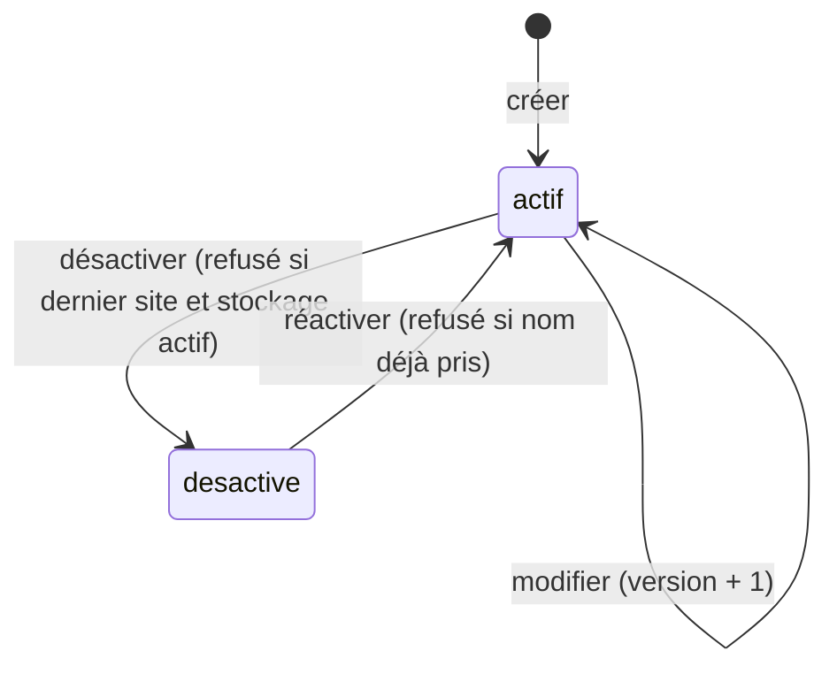

# UC-02-08 — Gérer les sites de l'agence

| Champ | Valeur |
|---|---|
| Statut | Brouillon (en attente de Q-02, Q-05, Q-14, Q-18) |
| Priorité | Must |
| Domaine | `agencies` (agrégat candidat `AgencyLocation`) |
| Tâche | B2.8 |
| Date | 2026-11-04 |
| Use cases liés | UC-02-04 (le stockage exige un site actif — hypothèse) ; UC-02-05 (exige un site actif) ; UC-02-09 ; UC-10-01 Créer un entrepôt (B7, distinct d'un site) |
| Exigences couvertes | UC-02-08, RM-02-02, EX-02-001 à EX-02-007, EX-02-011, EX-02-012, EX-02-013 |

## 0. Traçabilité

| Exigence | Source | Où elle est traitée |
|---|---|---|
| UC-02-08 | F02 §8 ; PH B2.8 (« créer, modifier, désactiver ») ; ARC3 §Identités (`agency_locations`) | §8 ; scénarios 1 à 5 |
| RM-02-02 | F02 §Règles | RG-02-08-05 ; scénario 8 |
| EX-02-004 | F02 §8 | scénario 11 |
| EX-02-006, 007 | CL ; ARC5 | RG-02-08-04 ; scénarios 3, 4 |
| EX-02-012 | ARC5 | RG-02-08-06 ; scénario 10 |
| EX-02-001, 002 | ARC3 ; RIA | scénarios 12 à 14 |
| EX-02-005 | F02 §8 | scénario 15 |
| EX-02-003, 011, 013 | CDX ; ARC5 ; RM-01-05 | scénario 5 (liste paginée) ; tests 13, 14 |

## 1. Objectif

Recenser les points physiques de l'agence (bureau, comptoir, dépôt) où elle reçoit, remet ou stocke des colis, et en garder l'historique.

## 2. User story

> En tant que **propriétaire ou administrateur d'agence**, je veux **créer, modifier, désactiver et réactiver les sites de mon agence**, afin que **la plateforme connaisse mes points physiques** ; en tant que **membre**, je veux **les consulter**.

## 3. Acteurs

Principal : propriétaire ou administrateur actif **[HYPOTHÈSE]** (Q-05). Consultation : tout membre actif (y compris agent).

## 4. Déclencheur

Le responsable crée, modifie, désactive ou réactive un site ; un membre consulte la liste.

## 5. Préconditions

- P1 : session valide ; P2 : membre actif ; P3 : propriétaire ou administrateur pour toute écriture.
- P4 : agence en brouillon ou soumise **[HYPOTHÈSE]** (Q-03).

## 6. Postconditions

- Succès : le site est créé (actif), modifié (version + 1), désactivé (conservé, date) ou réactivé ; une trace par action.
- Échec : aucun site modifié, aucune trace.

## 7. Règles métier

| ID | Règle | Exemple | Source |
|---|---|---|---|
| RG-02-08-01 | **[HYPOTHÈSE]** (Q-18) Un site a un nom (2 à 120 caractères), une ville (2 à 80), une adresse (5 à 300, repère accepté) et un téléphone facultatif (format de RG-02-02-04). | « Agence Akwa », Douala, « Rue Joss, face Total Akwa ». | D-04 ; [HYPOTHÈSE] |
| RG-02-08-02 | Deux sites actifs d'une même agence ne portent pas le même nom (sans casse ni accents). | « Agence Akwa » existe → « agence AKWA » refusé ; « Rapide Yaoundé » peut avoir sa propre « Agence Akwa ». | [HYPOTHÈSE] |
| RG-02-08-03 | Seul un site actif peut être modifié **[HYPOTHÈSE]** ; la modification est partielle. | Changer l'adresse de « Agence Akwa » ; modifier un site désactivé → refus pour conflit. | [HYPOTHÈSE] |
| RG-02-08-04 | Désactiver un site le conserve avec sa date de désactivation ; il peut être réactivé si aucun site actif ne porte déjà son nom. Aucune suppression. | « Comptoir Deïdo » désactivé le 2026-11-12, réactivé le 2026-12-01. | EX-02-006, 007 |
| RG-02-08-05 | **[HYPOTHÈSE]** (Q-02) Tant que le stockage est actif, l'agence garde au moins un site actif : désactiver le dernier est refusé pour conflit. | Stockage actif, seul site « Dépôt Bonabéri » → désactivation refusée. | RM-02-02 |
| RG-02-08-06 | Une modification sur une version périmée du site est refusée pour conflit. | Site en version 2, modification sur la version 1 → conflit. | EX-02-012 |
| RG-02-08-07 | Écriture : propriétaire et administrateur ; agent refusé. Lecture : tout membre actif. Ancien membre, autre agence, ou site d'une autre agence : introuvable. | Céline lit la liste, ne crée pas ; Awa modifie un site de « Rapide Yaoundé » → introuvable. | EX-02-001, 002 |
| RG-02-08-08 | La liste des sites (actifs puis désactivés) est paginée par curseur. | 25 sites, page de 20 → 20 éléments, `hasMore` vrai. | EX-02-011 |
| RG-02-08-09 | Création, modification, désactivation, réactivation sont auditées (noms de champs, pas de valeurs). | Trace « site créé : Agence Akwa » par Paul. | EX-02-005 |

## 8. Flux nominal (création)

1. Le responsable indique nom, ville, adresse et éventuellement un téléphone.
2. Le système vérifie session, membership actif, rôle.
3. Le système valide et normalise les champs (RG-02-08-01).
4. Le système vérifie le statut de l'agence (P4) et l'unicité du nom parmi les sites actifs (RG-02-08-02).
5. Le système crée le site actif, écrit la trace.
6. Le système renvoie le site (identifiant, données, statut, version).

## 9. Flux alternatifs

- A1 — Modification : site de l'agence, actif, version courante ; champs transmis validés ; nom toujours unique ; version + 1.
- A2 — Désactivation : site actif ; pas le dernier site actif si le stockage est actif (RG-02-08-05) ; date de désactivation.
- A3 — Réactivation : site désactivé ; nom non pris par un site actif.
- A4 — Consultation : tout membre actif, liste paginée (RG-02-08-08).

## 10. Flux d'exception

- E1 — Session invalide : 401. E2 — Non membre, ancien membre, autre agence, site d'une autre agence : introuvable (404). E3 — Agent en écriture : non autorisé (403).
- E4 — Champ invalide ou non attendu : 400.
- E5 — Nom déjà pris par un site actif : conflit (409), « Un site actif porte déjà ce nom ».
- E6 — Dernier site actif avec stockage actif : conflit (409).
- E7 — Site désactivé à modifier ou à désactiver, site actif à réactiver : conflit (409).
- E8 — Version périmée : conflit (409).

## 11. Workflow



## 12. Scénarios d'acceptation (Gherkin)

Copie conforme de [features/gerer-sites.feature](features/gerer-sites.feature).

```gherkin
# language: fr
@UC-02-08 @B2.8
Fonctionnalité: Gérer les sites de l'agence
  Afin que la plateforme connaisse mes points physiques
  En tant que propriétaire ou administrateur d'agence
  Je veux créer, modifier, désactiver et réactiver les sites de mon agence

  Contexte:
    Étant donné l'agence "Express Douala" au statut brouillon
    Et "Awa Ngono" propriétaire active de "Express Douala"
    Et "Paul Mbarga" administrateur actif de "Express Douala"
    Et "Céline Fotso" agente active de "Express Douala"

  @nominal @RG-02-08-01
  Scénario: Un administrateur crée un site
    Quand "Paul Mbarga" crée le site "Agence Akwa" à "Douala", adresse "Rue Joss, face Total Akwa"
    Alors "Express Douala" possède le site actif "Agence Akwa" à "Douala"

  @nominal @RG-02-08-03
  Scénario: La propriétaire modifie l'adresse d'un site
    Étant donné "Express Douala" possède le site actif "Agence Akwa"
    Quand "Awa Ngono" change l'adresse de "Agence Akwa" en "Boulevard de la Liberté, Akwa"
    Alors l'adresse du site "Agence Akwa" est "Boulevard de la Liberté, Akwa"
    Et le nom du site reste "Agence Akwa"

  @alternatif @RG-02-08-04 @EX-02-007
  Scénario: Un site désactivé est conservé
    Étant donné "Express Douala" possède les sites actifs "Agence Akwa" et "Comptoir Deïdo"
    Quand "Paul Mbarga" désactive le site "Comptoir Deïdo" le "2026-11-12"
    Alors le site "Comptoir Deïdo" apparaît comme désactivé depuis le "2026-11-12"
    Et le site "Agence Akwa" reste actif

  @alternatif @RG-02-08-04
  Scénario: Un site désactivé peut être réactivé
    Étant donné le site "Comptoir Deïdo" de "Express Douala" désactivé
    Quand "Paul Mbarga" réactive le site "Comptoir Deïdo"
    Alors le site "Comptoir Deïdo" est de nouveau actif

  @alternatif @RG-02-08-07 @RG-02-08-08
  Scénario: Une agente consulte la liste des sites
    Étant donné "Express Douala" possède le site actif "Agence Akwa" et le site désactivé "Comptoir Deïdo"
    Quand "Céline Fotso" consulte les sites de "Express Douala"
    Alors elle voit "Agence Akwa" comme actif puis "Comptoir Deïdo" comme désactivé

  @erreur @RG-02-08-02
  Plan du scénario: Deux sites actifs ne portent pas le même nom
    Étant donné "Express Douala" possède le site actif "Agence Akwa"
    Quand "Paul Mbarga" crée le site "<nom>" à "Douala", adresse "Rue Gallieni"
    Alors la création est refusée pour doublon
    Et "Express Douala" ne compte qu'un seul site "Agence Akwa"

    Exemples:
      | nom          |
      | Agence Akwa  |
      | agence AKWA  |
      | Agence Akwá  |

  @erreur @RG-02-08-01
  Plan du scénario: Bornes de longueur du nom de site
    Quand "Paul Mbarga" crée un site dont le nom compte <longueur> caractères utiles
    Alors la création est <résultat>

    Exemples:
      | longueur | résultat |
      | 1        | refusée  |
      | 2        | acceptée |
      | 120      | acceptée |
      | 121      | refusée  |

  @erreur @RG-02-08-05 @RM-02-02
  Scénario: Le dernier site actif ne peut pas être désactivé tant que le stockage est actif
    Étant donné "Express Douala" possède le seul site actif "Dépôt Bonabéri"
    Et la capacité stockage de "Express Douala" est active
    Quand "Paul Mbarga" désactive le site "Dépôt Bonabéri"
    Alors la désactivation est refusée pour conflit
    Et le site "Dépôt Bonabéri" reste actif

  @erreur @RG-02-08-04
  Scénario: Un site ne peut pas être réactivé si son nom est déjà pris
    Étant donné le site "Comptoir Deïdo" de "Express Douala" désactivé
    Et un autre site actif "Comptoir Deïdo" créé ensuite
    Quand "Paul Mbarga" réactive l'ancien site "Comptoir Deïdo"
    Alors la réactivation est refusée pour conflit

  @erreur @concurrence @RG-02-08-06 @EX-02-012
  Scénario: Une modification de site fondée sur une version périmée est refusée
    Étant donné le site "Agence Akwa" en version 2
    Quand "Awa Ngono" change l'adresse de "Agence Akwa" sur la version 1
    Alors la modification est refusée pour conflit
    Et l'adresse du site "Agence Akwa" est inchangée

  @concurrence @RG-02-08-02 @EX-02-004
  Scénario: Deux créations simultanées du même site n'en créent qu'un
    Quand "Awa Ngono" et "Paul Mbarga" créent en même temps le site "Agence Bonapriso"
    Alors "Express Douala" ne compte qu'un seul site actif "Agence Bonapriso"
    Et l'une des deux créations est refusée pour doublon

  @erreur @securite @RG-02-08-07 @EX-02-002
  Scénario: Une agente ne peut pas créer de site
    Quand "Céline Fotso" crée le site "Comptoir Bali" à "Douala", adresse "Rue de Bali"
    Alors l'action lui est refusée comme non autorisée
    Et "Express Douala" ne possède pas de site "Comptoir Bali"

  @erreur @securite @RG-02-08-07 @EX-02-001
  Plan du scénario: Une personne sans accès actif ne trouve pas les sites de l'agence
    Étant donné <situation>
    Quand "<personne>" consulte les sites de "Express Douala"
    Alors l'agence "Express Douala" lui est introuvable
    Et aucun site de "Express Douala" ne lui est renvoyé

    Exemples:
      | personne      | situation                                                    |
      | Ibrahim Bello | "Ibrahim Bello" propriétaire de "Rapide Yaoundé" uniquement  |
      | Jean Etoa     | "Jean Etoa" ancien administrateur de "Express Douala"        |

  @erreur @securite @RG-02-08-07 @EX-02-001
  Scénario: Un site d'une autre agence est introuvable
    Étant donné l'agence "Rapide Yaoundé" possède le site actif "Agence Bastos"
    Quand "Awa Ngono" désactive, au nom de "Express Douala", le site "Agence Bastos" de "Rapide Yaoundé"
    Alors le site lui est introuvable
    Et le site "Agence Bastos" de "Rapide Yaoundé" reste actif

  @nominal @RG-02-08-09 @EX-02-005
  Scénario: La création d'un site est tracée dans le journal d'audit
    Quand "Paul Mbarga" crée le site "Agence Akwa" à "Douala", adresse "Rue Joss"
    Alors le journal d'audit contient « site créé : Agence Akwa » par "Paul Mbarga"
```

## 13. Plan de tests TDD

| # | Niveau | Comportement | Étant donné | Quand | Alors | Règle |
|---|---|---|---|---|---|---|
| 1 | unit (VO) | Champs du site | — | nom 1, 2, 120, 121 ; ville, adresse limites ; téléphone | bornes et normalisation | RG-02-08-01 |
| 2 | unit (domaine) | Création | agence sans site | créer « Agence Akwa » | site actif, version 1 | RG-02-08-01 |
| 3 | unit (domaine) | Nom unique | « Agence Akwa » actif | créer les 3 variantes | `conflict` | RG-02-08-02 |
| 4 | unit (domaine) | Modification | site actif | changer l'adresse ; modifier un site désactivé | version + 1 ; `conflict` | RG-02-08-03 |
| 5 | unit (domaine) | Désactivation / réactivation | — | désactiver, réactiver, réactiver avec nom pris, désactiver deux fois | date conservée ; `conflict` sur les cas interdits | RG-02-08-04 |
| 6 | unit (domaine) | Dernier site et stockage | stockage actif, un site | désactiver | `conflict` ; sans stockage : accepté | RG-02-08-05 |
| 7 | unit (application) | Version périmée | site version 2 | modifier sur 1 | `conflict` | RG-02-08-06 |
| 8 | unit (application) | Rôles et isolation | fakes | écrire/lire par chaque acteur ; site d'autrui | écriture propriétaire, admin ; agent `forbidden` en écriture, OK en lecture ; autres `not_found` | RG-02-08-07 |
| 9 | unit (application) | Audit | fakes | 4 actions | une trace par action, sans valeurs | RG-02-08-09 |
| 10 | feature (PostgreSQL) | Unicité en concurrence | — | deux créations simultanées du même nom | un seul site actif (index unique partiel sur les sites actifs) | RG-02-08-02 |
| 11 | feature (PostgreSQL) | Dernier site vs stockage en concurrence | un site, stockage non actif | désactiver le site et activer le stockage simultanément | jamais stockage actif sans site actif | RG-02-08-05 |
| 12 | E2E | Liste paginée | 25 sites | lire avec `limit=20` puis le curseur | 20 + 5, `hasMore` vrai puis faux, ordre stable | RG-02-08-08 |
| 13 | E2E | 201, 200, 400, 401 | — | créer, modifier, désactiver, réactiver ; entrées invalides ; sans jeton | codes attendus | RG-02-08-01 à 04 |
| 14 | E2E | 403, 404, 409 | — | agent en écriture ; autre agence ; ancien membre ; site d'autrui ; doublon ; dernier site ; version | 403 ; 404 ×3 ; 409 ×3 | RG-02-08-02, 05 à 07 |

## 14. Données

| Champ | Type métier | Obligatoire (création) | Contraintes **[HYPOTHÈSE]** |
|---|---|---|---|
| Nom | texte | oui | 2 à 120 caractères, unique parmi les sites actifs de l'agence |
| Ville | texte | oui | 2 à 80 caractères (Q-14) |
| Adresse | texte | oui | 5 à 300 caractères, repère accepté |
| Téléphone | téléphone | non | format de RG-02-02-04 |
| Version attendue (modification) | entier | oui | version courante du site |

Sortie : site (identifiant, champs, statut actif/désactivé, dates, version). Liste : `{ items, nextCursor, hasMore }`, `limit` de 1 à 100.

## 15. Exigences non fonctionnelles

- Index unique partiel sur le nom normalisé des sites actifs par agence ; liste triée de façon stable (statut, nom, identifiant).

## 16. Hors périmètre

Coordonnées GPS et horaires des sites (Q-18) ; entrepôts et emplacements (B7) ; affichage public des sites (B3).

## 17. Questions ouvertes

| # | Question | Hypothèse retenue | Impact si différent |
|---|---|---|---|
| Q-02 | Le stockage exige-t-il un site actif ? | Oui. | Règle du dernier site supprimée. |
| Q-05 | Qui gère les sites ? | Propriétaire et administrateur ; lecture pour tous les membres. | Matrice des droits. |
| Q-14 | Ville en texte libre ? | Oui. | Référentiel. |
| Q-18 | Contenu d'un site : type (bureau, dépôt), GPS, horaires ? | Nom, ville, adresse, téléphone. | Champs supplémentaires ; GPS = donnée de géolocalisation à encadrer (D-08). |

## 18. Notes pour le tech lead

- Agrégat candidat `AgencyLocation` (fiche) : sa désactivation dépend du stockage de l'agence (RG-02-08-05). Agrégat séparé verrouillé par l'agence, ou sites dans l'agrégat `Agency` : à trancher en S2 avec UC-02-03 et UC-02-04.
- Actions dédiées pour désactiver et réactiver ; pas de `DELETE` ; identifiant du site toujours vérifié contre l'agence du chemin.

Definition of Ready :
- [x] Chaque exigence de la section 0 a au moins un scénario
- [x] Chaque règle a un exemple
- [x] Chaque flux d'exception a un scénario (E1 : test 13 ; E7 : test 5)
- [ ] Aucune question bloquante (Q-02)
- [x] Le plan TDD couvre chaque règle
- [x] Le `.feature` est synchronisé avec la section 12
