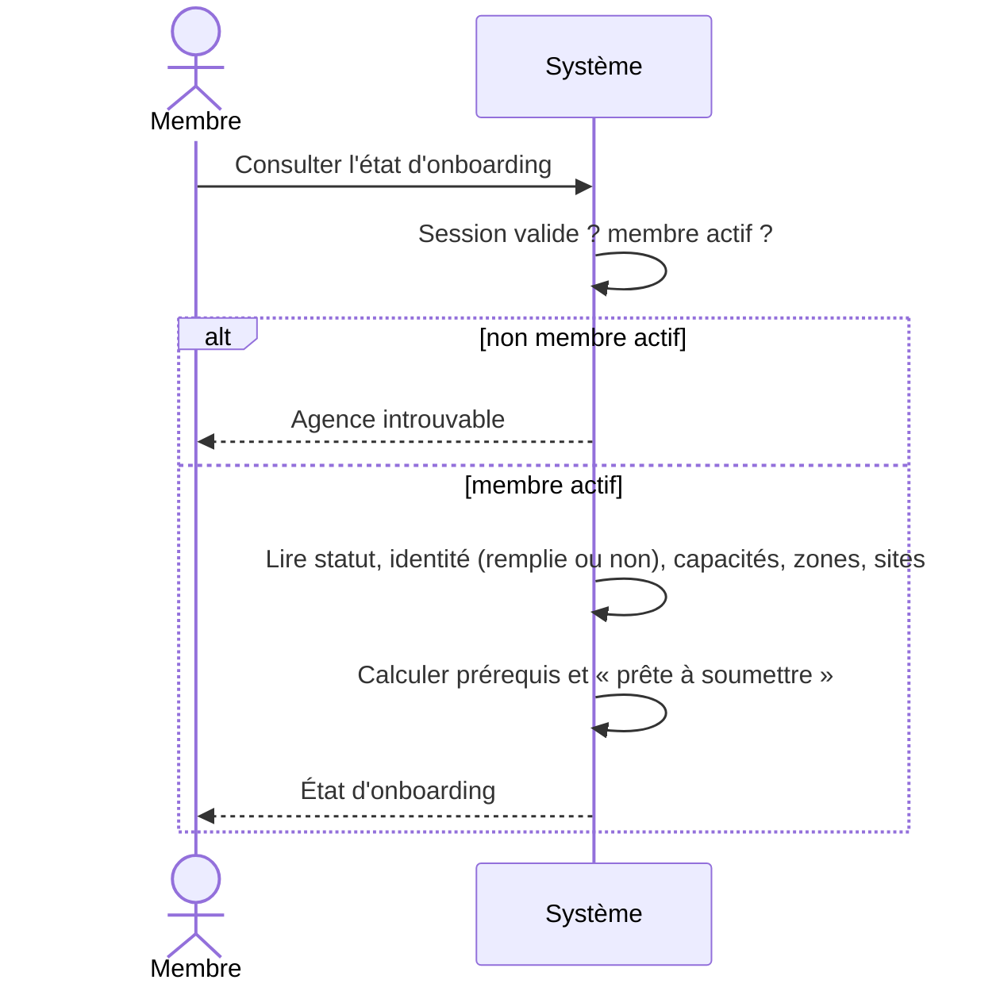

# UC-02-09 — Consulter l'état d'onboarding

| Champ | Valeur |
|---|---|
| Statut | Brouillon (en attente de Q-01, Q-02, Q-08) |
| Priorité | Must |
| Domaine | `agencies` (query sur un port de lecture) |
| Tâche | B2.9 |
| Date | 2026-11-04 |
| Use cases liés | UC-02-01 à UC-02-08 (alimentent l'état) ; UC-02-05 (même calcul des prérequis) |
| Exigences couvertes | UC-02-09 (ajouté, anomalie A-01), RM-02-01, RM-02-02, RM-02-03, RM-02-04, EX-02-001, EX-02-003, EX-02-011, EX-02-013 |

## 0. Traçabilité

| Exigence | Source | Où elle est traitée |
|---|---|---|
| UC-02-09 | F02 §API (`GET /agencies/{id}/onboarding`) ; PH B2.9 | §8 ; scénarios 1, 2, 4 |
| RM-02-01 | F02 §Règles | RG-02-09-05 ; scénario 6 |
| RM-02-02 | F02 §Règles | RG-02-09-02 (prérequis) ; scénarios 1, 2 |
| RM-02-03 | F02 §Règles | RG-02-09-03 ; scénario 5 |
| RM-02-04 | F02 §Règles | RG-02-09-04 ; scénario 3 |
| EX-02-001 | ARC3 | scénario 7 |
| EX-02-013 | RM-01-05 | scénario 8 |
| EX-02-003, 011 | CDX ; ARC5 | RG-02-09-06 ; scénario 9 |

## 1. Objectif

Donner à l'équipe une vue unique de l'avancement : où en est l'agence, ce qui manque pour la soumettre, quelles capacités sont actives.

## 2. User story

> En tant que **membre d'une agence**, je veux **voir l'état d'onboarding de mon agence**, afin de **savoir ce qui reste à faire avant la soumission**.

## 3. Acteurs

Principal : tout membre actif (propriétaire, administrateur, agent).

## 4. Déclencheur

Le membre consulte l'état d'onboarding de l'agence.

## 5. Préconditions

P1 : session valide ; P2 : membre actif de l'agence.

## 6. Postconditions

Lecture seule : aucune écriture, aucune trace d'audit **[HYPOTHÈSE]** (les lectures ne sont pas auditées en B2).

## 7. Règles métier

| ID | Règle | Exemple | Source |
|---|---|---|---|
| RG-02-09-01 | L'état contient : statut (brouillon / soumise), date et auteur de soumission le cas échéant, liste des prérequis avec rempli/manquant, indicateur « prête à soumettre », état de chaque capacité, indicateur hybride, nombre de zones actives, nombre de sites actifs. | Brouillon, 2 prérequis manquants, livraison active, 1 zone, 0 site, prête = non. | F02 §API ; PH B2.9 |
| RG-02-09-02 | Les prérequis et « prête à soumettre » suivent exactement la règle de soumission (RG-02-05-02, **[HYPOTHÈSE]** D-04). | Dossier complet → prête = oui ; la soumission réussit. | RM-02-02 ; Q-01, Q-02 |
| RG-02-09-03 | Une capacité suspendue apparaît comme suspendue (date, motif) et « n'accepte pas de nouvelles demandes ». | Livraison suspendue le 2026-11-20, motif « Manque de livreurs ». | RM-02-03 |
| RG-02-09-04 | L'état ne contient aucune mention « vérifiée », « certifiée », « assurée » ou « garantie » ; une agence soumise est « soumise à vérification ». | Après soumission : « soumise à vérification ». | RM-02-04 |
| RG-02-09-05 | Un brouillon reste brouillon sans limite de durée **[HYPOTHÈSE]** (Q-08). | Brouillon créé le 2026-08-01, consulté le 2026-11-04 → brouillon. | RM-02-01 |
| RG-02-09-06 | Projection minimale : les prérequis d'identité sont indiqués « rempli / manquant » sans leurs valeurs ; aucune donnée d'une autre agence. Lecture : tout membre actif ; ancien membre et autre agence : introuvable. | L'état dit « téléphone principal : rempli », pas le numéro. | EX-02-001, 003 ; ARC3 |

## 8. Flux nominal

1. Le membre demande l'état d'onboarding.
2. Le système vérifie session et membership actif.
3. Le système lit la projection de l'agence (statut, identité remplie ou non, capacités, zones et sites actifs).
4. Le système calcule les prérequis et « prête à soumettre ».
5. Le système renvoie l'état.

## 9. Flux alternatifs

- A1 — Agence soumise (étape 3) : l'état indique la date et l'auteur de la soumission ; « prête à soumettre » n'a plus d'objet (faux).

## 10. Flux d'exception

- E1 — Session invalide : 401.
- E2 — Non membre, ancien membre, autre agence, agence inexistante : introuvable (404), réponse identique dans tous les cas.

## 11. Workflow



## 12. Scénarios d'acceptation (Gherkin)

Copie conforme de [features/consulter-etat-onboarding.feature](features/consulter-etat-onboarding.feature).

```gherkin
# language: fr
@UC-02-09 @B2.9
Fonctionnalité: Consulter l'état d'onboarding
  Afin de savoir ce qui reste à faire avant la soumission
  En tant que membre d'une agence
  Je veux voir l'état d'onboarding de mon agence

  Contexte:
    Étant donné l'agence "Express Douala" au statut brouillon
    Et "Awa Ngono" propriétaire active de "Express Douala"
    Et "Céline Fotso" agente active de "Express Douala"

  @nominal @RG-02-09-01 @RG-02-09-02 @RM-02-02
  Scénario: Un brouillon incomplet montre les prérequis manquants
    Étant donné "Express Douala" a une identité complète sauf le téléphone principal
    Et la capacité livraison de "Express Douala" est active avec la zone "Douala / Akwa"
    Et "Express Douala" ne possède aucun site actif
    Quand "Awa Ngono" consulte l'état d'onboarding de "Express Douala"
    Alors le statut affiché est brouillon
    Et les prérequis manquants sont « téléphone principal » et « au moins un site actif »
    Et l'agence n'est pas prête à être soumise

  @nominal @RG-02-09-02
  Scénario: Un brouillon complet est prêt à être soumis
    Étant donné "Express Douala" a un dossier complet
    Quand "Awa Ngono" consulte l'état d'onboarding de "Express Douala"
    Alors aucun prérequis ne manque
    Et l'agence est prête à être soumise

  @alternatif @RG-02-09-04 @RM-02-04
  Scénario: Une agence soumise est présentée comme soumise à vérification, sans garantie
    Étant donné "Express Douala" soumise à vérification le "2026-11-15" par "Awa Ngono"
    Quand "Awa Ngono" consulte l'état d'onboarding de "Express Douala"
    Alors l'état indique « soumise à vérification » depuis le "2026-11-15" par "Awa Ngono"
    Et aucune mention de vérification acquise, de certification ou d'assurance n'apparaît

  @nominal @RG-02-09-06
  Scénario: Une agente consulte l'état d'onboarding
    Étant donné la capacité livraison de "Express Douala" est active
    Quand "Céline Fotso" consulte l'état d'onboarding de "Express Douala"
    Alors elle voit le statut brouillon et la livraison active

  @alternatif @RG-02-09-03 @RM-02-03
  Scénario: Une capacité suspendue apparaît fermée aux nouvelles demandes
    Étant donné les capacités livraison et stockage de "Express Douala" actives
    Et la livraison suspendue le "2026-11-20" pour le motif "Manque de livreurs"
    Quand "Awa Ngono" consulte l'état d'onboarding de "Express Douala"
    Alors la livraison apparaît suspendue depuis le "2026-11-20" pour "Manque de livreurs"
    Et la livraison n'accepte pas de nouvelles demandes
    Et "Express Douala" n'est pas présentée comme hybride

  @alternatif @RG-02-09-05 @RM-02-01
  Scénario: Un brouillon ancien reste un brouillon
    Étant donné "Express Douala" créée le "2026-08-01" et jamais soumise
    Quand "Awa Ngono" consulte l'état d'onboarding le "2026-11-04"
    Alors le statut affiché est brouillon

  @erreur @securite @RG-02-09-06 @EX-02-001
  Plan du scénario: Une personne sans accès actif ne trouve pas l'état d'onboarding
    Étant donné <situation>
    Quand "<personne>" consulte l'état d'onboarding de "Express Douala"
    Alors l'agence "Express Douala" lui est introuvable
    Et aucune donnée de "Express Douala" ne lui est renvoyée

    Exemples:
      | personne      | situation                                                    |
      | Ibrahim Bello | "Ibrahim Bello" propriétaire de "Rapide Yaoundé" uniquement  |
      | Jean Etoa     | "Jean Etoa" ancien administrateur de "Express Douala"        |

  @erreur @securite @EX-02-013
  Scénario: Un visiteur non connecté ne peut pas consulter l'état d'onboarding
    Étant donné un visiteur non connecté
    Quand le visiteur consulte l'état d'onboarding de "Express Douala"
    Alors une connexion lui est demandée
    Et aucune donnée de "Express Douala" ne lui est renvoyée

  @nominal @securite @RG-02-09-06
  Scénario: L'état indique les prérequis remplis sans en révéler les valeurs
    Étant donné "Express Douala" a le téléphone principal "+237677123456"
    Quand "Céline Fotso" consulte l'état d'onboarding de "Express Douala"
    Alors le prérequis « téléphone principal » apparaît rempli
    Et le numéro "+237677123456" n'apparaît pas dans l'état
```

## 13. Plan de tests TDD

| # | Niveau | Comportement | Étant donné | Quand | Alors | Règle |
|---|---|---|---|---|---|---|
| 1 | unit (domaine) | Calcul des prérequis | 8 combinaisons (complet, chaque manque, capacité suspendue) | évaluer | liste et « prête » exactes, identiques à la soumission | RG-02-09-02 |
| 2 | unit (domaine) | Pas de garantie | agence soumise | évaluer | aucun attribut vérifiée/assurée | RG-02-09-04 |
| 3 | E2E | Brouillon incomplet | téléphone et site manquants | GET état | 200, deux manques, prête = faux | RG-02-09-01, 02 |
| 4 | E2E | Brouillon complet puis soumis | dossier complet | GET état ; soumettre ; GET état | prête = vrai ; puis statut soumise, date, auteur | RG-02-09-02, 04 |
| 5 | E2E | Capacité suspendue | hybride puis livraison suspendue | GET état | livraison suspendue, motif, hybride = faux | RG-02-09-03 |
| 6 | E2E | Lecture par chaque rôle | propriétaire, admin, agent | GET état | 200 pour les trois | RG-02-09-06 |
| 7 | E2E | Isolation | autre agence ; ancien membre ; agence inexistante | GET état | 404 identiques, corps sans donnée | RG-02-09-06 |
| 8 | E2E | 401 | sans jeton ; session déconnectée | GET état | 401 | EX-02-013 |
| 9 | E2E | Projection minimale | identité complète | GET état | clés du corps limitées à l'allowlist ; aucune valeur d'identité | RG-02-09-06 |

## 14. Données

Entrée : aucune (agence désignée, validée par membership).
Sortie **[HYPOTHÈSE]** : `statut`, `soumission { date, auteur }` ou vide, `prerequis [{ code, rempli }]`, `pretePourSoumission`, `capacites [{ type, etat, depuis, motif?, accepteNouvellesDemandes }]`, `hybride`, `zonesActives` (nombre), `sitesActifs` (nombre).

## 15. Exigences non fonctionnelles

- Une seule lecture par requête, filtrée par `agencyId` dès l'entrée ; aucune liste non bornée dans la réponse (nombres seulement).

## 16. Hors périmètre

Vue de la plateforme sur toutes les agences (B10, UC-15-01) ; historique détaillé des actions (journal d'audit, B10) ; fiche publique (B3).

## 17. Questions ouvertes

| # | Question | Hypothèse retenue | Impact si différent |
|---|---|---|---|
| Q-01, Q-02 | Prérequis de soumission ? | Voir UC-02-05. | Liste des prérequis affichés. |
| Q-08 | Un brouillon expire-t-il ? | Non. | Tâche planifiée d'archivage. |
| Q-19 | Les lectures sensibles doivent-elles être auditées ? | Non en B2. | Trace de lecture. |

## 18. Notes pour le tech lead

- Query `get-onboarding-state` sur un port de lecture (`read-agency-onboarding.repository.ts`) ; le calcul des prérequis réutilise la règle du domaine (pas de duplication en SQL).
- Testée en E2E uniquement (lecture), plus les tests unitaires de la règle de domaine.

Definition of Ready :
- [x] Chaque exigence de la section 0 a au moins un scénario
- [x] Chaque règle a un exemple
- [x] Chaque flux d'exception a un scénario
- [x] Aucune question bloquante propre à ce cas (dépend de D-04 via UC-02-05)
- [x] Le plan TDD couvre chaque règle
- [x] Le `.feature` est synchronisé avec la section 12
