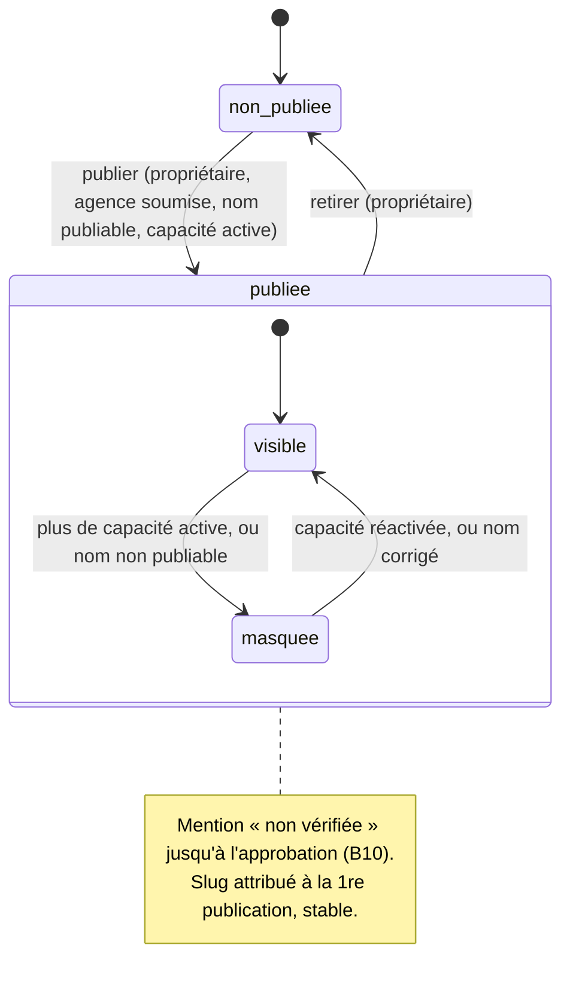

# UC-03-01 — Publier la fiche publique de l'agence

| Champ | Valeur |
|---|---|
| Statut | Brouillon (en attente de Q-36, Q-38, Q-39, Q-40, Q-41) |
| Priorité | Must |
| Domaine | `marketplace` (projection publique) ; lit `agencies` et `pricing` |
| Tâche | B3.9 |
| Date | 2026-11-04 |
| Use cases liés | UC-02-05 (soumission) ; UC-02-06 (profil) ; UC-03-02, 03, 04 (lecture publique) ; UC-15-03, 04, 06 (B10 : approbation, suspension, modération) |
| Exigences couvertes | UC-03-01, RM-03-01, RM-03-05, RM-02-04, EX-03-002, 003, 005 à 008, 010 à 014 |

## 0. Traçabilité

| Exigence | Source | Où elle est traitée |
|---|---|---|
| UC-03-01 | F03 §1 ; PH B3.9 | §8 ; scénario 1 |
| RM-03-01 | F03 §Règles ; ARC1 ADR-10 | RG-03-01-03 ; scénario 2 |
| RM-03-05 | F03 §Règles | RG-03-01-03 (mention des tarifs) ; UC-03-04 |
| RM-02-04 | F02 §Règles | RG-03-01-02 ; scénario 1 |
| EX-03-008 (D-05 publication) | PG Décisions prises 2026-11-04 | RG-03-01-01, 02 ; scénarios 1, 6 |
| EX-03-005 (description en texte) | revue sécurité B2 (PG B3.9) | RG-03-01-13 ; scénario 16 |
| EX-03-006 (caractères de format) | revue sécurité B2 | RG-03-01-04 ; scénario 8 |
| EX-03-007 (nom provisoire) | revue sécurité B2 | RG-03-01-05 ; scénario 7 |
| EX-03-002 (liste fermée) | ADR-10 ; revue sécurité B2 | RG-03-01-03 ; scénario 2 ; test 14 |
| EX-03-014 (concurrence) | F03 §1 | scénarios 12, 13 |
| EX-03-010 (projection à jour) | ARC6 | RG-03-01-11 ; scénarios 4, 10 |
| EX-03-011, 012, 013 | ARC3 ; CL | scénarios 14, 15, 17 ; tests 12, 13 |

## 1. Objectif

Rendre l'agence trouvable sur la marketplace, en n'exposant que des informations explicitement autorisées, et en signalant clairement qu'elle n'est pas encore vérifiée.

## 2. User story

> En tant que **propriétaire d'agence**, je veux **publier la fiche de mon agence soumise**, afin d'**être trouvé par des clients et des commerçants, sans exposer mes données internes**.

## 3. Acteurs

Principal : propriétaire actif (D-05 : « son propriétaire publie sa fiche »). Administrateur et agent : refusés **[HYPOTHÈSE]** (Q-39). Secondaire : visiteur public (lit la fiche, UC-03-04).

## 4. Déclencheur

Le propriétaire décide de publier (ou de retirer) la fiche.

## 5. Préconditions

- P1 : session valide ; P2 : membre actif ; P3 : propriétaire.
- P4 : agence **soumise** (ou approuvée, B10) — D-05.
- P5 : nom commercial publiable (non provisoire, sans caractère de contrôle ni de format).
- P6 : au moins une capacité active **[HYPOTHÈSE]** (Q-40).

## 6. Postconditions

- Succès : fiche publiée, adresse publique (slug) attribuée et stable ; visible en recherche et en consultation avec la mention « non vérifiée » ; trace « fiche publiée ».
- Retrait : fiche non publiée, introuvable publiquement ; slug réservé ; trace « fiche retirée ».
- Échec : rien ne change, aucune trace.

## 7. Règles métier

| ID | Règle | Exemple | Source |
|---|---|---|---|
| RG-03-01-01 | **D-05** Une agence est publiable dès qu'elle est **soumise** (et le restera approuvée, B10) et que son propriétaire publie ; un brouillon ne l'est pas. | Express Douala soumise → publiable ; Colis Bafoussam brouillon → refus. | D-05 |
| RG-03-01-02 | **D-05, RM-02-04** La fiche affiche « non vérifiée » tant que l'admin plateforme n'a pas approuvé l'agence (B10) ; jamais « garantie », « assurée » ni « certifiée ». | Express Douala soumise → « non vérifiée ». | D-05 ; RM-02-04 |
| RG-03-01-03 | **RM-03-01, ADR-10** La fiche ne contient **que** : adresse publique (slug), nom commercial, description (texte brut), mention de vérification, capacités actives (et « hybride »), zones desservies actives (ville, quartier), **villes** des sites actifs **[HYPOTHÈSE]**, tarifs indicatifs « à partir de » avec la mention « non garantis sans devis » (RM-03-05), date de publication. Rien d'autre : ni clients, ni membres, ni raison sociale **[HYPOTHÈSE]**, ni RCCM, NIU, téléphone, e-mail, adresse du siège, adresses ou téléphones des sites, motifs de suspension, versions, identifiant interne d'agence **[HYPOTHÈSE]** (Q-36). | Fiche Express Douala : pas de « +237 677 12 34 56 », pas de « RC/DLA/2024/B/1234 ». | RM-03-01 ; ADR-10 ; revue sécurité B2 |
| RG-03-01-04 | **Revue sécurité B2** Un nom commercial contenant un caractère de **format** Unicode (`\p{Cf}` : marques bidi comme U+202E, espaces de largeur nulle U+200B, U+200D, U+FEFF) ou de contrôle n'est pas publiable : publication refusée ; une fiche publiée dont le nom devient non publiable est **masquée** jusqu'à correction **[HYPOTHÈSE]** (Q-45). | « Express‮alauoD » → refus. | revue sécurité B2 ; B2.13 |
| RG-03-01-05 | **Revue sécurité B2** Une agence au **nom provisoire** issu de la migration n'est pas publiable. Nom provisoire = exactement « Agence » suivi d'une espace et des 8 premiers caractères de son identifiant **[HYPOTHÈSE]** (Q-41) ; le changer par le profil (UC-02-06) lève l'obstacle. | « Agence 3f9a1c2e » pour l'agence `3f9a1c2e-…` → refus. | migration `1793777474207` ; revue sécurité B2 |
| RG-03-01-06 | **[HYPOTHÈSE]** (Q-40) Publier exige au moins une capacité active ; une fiche publiée dont toutes les capacités sont suspendues est **masquée** (sans être dépubliée) et réapparaît à la réactivation. | Livraison suspendue, seule capacité → fiche introuvable ; réactivée → visible. | RM-02-03 |
| RG-03-01-07 | **[HYPOTHÈSE]** (Q-38) Le slug est calculé à la **première** publication depuis le nom : minuscules, sans accents, mots séparés par « - », 3 à 80 caractères ; unique sur toute la plateforme (suffixe « -2 », « -3 »…) ; **stable** ensuite (un changement de nom ne le modifie pas) ; jamais réattribué. | « Express Douala » → `express-douala` ; seconde « Express Douala » → `express-douala-2`. | F03 §API (`{slug}`) ; A-28 |
| RG-03-01-08 | **[HYPOTHÈSE]** Le propriétaire peut **retirer** la fiche : elle devient introuvable publiquement ; la republier garde le même slug. | Retrait puis republication → `express-douala`. | A-28 |
| RG-03-01-09 | Publier une fiche déjà publiée, ou retirer une fiche non publiée → conflit, sans second effet ni seconde trace. Deux publications simultanées → une seule. | Second « publier » → refus. | D-14 (analogie) |
| RG-03-01-10 | Propriétaire seul (D-05) ; administrateur et agent refusés (403) ; ancien membre, autre agence → introuvable (404). | Paul (admin) → refus ; Ibrahim → introuvable. | D-05 ; EX-03-011 |
| RG-03-01-11 | La fiche publiée reflète sans republication les changements de profil, de zones, de capacités, de sites et de grille (au plus tard à la lecture suivante) **[HYPOTHÈSE]**. | Nom changé → nouveau nom affiché, même slug. | ARC6 ; EX-03-010 |
| RG-03-01-12 | Publication et retrait sont audités (« fiche publiée », « fiche retirée »). | — | EX-03-013 |
| RG-03-01-13 | **Revue sécurité B2** La description est publiée **comme du texte** : le balisage saisi est conservé tel quel, jamais interprété ni transformé en HTML par l'API ; tout affichage l'échappe. | « <b>Promo</b> » est restitué tel quel et affiché comme texte. | `routes/agences-onboarding.md` §Profil ; revue sécurité B2 |

## 8. Flux nominal

1. Le propriétaire demande la publication de la fiche (action sans contenu).
2. Le système vérifie session, membership actif, rôle propriétaire (P1 à P3).
3. Le système verrouille l'agence et vérifie : soumise (P4), nom publiable (P5), capacité active (P6), fiche non publiée (RG-03-01-09).
4. Si aucun slug n'existe, le système le calcule et le réserve (RG-03-01-07).
5. Le système marque la fiche publiée (date, auteur).
6. Le système écrit la trace et renvoie la fiche telle que le public la verra.

## 9. Flux alternatifs

- A1 — Republication après retrait (étape 4) : le slug existant est réutilisé.
- A2 — Retrait : le propriétaire retire la fiche ; contrôles des étapes 2-3 (fiche publiée) ; elle devient introuvable ; trace « fiche retirée ».
- A3 — Après publication, toutes les capacités sont suspendues ou le nom devient non publiable : fiche masquée sans changer son état publié (RG-03-01-04, 06).

## 10. Flux d'exception

- E1 — Session invalide : 401. E2 — Ancien membre, autre agence : 404. E3 — Administrateur, agent : 403.
- E4 — Brouillon : 409 `AGENCY_NOT_SUBMITTED`. E5 — Nom provisoire : 409 `PROVISIONAL_TRADE_NAME`. E6 — Nom avec caractère de format ou de contrôle : 409 `TRADE_NAME_NOT_PUBLISHABLE` **[HYPOTHÈSE]** (c'est l'état de l'agence, pas la requête, qui est en cause). E7 — Aucune capacité active : 409 `NO_ACTIVE_CAPABILITY`.
- E8 — Déjà publiée : 409 `PROFILE_ALREADY_PUBLISHED` ; retrait d'une fiche non publiée : 409 `PROFILE_NOT_PUBLISHED`.
- E9 — Contenu non vide : 400.

## 11. Workflow



## 12. Scénarios d'acceptation (Gherkin)

Copie conforme de [features/publier-fiche-publique.feature](features/publier-fiche-publique.feature).

```gherkin
# language: fr
@UC-03-01 @B3.9
Fonctionnalité: Publier la fiche publique de l'agence
  Afin d'être trouvé par des clients sans exposer mes données internes
  En tant que propriétaire d'agence
  Je veux publier la fiche de mon agence soumise

  Contexte:
    Étant donné l'agence "Express Douala" soumise à vérification, non approuvée
    Et "Express Douala" a la livraison active, les zones "Douala / Akwa" et "Douala / Bonabéri" et le site "Agence Akwa" à "Douala"
    Et "Awa Ngono" propriétaire active de "Express Douala"
    Et "Paul Mbarga" administrateur actif de "Express Douala"
    Et "Céline Fotso" agente active de "Express Douala"
    Et la fiche de "Express Douala" n'est pas publiée

  @nominal @RG-03-01-01 @RG-03-01-02 @RG-03-01-07 @D-05
  Scénario: La propriétaire publie la fiche d'une agence soumise
    Quand "Awa Ngono" publie la fiche de "Express Douala"
    Alors la fiche publique "express-douala" est visible par un visiteur non connecté
    Et elle porte la mention « non vérifiée »

  @nominal @securite @RG-03-01-03 @RM-03-01
  Scénario: La fiche ne contient que les informations autorisées
    Étant donné l'identité de "Express Douala" : téléphone "+237677123456", RCCM "RC/DLA/2024/B/1234", NIU "M012345678901A", adresse du siège "Rue Joss, face pharmacie"
    Quand "Awa Ngono" publie la fiche de "Express Douala"
    Alors la fiche publique "express-douala" contient le nom, la description, la mention de vérification, la livraison, les zones, la ville "Douala" et les tarifs indicatifs
    Et elle ne contient ni téléphone, ni e-mail, ni RCCM, ni NIU, ni adresse, ni membre, ni client

  @alternatif @RG-03-01-07
  Scénario: Deux agences de même nom reçoivent des adresses publiques distinctes
    Étant donné une autre agence soumise nommée "Express Douala" dont la fiche "express-douala" est déjà publiée
    Quand "Awa Ngono" publie la fiche de son agence "Express Douala"
    Alors la fiche de son agence est publiée à l'adresse "express-douala-2"

  @alternatif @RG-03-01-07 @RG-03-01-11
  Scénario: Changer de nom ne change pas l'adresse publique
    Étant donné la fiche "express-douala" publiée
    Quand "Paul Mbarga" renomme l'agence "Express Douala & Littoral"
    Alors la fiche publique "express-douala" affiche le nom "Express Douala & Littoral"

  @alternatif @RG-03-01-08
  Scénario: Retirer puis republier conserve l'adresse publique
    Étant donné la fiche "express-douala" publiée
    Et "Awa Ngono" a retiré la fiche de "Express Douala"
    Quand "Awa Ngono" publie de nouveau la fiche de "Express Douala"
    Alors la fiche publique "express-douala" est de nouveau visible

  @erreur @RG-03-01-01 @D-05
  Scénario: Une agence en brouillon ne peut pas être publiée
    Étant donné l'agence "Colis Bafoussam" au statut brouillon dont "Awa Ngono" est propriétaire
    Quand "Awa Ngono" publie la fiche de "Colis Bafoussam"
    Alors la publication est refusée car l'agence n'est pas soumise

  @erreur @securite @RG-03-01-05
  Scénario: Une agence au nom provisoire ne peut pas être publiée
    Étant donné "Express Douala" porte encore le nom provisoire « Agence » suivi des 8 premiers caractères de son identifiant
    Quand "Awa Ngono" publie la fiche de "Express Douala"
    Alors la publication est refusée car le nom est provisoire

  @erreur @securite @RG-03-01-04
  Plan du scénario: Un nom contenant un caractère de format invisible n'est pas publiable
    Étant donné le nom commercial de "Express Douala" contient le caractère <caractère>
    Quand "Awa Ngono" publie la fiche de "Express Douala"
    Alors la publication est refusée car le nom n'est pas publiable

    Exemples:
      | caractère                          |
      | U+202E (inversion droite-gauche)   |
      | U+200B (espace de largeur nulle)   |
      | U+FEFF (indicateur d'ordre)        |

  @erreur @RG-03-01-06
  Scénario: Une agence sans capacité active ne peut pas être publiée
    Étant donné la seule capacité de "Express Douala", la livraison, est suspendue
    Quand "Awa Ngono" publie la fiche de "Express Douala"
    Alors la publication est refusée car aucune capacité n'est active

  @alternatif @RG-03-01-06
  Scénario: Une fiche publiée sans capacité active est masquée
    Étant donné la fiche "express-douala" publiée
    Quand "Paul Mbarga" suspend la livraison, seule capacité active de "Express Douala"
    Alors la fiche publique "express-douala" est introuvable
    Et la fiche de "Express Douala" reste publiée

  @erreur @RG-03-01-09
  Scénario: Une fiche déjà publiée ne se publie pas une seconde fois
    Étant donné la fiche "express-douala" publiée par "Awa Ngono" le 2026-11-12
    Quand "Awa Ngono" publie la fiche de "Express Douala"
    Alors la publication est refusée car la fiche est déjà publiée
    Et la date de publication reste le 2026-11-12

  @concurrence @RG-03-01-09
  Scénario: Deux publications simultanées n'en retiennent qu'une
    Quand "Awa Ngono" publie deux fois en même temps la fiche de "Express Douala"
    Alors la fiche est publiée une seule fois
    Et le journal d'audit contient une seule trace « fiche publiée »

  @concurrence @RG-03-01-07
  Scénario: Deux agences homonymes publiées en même temps reçoivent des adresses distinctes
    Étant donné une autre agence soumise nommée "Express Douala" dont "Ibrahim Bello" est propriétaire
    Quand "Awa Ngono" et "Ibrahim Bello" publient en même temps la fiche de leur agence
    Alors les deux fiches sont publiées aux adresses "express-douala" et "express-douala-2"

  @erreur @securite @RG-03-01-10 @D-05
  Plan du scénario: Seule la propriétaire publie la fiche
    Quand "<personne>" publie la fiche de "Express Douala"
    Alors l'action lui est refusée comme non autorisée
    Et la fiche de "Express Douala" n'est pas publiée

    Exemples:
      | personne     |
      | Paul Mbarga  |
      | Céline Fotso |

  @erreur @securite @RG-03-01-10
  Plan du scénario: Une personne sans accès actif ne trouve pas l'agence
    Étant donné <situation>
    Quand "<personne>" publie la fiche de "Express Douala"
    Alors l'agence "Express Douala" lui est introuvable

    Exemples:
      | personne      | situation                                                   |
      | Ibrahim Bello | "Ibrahim Bello" propriétaire de "Rapide Yaoundé" uniquement |
      | Jean Etoa     | "Jean Etoa" ancien administrateur de "Express Douala"       |

  @alternatif @securite @RG-03-01-13
  Scénario: Une description contenant du balisage est publiée comme du texte
    Étant donné la description de "Express Douala" est "<script>alert(1)</script> Livraison 7j/7"
    Quand "Awa Ngono" publie la fiche de "Express Douala"
    Alors la fiche publique restitue la description exactement comme ce texte
    Et aucun balisage n'est interprété à l'affichage

  @nominal @RG-03-01-12
  Scénario: La publication est tracée
    Quand "Awa Ngono" publie la fiche de "Express Douala"
    Alors le journal d'audit contient « fiche publiée » par "Awa Ngono" pour "Express Douala"
```

## 13. Plan de tests TDD

| # | Niveau | Comportement | Étant donné | Quand | Alors | Règle |
|---|---|---|---|---|---|---|
| 1 | unit (VO `PublicSlug`) | Calcul du slug | — | « Express Douala », « Éco & Rapide », « A », 200 caractères | `express-douala` ; `eco-rapide` ; trop court → `invalid` ; tronqué à 80 sans tiret final | RG-03-01-07 |
| 2 | unit (domaine) | Collision | slugs pris `express-douala`, `-2` | calculer | `express-douala-3` | RG-03-01-07 |
| 3 | unit (domaine) | Nom publiable | — | U+202E, U+200B, U+200D, U+FEFF, NUL ; « Agence 3f9a1c2e » pour l'id `3f9a1c2e-…` ; « Agence 3f9a1c2e » pour un autre id | non publiable ×5 ; provisoire ; publiable | RG-03-01-04, 05 |
| 4 | unit (domaine) | Préconditions | agence brouillon ; sans capacité active | publier | `conflict` ×2 | RG-03-01-01, 06 |
| 5 | unit (domaine) | Publier, retirer | fiche non publiée ; publiée | publier ×2 ; retirer ×2 | publiée puis `conflict` ; retirée puis `conflict` ; slug conservé | RG-03-01-08, 09 |
| 6 | unit (mapper) | Liste fermée | agence complète (identité, membres, motifs) | projeter | exactement les champs autorisés (comparaison de l'ensemble des clés) | RG-03-01-03 |
| 7 | unit (mapper) | Mention de vérification | soumise ; approuvée (futur B10) | projeter | « non vérifiée » ; « vérifiée » ; aucun libellé « garantie/assurée » | RG-03-01-02 |
| 8 | unit (application) | Droits | fakes | propriétaire ; admin ; agent ; ancien membre ; autre agence | OK ; `forbidden` ×2 ; `not_found` ×2 | RG-03-01-10 |
| 9 | unit (application) | Audit | fakes | publier ; retirer ; refus | une trace chacun ; aucune | RG-03-01-12 |
| 10 | feature (PostgreSQL) | Unicité du slug | — | deux publications homonymes simultanées | slugs distincts (index unique, nouvelle tentative avec suffixe) | RG-03-01-07 |
| 11 | feature (PostgreSQL) | Double publication | — | deux publications simultanées | une seule (verrou de l'agence, mise à jour conditionnée) | RG-03-01-09 |
| 12 | E2E | 200, 400, 401 | — | publier ; corps non vide ; sans jeton | codes attendus | RG-03-01-01 |
| 13 | E2E | 403, 404, 409 | — | admin ; agent ; autre agence ; ancien membre ; brouillon ; nom provisoire ; nom avec U+202E ; sans capacité ; déjà publiée | 403 ×2 ; 404 ×2 ; 409 ×5 | RG-03-01-01, 04 à 06, 09, 10 |
| 14 | E2E | Anti-fuite | identité, membres, motif de suspension, grille remplis | lire la fiche publique | l'ensemble des clés JSON est exactement la liste autorisée ; aucune valeur d'identité n'apparaît dans le corps | RG-03-01-03 |
| 15 | E2E | Description texte, projection à jour | description avec `<script>` ; nom modifié après publication | lire la fiche | description identique octet pour octet, `Content-Type: application/json` ; nouveau nom, même slug | RG-03-01-11, 13 |

## 14. Données

Entrée : aucune (action sans contenu, agence dans le chemin).
Sortie : la fiche telle que publiée (voir UC-03-04 §14) avec l'état `published`, la date de publication et le slug.

## 15. Exigences non fonctionnelles

- Publication sous le verrou de la ligne de l'agence (même verrou que la configuration en B2).
- Aucun champ ajouté à la projection sans mise à jour de la liste fermée et du test anti-fuite (test 14).

## 16. Hors périmètre

Approbation, rejet, suspension et modération par l'admin plateforme (B10, UC-15-03 à 06) ; logo, photos, horaires ; contact public de l'agence (Q-36) ; demandes de prestation depuis la fiche (B4) ; notification de publication.

## 17. Questions ouvertes

| # | Question | Hypothèse retenue | Impact si différent |
|---|---|---|---|
| Q-36 | Contenu exact de la fiche (liste fermée) ? Raison sociale, contact public ? | Liste de RG-03-01-03 ; ni raison sociale ni contact. | Ajouts à la liste fermée, test anti-fuite. |
| Q-38 | Slug calculé, stable, jamais réattribué ? | Oui. | Redirections, slug choisi par l'agence. |
| Q-39 | L'administrateur peut-il publier ou retirer ? | Non (D-05 : propriétaire). | Matrice des droits. |
| Q-40 | Capacité active exigée ; fiche masquée sans capacité active ? | Oui et oui. | Fiche affichée « aucun service disponible ». |
| Q-41 | Définition du nom provisoire ? | « Agence » + 8 premiers caractères de l'identifiant. | Indicateur explicite posé par la migration. |
| Q-45 | Nom devenu non publiable après publication (avant B2.13) : masquer ? | Oui ; recommandation : livrer B2.13 avant ou avec B3.9. | Contrôle à la modification du profil seulement. |

## 18. Notes pour le tech lead

- **Anomalie A-20** : la note de B3.9 dans `progress.md` dit « ne publier que les agences approuvées » ; la décision D-05 du 2026-11-04 (soumise + mention « non vérifiée ») la remplace.
- Projection : table de projection dans `marketplace` alimentée par les événements de `agencies` et `pricing` dans la transaction (in-process), **ou** requête de lecture sur un port exposé par ces modules ; jamais lecture directe des tables d'un autre module (`CLAUDE.md`). À trancher en S2.
- L'état « publié » et le slug appartiennent à `marketplace` (agrégat candidat `AgencyPublicProfile`) ; la règle « propriétaire seul » se lit sur l'équipe exposée par `agencies`.

Definition of Ready :
- [x] Chaque exigence de la section 0 a au moins un scénario
- [x] Chaque règle a un exemple
- [x] Chaque flux d'exception a un scénario (E1, E9 : test 12)
- [ ] Aucune question bloquante (Q-36, Q-40)
- [x] Le plan TDD couvre chaque règle
- [x] Le `.feature` est synchronisé avec la section 12
