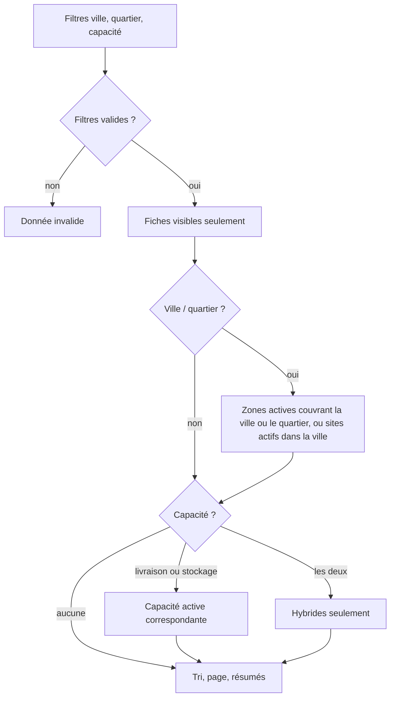

# UC-03-03 — Filtrer les agences par zone et par capacité

| Champ | Valeur |
|---|---|
| Statut | Brouillon (en attente de Q-43) |
| Priorité | Must |
| Domaine | `marketplace` (lecture publique) |
| Tâche | B3.11 (+ B3.13 : index) |
| Date | 2026-11-04 |
| Use cases liés | UC-03-02 (recherche, pagination) ; UC-02-03, UC-05-02, 03 (zones) ; UC-02-04, 07 (capacités) ; UC-02-08 (sites) |
| Exigences couvertes | UC-03-03, RM-03-01, RM-02-03, RM-05-02, EX-03-001, 003, 004, 006, 009 |

## 0. Traçabilité

| Exigence | Source | Où elle est traitée |
|---|---|---|
| UC-03-03 | F03 §3 ; PH B3.11 | §8 ; scénarios 1 à 4 |
| RM-02-03 | F02 §Règles (capacité suspendue) | RG-03-03-03 ; scénario 5 |
| RM-05-02 | F05 §Règles (zone inactive) | RG-03-03-04 ; scénario 6 |
| EX-03-004 (filtres en liste fermée) | ARC5 ; consigne B3 | RG-03-03-05, 06 ; scénarios 9, 10 |
| EX-03-003 | consigne B3 | RG-03-03-07 ; scénario 11 |
| EX-03-009 | ARC3 ; PH B3.13 | test 10 |
| D-15 | PG Décisions prises | RG-03-03-01 (mêmes zones que l'onboarding) ; anomalie A-03 close |

## 1. Objectif

Trouver vite les agences qui servent **ma** ville ou **mon** quartier et qui offrent le service dont j'ai besoin (livraison, stockage, ou les deux).

## 2. User story

> En tant que **visiteur de la marketplace**, je veux **filtrer l'annuaire par ville, quartier et capacité**, afin de **ne voir que les agences qui peuvent réellement me servir**.

## 3. Acteurs

Visiteur public, connecté ou non (même réponse).

## 4. Déclencheur

Le visiteur choisit une ville, éventuellement un quartier, et/ou une capacité.

## 5. Préconditions

Celles de UC-03-02.

## 6. Postconditions

Lecture seule.

## 7. Règles métier

Distribution : « Express Douala » (livraison ; zones « Douala / Akwa », « Douala / Bonabéri »), « Rapide Yaoundé » (livraison ; zone « Yaoundé » entière), « Stock Plus Douala » (stockage seul ; aucune zone ; site actif à Douala), « Logi Hybride » (livraison et stockage ; zone « Douala / Bonapriso » ; site à Douala). Toutes visibles.

| ID | Règle | Exemple | Source |
|---|---|---|---|
| RG-03-03-01 | Filtre **ville** (2 à 80 caractères) et **quartier** facultatif (2 à 80, exige une ville), comparés comme les zones de B2 : sans casse, accents ni espaces multiples. | « douala », « Douala », « DOUALA » équivalents. | D-15 ; UC-02-03 RG-02-03-02 |
| RG-03-03-02 | Une agence correspond à la ville V si une de ses zones **actives** est dans V (ville entière ou un quartier de V), **ou** si un de ses sites **actifs** est dans V **[HYPOTHÈSE]** (Q-43, pour les agences de stockage sans zone). Elle correspond à V / Q si elle dessert V entière ou exactement V / Q (les sites ne comptent pas pour le quartier, faute de quartier sur un site). | Douala → Express, Stock Plus, Logi Hybride ; Douala / Akwa → Express ; Douala / Bonapriso → Logi Hybride ; Yaoundé / Bastos → Rapide (ville entière). | A-32 ; [HYPOTHÈSE] |
| RG-03-03-03 | Filtre **capacité** : `livraison`, `stockage` ; les deux ensemble → agences **hybrides** seulement ; une capacité suspendue ne compte pas. Toute autre valeur est refusée. | Stockage → Stock Plus, Logi Hybride ; livraison + stockage → Logi Hybride. | ARC1 ADR-04 ; RM-02-03 |
| RG-03-03-04 | Une zone retirée ou un site désactivé ne comptent pas. | Express retire « Douala / Akwa » → plus trouvée par Douala / Akwa. | RM-05-02 ; UC-05-03 |
| RG-03-03-05 | Les filtres se combinent entre eux et avec le texte (toutes les conditions), avec la pagination de UC-03-02. | Douala + livraison + « logi » → Logi Hybride. | UC-03-02 |
| RG-03-03-06 | Un curseur reste attaché aux filtres et au texte qui l'ont produit ; réutilisé avec d'autres filtres, il est refusé **[HYPOTHÈSE]**. | Curseur obtenu pour Douala réutilisé pour Yaoundé → refus. | ARC5 |
| RG-03-03-07 | Les filtres ne portent que sur les fiches visibles (UC-03-02 RG-03-02-01) : une agence non visible n'est jamais révélée par un filtre. | « Colis Bafoussam » brouillon desservant Douala → absente. | EX-03-003 |

## 8. Flux nominal

1. Le visiteur choisit ville, quartier, capacité (au moins un).
2. Le système valide les filtres (RG-03-03-01, 03) et le curseur (RG-03-03-06).
3. Le système applique la visibilité (RG-03-03-07), puis les correspondances de zone et de site (RG-03-03-02, 04) et de capacité (RG-03-03-03).
4. Le système renvoie la page de résumés (UC-03-02).

## 9. Flux alternatifs

- A1 — Aucun résultat : liste vide.
- A2 — Combinaison avec le texte : intersection (RG-03-03-05).

## 10. Flux d'exception

- E1 — Capacité inconnue, quartier sans ville, ville ou quartier hors bornes ou avec caractère de format, curseur d'autres filtres : 400.
- E2 — Débit dépassé : 429 (UC-03-02).

## 11. Workflow



## 12. Scénarios d'acceptation (Gherkin)

Copie conforme de [features/filtrer-zone-capacite.feature](features/filtrer-zone-capacite.feature).

```gherkin
# language: fr
@UC-03-03 @B3.11
Fonctionnalité: Filtrer les agences par zone et par capacité
  Afin de ne voir que les agences qui peuvent réellement me servir
  En tant que visiteur de la marketplace
  Je veux filtrer l'annuaire par ville, quartier et capacité

  Contexte:
    Étant donné les fiches publiques visibles suivantes :
      | agence            | capacités actives     | zones actives                           | villes des sites actifs |
      | Express Douala    | livraison             | Douala / Akwa, Douala / Bonabéri        | Douala                  |
      | Rapide Yaoundé    | livraison             | Yaoundé                                 | Yaoundé                 |
      | Stock Plus Douala | stockage              |                                         | Douala                  |
      | Logi Hybride      | livraison, stockage   | Douala / Bonapriso                      | Douala                  |

  @nominal @RG-03-03-02
  Scénario: Un visiteur filtre par ville
    Quand un visiteur filtre l'annuaire sur la ville "Douala"
    Alors il voit "Express Douala", "Logi Hybride" et "Stock Plus Douala"
    Et il ne voit pas "Rapide Yaoundé"

  @nominal @RG-03-03-01 @RG-03-03-02
  Plan du scénario: Un quartier est couvert par la zone exacte ou par la ville entière
    Quand un visiteur filtre l'annuaire sur la ville "<ville>" et le quartier "<quartier>"
    Alors il voit <résultat>

    Exemples:
      | ville   | quartier  | résultat                     |
      | douala  | AKWA      | uniquement "Express Douala"  |
      | Douala  | Bonapriso | uniquement "Logi Hybride"    |
      | Douala  | Bépanda   | aucune agence                |
      | Yaoundé | Bastos    | uniquement "Rapide Yaoundé"  |

  @nominal @RG-03-03-03
  Plan du scénario: Un visiteur filtre par capacité
    Quand un visiteur filtre l'annuaire sur la capacité <capacité>
    Alors il voit <résultat>

    Exemples:
      | capacité              | résultat                                                  |
      | livraison             | "Express Douala", "Logi Hybride" et "Rapide Yaoundé"      |
      | stockage              | "Logi Hybride" et "Stock Plus Douala"                     |
      | livraison et stockage | uniquement "Logi Hybride"                                 |

  @alternatif @RG-03-03-05
  Scénario: Les filtres et le texte se combinent
    Quand un visiteur filtre l'annuaire sur la ville "Douala", la capacité livraison et le texte "logi"
    Alors il voit uniquement "Logi Hybride"

  @alternatif @RG-03-03-03 @RM-02-03
  Scénario: Une capacité suspendue n'est plus retenue
    Étant donné "Logi Hybride" a suspendu son stockage
    Quand un visiteur filtre l'annuaire sur la capacité stockage
    Alors il voit uniquement "Stock Plus Douala"

  @alternatif @RG-03-03-04 @RM-05-02
  Scénario: Une zone retirée n'est plus retenue
    Étant donné "Express Douala" a retiré la zone "Douala / Akwa"
    Quand un visiteur filtre l'annuaire sur la ville "Douala" et le quartier "Akwa"
    Alors il ne voit aucune agence

  @alternatif @RG-03-03-02
  Scénario: Une agence de stockage sans zone est trouvée par la ville de son site
    Quand un visiteur filtre l'annuaire sur la ville "Douala" et la capacité stockage
    Alors il voit "Logi Hybride" et "Stock Plus Douala"

  @erreur @RG-03-03-01 @RG-03-03-03
  Plan du scénario: Un filtre invalide est refusé
    Quand un visiteur filtre l'annuaire avec <filtre>
    Alors la recherche est refusée comme invalide

    Exemples:
      | filtre                                        |
      | la capacité "transport"                       |
      | le quartier "Akwa" sans ville                 |
      | la ville "D"                                  |
      | la ville "Douala" suivie du caractère U+200B  |

  @erreur @RG-03-03-06
  Scénario: Un curseur ne sert pas pour d'autres filtres
    Étant donné un visiteur a obtenu la première page et le curseur du filtre ville "Douala"
    Quand il demande la page suivante du filtre ville "Yaoundé" avec ce curseur
    Alors la recherche est refusée comme invalide

  @erreur @securite @RG-03-03-07
  Scénario: Un filtre ne révèle jamais une agence non visible
    Étant donné l'agence "Colis Bafoussam" au statut brouillon desservant la zone "Douala / Akwa"
    Quand un visiteur filtre l'annuaire sur la ville "Douala" et le quartier "Akwa"
    Alors il voit uniquement "Express Douala"

  @alternatif @RG-03-03-04
  Scénario: Un site désactivé n'est plus retenu
    Étant donné "Stock Plus Douala" a désactivé son site à Douala et ouvert un site actif à Kribi
    Quand un visiteur filtre l'annuaire sur la ville "Douala" et la capacité stockage
    Alors il voit uniquement "Logi Hybride"
```

## 13. Plan de tests TDD

| # | Niveau | Comportement | Étant donné | Quand | Alors | Règle |
|---|---|---|---|---|---|---|
| 1 | unit (VO `PublicAreaFilter`) | Filtre de zone | — | ville 1, 2, 80, 81 ; quartier sans ville ; U+200B ; casse et accents | bornes ; `invalid` ; clés de comparaison identiques à `ServiceZone` | RG-03-03-01 |
| 2 | unit (VO `CapabilityFilter`) | Capacités | — | `delivery`, `storage`, les deux, `transport` | ensemble ; hybride ; `invalid` | RG-03-03-03 |
| 3 | unit (VO `PublicCursor`) | Curseur lié aux filtres | curseur pour Douala | décoder avec Yaoundé | `invalid` | RG-03-03-06 |
| 4 | E2E | Zones | distribution du contexte | les 5 filtres de zone des scénarios | résultats attendus | RG-03-03-02 |
| 5 | E2E | Capacités | — | livraison ; stockage ; les deux | résultats attendus | RG-03-03-03 |
| 6 | E2E | Suspendue, retirée, désactivée | — | suspendre le stockage de Logi ; retirer Akwa ; désactiver le site de Stock Plus | exclusions attendues | RG-03-03-03, 04 |
| 7 | E2E | Combinaison et pagination | 30 agences à Douala | Douala + livraison + texte ; pages de 10 | intersection ; pages stables | RG-03-03-05 |
| 8 | E2E | 400 | — | filtres invalides ; curseur d'autres filtres | 400 | RG-03-03-01, 03, 06 |
| 9 | E2E | Non visibles | brouillon desservant Douala / Akwa | filtrer Douala / Akwa | absent | RG-03-03-07 |
| 10 | feature (PostgreSQL, `query-perf`) | Index | 50 agences, 5 000 zones | EXPLAIN ANALYZE filtre ville + capacité | index sur la clé de ville normalisée des zones actives et des sites actifs de la projection | EX-03-009 |

## 14. Données

Entrée : `city`, `district` (exige `city`), `capability` (répétable : `delivery`, `storage`), plus les paramètres de UC-03-02. Sortie : comme UC-03-02.

## 15. Exigences non fonctionnelles

- La clé de comparaison des villes et quartiers est la même que celle des zones de B2 (une seule fonction de normalisation).
- Index sur la projection ; aucun parcours séquentiel des zones à chaque requête (test 10).

## 16. Hors périmètre

Recherche par distance ou par coordonnées ; filtre par prix ; référentiel administré des villes (B2 Q-14 : texte libre).

## 17. Questions ouvertes

| # | Question | Hypothèse retenue | Impact si différent |
|---|---|---|---|
| Q-43 | Le filtre ville prend-il en compte les villes des sites (agences de stockage sans zone) ? | Oui, pour la ville seulement. | Une agence de stockage pure n'est jamais trouvée par ville ; ou elle doit déclarer des zones. |

## 18. Notes pour le tech lead

- D-15 ferme l'anomalie A-03 de B2 : « filtrer par zone » utilise les zones desservies de l'onboarding.
- Les villes des sites sont dans la projection publique (sans adresse) : elles servent à la fois au filtre et à l'affichage (UC-03-04).

Definition of Ready :
- [x] Chaque exigence de la section 0 a au moins un scénario
- [x] Chaque règle a un exemple
- [x] Chaque flux d'exception a un scénario (E2 : UC-03-02)
- [ ] Aucune question bloquante (Q-43, mineure)
- [x] Le plan TDD couvre chaque règle
- [x] Le `.feature` est synchronisé avec la section 12
