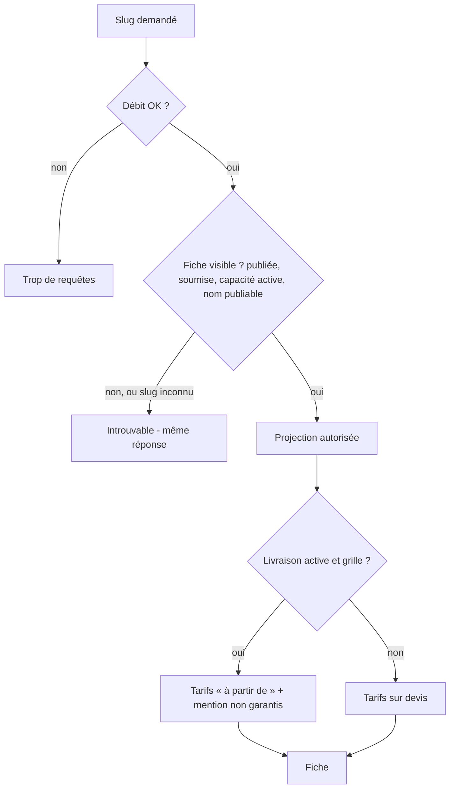

# UC-03-04 — Consulter la fiche publique d'une agence

| Champ | Valeur |
|---|---|
| Statut | Brouillon (en attente de Q-36, Q-37) |
| Priorité | Must |
| Domaine | `marketplace` (lecture publique) ; tarifs indicatifs lus dans `pricing` |
| Tâche | B3.12 (+ B3.13 : limitation de débit) |
| Date | 2026-11-04 |
| Use cases liés | UC-03-01 (publication, liste fermée) ; UC-03-02 (annuaire) ; UC-05-05 (version en vigueur) ; UC-03-05 (B4 : demander une prestation depuis la fiche) |
| Exigences couvertes | UC-03-04, RM-03-01, RM-03-05, RM-02-04, EX-03-001, 002, 003, 005, 008, 010, 011, 012 |

## 0. Traçabilité

| Exigence | Source | Où elle est traitée |
|---|---|---|
| UC-03-04 | F03 §4 ; PH B3.12 | §8 ; scénario 1 |
| RM-03-01 | F03 §Règles ; ADR-10 | RG-03-04-03 ; scénario 2 |
| RM-03-05 | F03 §Règles | RG-03-04-04 ; scénarios 1, 4, 5 |
| RM-02-04, D-05 | F02 ; PG Décisions | RG-03-04-05 ; scénario 1 |
| EX-03-003 (introuvable uniforme) | consigne B3 ; ARC3 | RG-03-04-02 ; scénario 3 |
| EX-03-005 (texte) | revue sécurité B2 | RG-03-04-06 ; scénario 8 |
| EX-03-010 (projection à jour) | ARC6 | scénarios 4, 6, 7 |
| EX-03-001 | PH B3.13 | RG-03-04-08 ; test 8 |

## 1. Objectif

Donner au visiteur tout ce qu'il faut pour choisir une agence (services, zones, villes, tarifs indicatifs) et rien de ce qui est privé.

## 2. User story

> En tant que **visiteur de la marketplace**, je veux **consulter la fiche d'une agence**, afin de **savoir où elle intervient, ce qu'elle propose et à partir de quel prix**.

## 3. Acteurs

Visiteur public, connecté ou non (même réponse).

## 4. Déclencheur

Le visiteur ouvre l'adresse publique d'une agence (depuis l'annuaire ou un lien partagé).

## 5. Préconditions

Aucune authentification ; débit sous la limite.

## 6. Postconditions

Lecture seule, aucune trace.

## 7. Règles métier

| ID | Règle | Exemple | Source |
|---|---|---|---|
| RG-03-04-01 | La fiche se lit par son adresse publique (slug), sans connexion. | `express-douala`. | F03 §API |
| RG-03-04-02 | Réponse **introuvable uniforme** si le slug est inconnu ou mal formé, si la fiche n'est pas publiée ou a été retirée, si elle est masquée (aucune capacité active, nom non publiable), ou si l'agence n'est pas soumise : même réponse, rien ne laisse deviner qu'une agence existe. | `taxi-colis` non publiée et `xyz-inconnue` → même réponse. | consigne B3 ; ARC3 |
| RG-03-04-03 | Contenu = liste fermée de RG-03-01-03 : slug, nom, description, mention de vérification, capacités actives (+ hybride), zones desservies actives, villes des sites actifs, tarifs indicatifs, date de publication. | Aucun téléphone, e-mail, RCCM, NIU, adresse, membre, client, motif de suspension. | RM-03-01 |
| RG-03-04-04 | **RM-03-05 [HYPOTHÈSE]** (Q-37) Tarifs indicatifs : pour chaque zone active tarifée de la version en vigueur, le prix **le plus bas** (« à partir de 1 000 FCFA »), avec la mention « Tarifs indicatifs, non garantis sans devis » ; aucun tarif si la livraison n'est pas active ou sans grille (mention « tarifs sur devis »). | Akwa : à partir de 1 000 ; Bonabéri : à partir de 1 500. | RM-03-05 ; UC-05-05 |
| RG-03-04-05 | **D-05** Mention « non vérifiée » tant que l'agence n'est pas approuvée ; jamais « garantie » ni « assurée ». | Express Douala → « non vérifiée ». | D-05 ; RM-02-04 |
| RG-03-04-06 | La description est renvoyée comme **texte brut** (aucun HTML produit par l'API) ; l'affichage l'échappe. | `<b>Promo</b>` restitué tel quel. | revue sécurité B2 |
| RG-03-04-07 | Zones retirées, sites désactivés, capacités suspendues n'apparaissent pas ; tout changement se voit à la lecture suivante. | Bonabéri retirée → absente. | RM-05-02 ; RM-02-03 |
| RG-03-04-08 | Débit limité comme UC-03-02 (60 par minute et par adresse **[HYPOTHÈSE]**). | 61e lecture dans la minute → refus. | PH B3.13 |

## 8. Flux nominal

1. Le visiteur demande la fiche d'un slug.
2. Le système contrôle le débit.
3. Le système cherche une fiche **visible** pour ce slug (RG-03-04-02).
4. Le système assemble la projection autorisée (RG-03-04-03) et les tarifs indicatifs (RG-03-04-04).
5. Le système renvoie la fiche.

## 9. Flux alternatifs

- A1 — Pas de grille ou livraison inactive : fiche sans tarifs, mention « tarifs sur devis ».
- A2 — Agence de stockage seule : pas de zones ni de tarifs de livraison ; villes des sites affichées.

## 10. Flux d'exception

- E1 — Fiche non visible pour quelque raison que ce soit, slug inconnu ou mal formé : 404 uniforme.
- E2 — Débit dépassé : 429. E3 — Base indisponible : 503.

## 11. Workflow



## 12. Scénarios d'acceptation (Gherkin)

Copie conforme de [features/consulter-fiche-publique.feature](features/consulter-fiche-publique.feature).

```gherkin
# language: fr
@UC-03-04 @B3.12
Fonctionnalité: Consulter la fiche publique d'une agence
  Afin de savoir où une agence intervient, ce qu'elle propose et à partir de quel prix
  En tant que visiteur de la marketplace
  Je veux consulter sa fiche publique

  Contexte:
    Étant donné la fiche publique "express-douala" publiée, agence soumise et non approuvée
    Et "Express Douala" a la livraison active, les zones actives "Douala / Akwa" et "Douala / Bonabéri" et le site actif "Agence Akwa" à "Douala"
    Et la version 1 de sa grille tarife "Douala / Akwa" à partir de 1000 FCFA et "Douala / Bonabéri" à partir de 1500 FCFA

  @nominal @RG-03-04-01 @RG-03-04-04 @RG-03-04-05 @RM-03-05
  Scénario: Un visiteur consulte la fiche d'une agence
    Quand un visiteur non connecté consulte la fiche "express-douala"
    Alors il voit le nom "Express Douala", la mention « non vérifiée » et la capacité livraison
    Et il voit les zones "Douala / Akwa" et "Douala / Bonabéri" et la ville "Douala"
    Et il voit « à partir de 1000 FCFA » pour "Douala / Akwa" et « à partir de 1500 FCFA » pour "Douala / Bonabéri"
    Et la mention « Tarifs indicatifs, non garantis sans devis » accompagne les tarifs

  @nominal @securite @RG-03-04-03 @RM-03-01
  Plan du scénario: La fiche n'expose aucune donnée privée
    Étant donné <donnée> de "Express Douala" est renseigné
    Quand un visiteur consulte la fiche "express-douala"
    Alors la fiche ne contient pas <donnée>

    Exemples:
      | donnée                                 |
      | le téléphone principal                 |
      | l'e-mail de contact                    |
      | le RCCM                                |
      | le NIU                                 |
      | l'adresse du siège                     |
      | l'adresse et le téléphone du site      |
      | la liste des membres                   |
      | le motif d'une capacité suspendue      |

  @erreur @securite @RG-03-04-02
  Plan du scénario: Une fiche non visible est introuvable, toujours de la même façon
    Étant donné <situation>
    Quand un visiteur consulte la fiche "<slug>"
    Alors la fiche est introuvable
    Et la réponse est identique à celle d'une adresse qui n'a jamais existé

    Exemples:
      | slug             | situation                                                        |
      | xyz-inconnue     | aucune agence n'a l'adresse "xyz-inconnue"                       |
      | livraison-kribi  | la fiche "livraison-kribi" a été retirée                         |
      | stock-limbe      | la fiche "stock-limbe" publiée dont toutes les capacités sont suspendues |
      | agence-7b2e4a10  | la fiche "agence-7b2e4a10" d'une agence revenue au nom provisoire |
      | Express-Douala   | la fiche "express-douala" existe en minuscules seulement         |

  @alternatif @RG-03-04-04 @RM-05-01
  Scénario: Les tarifs indicatifs suivent la version en vigueur
    Étant donné "Paul Mbarga" a publié la version 2 où "Douala / Akwa" jusqu'à 1 kg coûte 1200 FCFA
    Quand un visiteur consulte la fiche "express-douala"
    Alors il voit « à partir de 1200 FCFA » pour "Douala / Akwa"

  @alternatif @RG-03-04-04
  Scénario: Une agence sans grille affiche des tarifs sur devis
    Étant donné la fiche publique "rapide-yaounde" publiée, sans grille tarifaire
    Quand un visiteur consulte la fiche "rapide-yaounde"
    Alors aucun prix n'est affiché
    Et la fiche indique « tarifs sur devis »

  @alternatif @RG-03-04-07
  Scénario: Une zone retirée n'apparaît plus sur la fiche
    Étant donné "Express Douala" a retiré la zone "Douala / Bonabéri"
    Quand un visiteur consulte la fiche "express-douala"
    Alors la fiche ne mentionne plus "Douala / Bonabéri" ni son tarif

  @alternatif @RG-03-04-07 @RM-02-03
  Scénario: Une capacité suspendue n'apparaît plus sur la fiche
    Étant donné "Express Douala" a aussi la capacité stockage active
    Et "Express Douala" a suspendu son stockage pour "Inventaire annuel"
    Quand un visiteur consulte la fiche "express-douala"
    Alors la fiche indique seulement la capacité livraison
    Et elle ne contient pas le motif "Inventaire annuel"

  @alternatif @securite @RG-03-04-06
  Scénario: La description est restituée comme du texte
    Étant donné la description de "Express Douala" est " Livraison 7j/7"
    Quand un visiteur consulte la fiche "express-douala"
    Alors la description est restituée exactement comme ce texte
    Et aucun balisage n'est interprété à l'affichage
```

## 13. Plan de tests TDD

| # | Niveau | Comportement | Étant donné | Quand | Alors | Règle |
|---|---|---|---|---|---|---|
| 1 | unit (domaine `pricing`) | Prix « à partir de » | version avec Akwa (1 000…5 000), Bonabéri (1 500…), Deïdo sans ligne, zone retirée | calculer le résumé | Akwa 1 000, Bonabéri 1 500 ; ni Deïdo ni zone retirée ; livraison inactive → vide | RG-03-04-04 |
| 2 | unit (mapper) | Projection détaillée | agence complète | projeter | ensemble de clés = liste fermée ; mention de vérification | RG-03-04-03, 05 |
| 3 | E2E | 200 | contexte | lire `express-douala` | contenu attendu, mention des tarifs, `verification: "unverified"` | RG-03-04-01, 04, 05 |
| 4 | E2E | 404 uniforme | les 5 situations | lire | 404 ; corps Problem Details identiques à ceux d'un slug inconnu (hors `instance` et `traceId`) | RG-03-04-02 |
| 5 | E2E | Anti-fuite | identité, sites, membres, motifs remplis | lire | aucune valeur privée dans le corps (recherche des valeurs connues dans le JSON brut) | RG-03-04-03 |
| 6 | E2E | Projection à jour | — | versionner la grille ; retirer une zone ; suspendre une capacité | fiche mise à jour à la lecture suivante | RG-03-04-04, 07 |
| 7 | E2E | Description texte | description avec balisage | lire | octet pour octet ; `Content-Type: application/json` | RG-03-04-06 |
| 8 | E2E | 429 | — | 61 lectures en une minute | 429 | RG-03-04-08 |

## 14. Données

Sortie **[HYPOTHÈSE]** (Q-36, Q-37) :

| Champ | Contenu |
|---|---|
| `slug` | adresse publique |
| `tradeName` | nom commercial |
| `description` | texte brut ou `null` |
| `verification` | `unverified` (soumise) ; `verified` (approuvée, B10) |
| `capabilities`, `hybrid` | capacités actives |
| `zones` | `[{ city, district }]` actives |
| `siteCities` | villes des sites actifs, sans doublon |
| `indicativeRates` | `{ currency: "XAF", disclaimer, zones: [{ city, district, fromAmount }] }` ou `null` (« tarifs sur devis ») |
| `publishedAt` | date de publication |

## 15. Exigences non fonctionnelles

- Même temps de réponse pour une fiche introuvable et pour une fiche masquée (pas de différence observable par mesure grossière).
- Limitation de débit partagée avant la production (B10.19).

## 16. Hors périmètre

Simulation publique (Q-28) ; formulaire de demande (B4) ; avis, photos, horaires ; contact direct ; historique des versions de tarifs.

## 17. Questions ouvertes

| # | Question | Hypothèse retenue | Impact si différent |
|---|---|---|---|
| Q-36 | Liste fermée exacte de la fiche ? | Tableau §14. | Ajouts à la liste et au test anti-fuite. |
| Q-37 | Forme des tarifs indicatifs ? | Prix le plus bas par zone (« à partir de »). | Barème complet affiché, ou aucun tarif public. |

## 18. Notes pour le tech lead

- Route `GET /public/agencies/{slug}`, sans `AccessTokenGuard` ; le slug est validé (format) et un format invalide donne la **même** 404 qu'un slug inconnu.
- Le résumé des tarifs vient de `pricing` par un port exposé ou par la projection ; une seule implémentation du calcul de prix (UC-05-06).

Definition of Ready :
- [x] Chaque exigence de la section 0 a au moins un scénario
- [x] Chaque règle a un exemple
- [x] Chaque flux d'exception a un scénario (E2 : test 8 ; E3 : contrat général)
- [ ] Aucune question bloquante (Q-36, Q-37)
- [x] Le plan TDD couvre chaque règle
- [x] Le `.feature` est synchronisé avec la section 12
