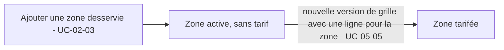

# UC-05-01 — Créer une zone tarifaire

| Champ | Valeur |
|---|---|
| Statut | **Déjà implémenté pour l'essentiel (B2.3, UC-02-03)**, seul le complément de B3 est spécifié ici. Prêt pour revue. |
| Priorité | Must |
| Domaine | `agencies` (zone) ; `pricing` (utilisation de la zone dans une grille) |
| Tâche | B3.1 |
| Date | 2026-11-04 |
| Use cases liés | UC-02-03 Renseigner les zones desservies (création réelle de la zone) ; UC-05-04 Créer la grille ; UC-05-06 Simuler un prix |
| Exigences couvertes | UC-05-01, RM-05-05, EX-05-001, EX-05-003 |

## 0. Traçabilité

| Exigence | Source | Où elle est traitée |
|---|---|---|
| UC-05-01 | F05 §Cas d'usage 1 ; PH B3.1 ; DEC D-15 | RG-05-01-01 ; renvoi à UC-02-03 (livré) |
| RM-05-05 | F05 §Règles | RG-05-01-03 ; scénario 3 ; détail dans UC-05-04 |
| EX-05-001, EX-05-003 | ARC3 ; CL | RG-05-01-03 ; UC-05-04 scénario 14 |

## 1. Objectif

Disposer des zones sur lesquelles une agence fixe ses prix. Depuis la décision **D-15**, la zone tarifaire **est** la zone desservie déclarée à l'onboarding : aucun second objet « zone » n'est créé en B3.

## 2. User story

> En tant que **propriétaire ou administrateur d'agence**, je veux **que chaque zone que je dessers puisse recevoir un tarif**, afin de **ne pas déclarer deux fois mes zones**.

## 3. Acteurs

Propriétaire ou administrateur actif (D-13), exactement comme UC-02-03.

## 4. Déclencheur

Le responsable ajoute une zone desservie (UC-02-03).

## 5. Préconditions

Celles de UC-02-03 (session valide, membre actif, rôle propriétaire ou administrateur).

## 6. Postconditions

- Succès : la zone existe, active, avec un identifiant durable ; elle est **sans tarif** tant qu'aucune version de grille ne la couvre.
- Aucune version de grille existante n'est modifiée.

## 7. Règles métier

| ID | Règle | Exemple | Source |
|---|---|---|---|
| RG-05-01-01 | Créer une zone tarifaire = ajouter une zone desservie (UC-02-03) : mêmes droits, bornes, normalisation, unicité, limite de 100 zones actives, réactivation d'une zone retirée avec le même identifiant. | « Douala / Deïdo » ajoutée par Paul en onboarding = zone tarifaire disponible. | D-15 ; RAO §Zones desservies |
| RG-05-01-02 | Une zone ajoutée est **sans tarif** tant qu'aucune version de grille ne contient de ligne pour elle : une simulation sur cette zone répond « aucun tarif pour cette zone », sans erreur **[HYPOTHÈSE]** (Q-20). | Simulation sur « Douala / Deïdo » → « aucun tarif ». | [HYPOTHÈSE] |
| RG-05-01-03 | Seules les zones de l'agence de la grille peuvent recevoir un tarif ; une zone d'une autre agence est introuvable (RM-05-05). | Awa ne peut pas tarifer « Yaoundé / Bastos » de « Rapide Yaoundé ». | RM-05-05 ; EX-05-001 |
| RG-05-01-04 | Ajouter une zone ne modifie aucune version de grille (les versions sont immuables, UC-05-05). | Après l'ajout de « Douala / Deïdo », la version 1 compte toujours deux lignes. | RG-05-05-01 |

## 8. Flux nominal

1. Le responsable ajoute la zone (UC-02-03, flux nominal, déjà livré).
2. La zone devient sélectionnable comme zone tarifaire de l'agence (même identifiant).
3. Tant qu'aucune version de grille ne la couvre, elle est « sans tarif » (RG-05-01-02).

## 9. Flux alternatifs

- A1 — La grille de l'agence est versionnée pour inclure la zone (UC-05-05) : la zone devient tarifée à partir de cette version.

## 10. Flux d'exception

Ceux de UC-02-03 (401, 403, 404, 400, 409 doublon ou limite). Aucun nouveau cas d'erreur en B3.

## 11. Workflow



## 12. Scénarios d'acceptation (Gherkin)

Copie conforme de [features/creer-zone.feature](features/creer-zone.feature).

```gherkin
# language: fr
@UC-05-01 @B3.1
Fonctionnalité: Créer une zone tarifaire
  Afin de ne déclarer mes zones qu'une seule fois
  En tant que propriétaire ou administrateur d'agence
  Je veux que chaque zone desservie puisse recevoir un tarif

  Contexte:
    Étant donné l'agence "Express Douala" soumise à vérification avec la livraison active
    Et "Paul Mbarga" administrateur actif de "Express Douala"
    Et "Céline Fotso" agente active de "Express Douala"
    Et la version 1 de la grille de "Express Douala" tarife les zones "Douala / Akwa" et "Douala / Bonabéri"

  @nominal @RG-05-01-01 @D-15
  Scénario: Une zone desservie ajoutée peut recevoir un tarif
    Quand "Paul Mbarga" ajoute la zone desservie "Douala" quartier "Deïdo"
    Alors la zone "Douala / Deïdo" figure parmi les zones tarifables de "Express Douala"
    Et elle porte le même identifiant que la zone desservie

  @alternatif @RG-05-01-02 @RG-05-01-04
  Scénario: Une zone nouvellement ajoutée est sans tarif
    Étant donné "Paul Mbarga" a ajouté la zone desservie "Douala / Deïdo"
    Quand "Céline Fotso" simule le prix d'un colis de 2 kg vers "Douala / Deïdo"
    Alors le résultat indique « aucun tarif pour cette zone »
    Et la version 1 de la grille compte toujours deux zones tarifées

  @erreur @securite @RG-05-01-03 @RM-05-05
  Scénario: La zone d'une autre agence ne devient pas une zone tarifable
    Étant donné l'agence "Rapide Yaoundé" dessert la zone "Yaoundé / Bastos"
    Quand "Paul Mbarga" consulte les zones tarifables de "Express Douala"
    Alors la zone "Yaoundé / Bastos" n'y figure pas
```

## 13. Plan de tests TDD

Les tests de la zone elle-même existent depuis B2 (UC-02-03, 14 tests) et ne sont pas réécrits.

| # | Niveau | Comportement | Étant donné | Quand | Alors | Règle |
|---|---|---|---|---|---|---|
| 1 | unit (domaine `pricing`) | Zone sans ligne | version 1 sans ligne pour la zone Z | calculer le prix vers Z | résultat « non chiffrable : aucun tarif », pas d'exception | RG-05-01-02 |
| 2 | E2E | Zone B2 utilisée par une grille | zone créée par la route d'ajout de zone de B2 | créer une version de grille qui la référence | 201 ; la ligne de la version porte le même identifiant de zone ; une zone d'une autre agence → 404 | RG-05-01-01, 03 |

## 14. Données

Aucune nouvelle donnée : la zone garde le contrat de B2 (`id`, ville, quartier, statut, dates).

## 15. Exigences non fonctionnelles

La référence d'une ligne de grille à une zone passe par la paire (agence, zone), comme prévu en B2 (unicité `(agency_id, id)` des zones) : une ligne ne peut jamais pointer une zone d'une autre agence, même par erreur de code.

## 16. Hors périmètre

Création d'une zone tarifaire distincte de la zone desservie (abandonné par D-15) ; géométrie, polygones, distance.

## 17. Questions ouvertes

| # | Question | Hypothèse retenue | Impact si différent |
|---|---|---|---|
| Q-20 | Une zone sans ligne de grille : « aucun tarif » (réponse normale) ou erreur ? | Réponse normale, non chiffrable. | Code d'erreur dédié côté simulation et devis. |

## 18. Notes pour le tech lead

- Le module `pricing` ne lit pas la table `service_zones` directement (règle inter-modules de `CLAUDE.md`) : `agencies` expose une capacité de lecture des zones d'une agence (identifiant, libellé, statut), ou la contrainte est tenue par clé étrangère composite plus un port exposé. À trancher en S2.

Definition of Ready :
- [x] Chaque exigence de la section 0 a au moins un scénario
- [x] Chaque règle a un exemple
- [x] Chaque flux d'exception a un scénario (ceux de UC-02-03, déjà couverts)
- [ ] Aucune question bloquante (Q-20 dépend de D-05)
- [x] Le plan TDD couvre chaque règle
- [x] Le `.feature` est synchronisé avec la section 12
