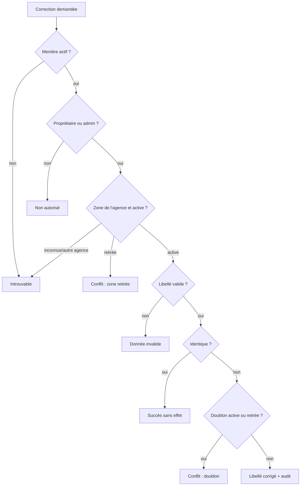

# UC-05-02 — Modifier une zone (corriger son libellé)

| Champ | Valeur |
|---|---|
| Statut | Brouillon (en attente de Q-27, Q-47) |
| Priorité | Should |
| Domaine | `agencies` (zone) ; effets lus par `pricing` et `marketplace` |
| Tâche | B3.2 |
| Date | 2026-11-04 |
| Use cases liés | UC-02-03 (zone) ; UC-05-04, 05 (grilles qui référencent la zone) ; UC-05-07 (devis, libellé figé) ; UC-03-04 (fiche publique) |
| Exigences couvertes | UC-05-02, RM-05-01, RM-05-05, EX-05-001, 002, 003, 004, 005, 006, 007 |

## 0. Traçabilité

| Exigence | Source | Où elle est traitée |
|---|---|---|
| UC-05-02 | F05 §2 ; PH B3.2 ; DEC D-15 | §8 ; scénarios 1, 2 ; anomalie A-19 |
| RM-05-01 | F05 §Règles | RG-05-02-04 ; scénario 3 |
| RM-05-05 | F05 §Règles | RG-05-02-06 ; scénario 10 |
| EX-05-001, 002 | ARC3 ; RAO | scénarios 8, 9, 10 |
| EX-05-004 | F05 §2 (« effet concurrent ») | scénario 13 |
| EX-05-005 | F05 §2 (« audit ») | scénarios 11, 12 |
| EX-05-003, 006, 007 | CDX ; ARC5 ; RM-01-05 | tests 9, 10 |

## 1. Objectif

Corriger une faute de saisie dans une zone (« Akwaa » au lieu de « Akwa ») sans perdre les tarifs qui la référencent, puisque la zone garde son identifiant.

## 2. User story

> En tant que **propriétaire ou administrateur d'agence**, je veux **corriger la ville ou le quartier d'une zone**, afin de **garder mes tarifs attachés à la bonne zone sans la recréer**.

## 3. Acteurs

Principal : propriétaire ou administrateur actif (D-13). Un agent consulte seulement.

## 4. Déclencheur

Le responsable constate une erreur dans le libellé d'une zone active.

## 5. Préconditions

- P1 : session valide ; P2 : membre actif de l'agence ; P3 : rôle propriétaire ou administrateur.
- P4 : la zone appartient à l'agence du chemin et elle est active.

## 6. Postconditions

- Succès : la zone garde son identifiant et porte le nouveau libellé ; les versions de grille qui la référencent s'appliquent au nouveau libellé ; la fiche publique l'affiche ; trace « zone modifiée ».
- Les devis déjà émis ou acceptés gardent le libellé qu'ils avaient à l'émission.
- Échec : rien ne change, aucune trace.

## 7. Règles métier

| ID | Règle | Exemple | Source |
|---|---|---|---|
| RG-05-02-01 | **[HYPOTHÈSE]** (Q-27) Modifier une zone = **corriger** sa ville et son quartier (les deux transmis, quartier facultatif), en gardant son identifiant ; mêmes bornes (2 à 80 caractères) et normalisation que UC-02-03. Pour desservir un **autre** secteur, on retire la zone et on en ajoute une nouvelle. | « Douala / Akwaa » → « Douala / Akwa », même identifiant. | A-19 ; UC-02-03 RG-02-03-01 |
| RG-05-02-02 | Le nouveau libellé ne doit égaler aucune autre zone de l'agence, **active ou retirée** (comparaison sans casse, accents ni espaces) **[HYPOTHÈSE]** : pour une zone retirée identique, il faut la réactiver. | « Douala / Akwaa » → « douala / AKWA » alors que « Douala / Akwa » existe → refus pour doublon. « Douala / Bonaberi » → « Douala / Bonabéri » retirée → refus, « réactivez la zone ». | UC-02-03 RG-02-03-02, 04 |
| RG-05-02-03 | Seule une zone active se modifie ; une zone retirée → conflit. | Modifier « Douala / Bépanda » retirée → refus. | [HYPOTHÈSE] |
| RG-05-02-04 | Les devis émis ou acceptés conservent le libellé figé à l'émission (RM-05-01) ; les versions de grille référencent la zone par identifiant et suivent le nouveau libellé. | Devis DEV-2026-000001 vers « Douala / Akwaa » reste « Douala / Akwaa ». | RM-05-01 |
| RG-05-02-05 | Un libellé strictement identique au libellé actuel ne change rien : succès sans trace. Une correction de casse ou d'accent seule (« Douala / akwa » → « Douala / Akwa ») est une modification. | Paul renvoie « Douala / Akwa » inchangé → aucune trace. | comme B2 (`domains.md` §Agency) |
| RG-05-02-06 | Propriétaire et administrateur modifient ; agent refusé (403) ; ancien membre, autre agence, zone inconnue ou d'une autre agence → introuvable (404). | Céline → refus ; Ibrahim → introuvable. | D-13 ; EX-05-001, 002 |
| RG-05-02-07 | Chaque modification effective est auditée avec l'identifiant de la zone et les **noms** des champs modifiés (`city`, `district`), jamais leurs valeurs. | Trace « zone modifiée », champs `district`. | EX-05-005 ; `events.md` |
| RG-05-02-08 | Les modifications d'une même agence sont sérialisées (verrou de l'agence) ; deux corrections simultanées vers un même libellé : une seule réussit, l'autre est refusée pour doublon. Deux corrections de la même zone : la dernière l'emporte, toutes deux auditées **[HYPOTHÈSE]** (Q-47). | Paul et Awa corrigent deux zones en « Douala / Deïdo » en même temps → une seule réussit. | EX-05-004 |

## 8. Flux nominal

1. Le responsable désigne la zone et transmet la ville et le quartier corrigés.
2. Le système vérifie session, membership actif, rôle (P1 à P3).
3. Le système vérifie que la zone appartient à l'agence et qu'elle est active (P4).
4. Le système valide et normalise le libellé (RG-05-02-01).
5. Le système vérifie l'absence de doublon (RG-05-02-02).
6. Le système enregistre le nouveau libellé, écrit la trace et renvoie la zone.

## 9. Flux alternatifs

- A1 — Libellé identique (étape 4) : succès sans écriture ni trace (RG-05-02-05).

## 10. Flux d'exception

- E1 — Session invalide : 401. E2 — Non membre, ancien membre, autre agence, zone inconnue ou d'une autre agence : 404. E3 — Agent : 403.
- E4 — Ville ou quartier hors bornes, champ inconnu : 400.
- E5 — Doublon d'une zone active : 409 `ZONE_ALREADY_SERVED`. E6 — Doublon d'une zone retirée : 409 `ZONE_RETIRED_DUPLICATE` (« réactivez la zone existante »). E7 — Zone retirée : 409 `ZONE_RETIRED`.

## 11. Workflow



## 12. Scénarios d'acceptation (Gherkin)

Copie conforme de [features/modifier-zone.feature](features/modifier-zone.feature).

```gherkin
# language: fr
@UC-05-02 @B3.2
Fonctionnalité: Modifier une zone
  Afin de garder mes tarifs attachés à la bonne zone
  En tant que propriétaire ou administrateur d'agence
  Je veux corriger la ville ou le quartier d'une zone sans la recréer

  Contexte:
    Étant donné l'agence "Express Douala" soumise à vérification avec la livraison active
    Et "Awa Ngono" propriétaire active de "Express Douala"
    Et "Paul Mbarga" administrateur actif de "Express Douala"
    Et "Céline Fotso" agente active de "Express Douala"
    Et "Express Douala" dessert les zones actives "Douala / Akwaa" et "Douala / Bonabéri"
    Et la version 1 de la grille tarife "Douala / Akwaa" à 1 000 FCFA jusqu'à 1 kg

  @nominal @RG-05-02-01
  Scénario: Un administrateur corrige une faute dans le quartier
    Quand "Paul Mbarga" corrige la zone "Douala / Akwaa" en "Douala" quartier "Akwa"
    Alors la zone porte le libellé "Douala / Akwa"
    Et elle garde le même identifiant

  @nominal @RG-05-02-01 @RG-05-02-04
  Scénario: Le tarif suit la zone corrigée
    Étant donné "Paul Mbarga" a corrigé la zone "Douala / Akwaa" en "Douala / Akwa"
    Quand "Céline Fotso" simule le prix d'un colis de 1 kg vers "Douala / Akwa"
    Alors le prix indicatif est de 1 000 FCFA selon la version 1

  @alternatif @RG-05-02-04 @RM-05-01
  Scénario: Un devis émis garde le libellé de la zone au moment de l'émission
    Étant donné le devis "DEV-2026-000001" émis vers "Douala / Akwaa"
    Quand "Paul Mbarga" corrige la zone "Douala / Akwaa" en "Douala / Akwa"
    Alors le devis "DEV-2026-000001" indique toujours la zone "Douala / Akwaa"
    Et son total est inchangé

  @erreur @RG-05-02-02
  Plan du scénario: Une correction qui crée un doublon est refusée
    Étant donné "Express Douala" a aussi <situation>
    Quand "Paul Mbarga" corrige la zone "Douala / Akwaa" en "<ville>" quartier "<quartier>"
    Alors la correction est refusée pour <motif>
    Et la zone "Douala / Akwaa" garde son libellé

    Exemples:
      | situation                                     | ville  | quartier | motif                         |
      | la zone active "Douala / Deïdo"               | douala | DEIDO    | doublon                       |
      | la zone retirée "Douala / Bépanda"            | Douala | Bépanda  | doublon d'une zone à réactiver |

  @erreur @RG-05-02-03
  Scénario: Une zone retirée ne se modifie pas
    Étant donné la zone "Douala / Bépanda" retirée de "Express Douala"
    Quand "Paul Mbarga" corrige la zone "Douala / Bépanda" en "Douala" quartier "Bépanda Omnisport"
    Alors la correction est refusée car la zone est retirée

  @erreur @RG-05-02-01
  Plan du scénario: Bornes de longueur du quartier corrigé
    Quand "Paul Mbarga" corrige la zone "Douala / Akwaa" avec un quartier de <longueur> caractères utiles
    Alors la correction est <résultat>

    Exemples:
      | longueur | résultat |
      | 1        | refusée  |
      | 2        | acceptée |
      | 80       | acceptée |
      | 81       | refusée  |

  @alternatif @RG-05-02-05
  Scénario: Une correction identique ne change rien
    Étant donné la zone active "Douala / Bonabéri"
    Quand "Paul Mbarga" corrige la zone "Douala / Bonabéri" en "Douala" quartier "Bonabéri"
    Alors la zone est inchangée
    Et aucune trace n'est ajoutée au journal d'audit

  @erreur @securite @RG-05-02-06 @EX-05-002
  Scénario: Une agente ne peut pas modifier une zone
    Quand "Céline Fotso" corrige la zone "Douala / Akwaa" en "Douala" quartier "Akwa"
    Alors l'action lui est refusée comme non autorisée
    Et la zone "Douala / Akwaa" garde son libellé

  @erreur @securite @RG-05-02-06 @EX-05-001
  Plan du scénario: Une personne sans accès actif ne trouve pas la zone
    Étant donné <situation>
    Quand "<personne>" corrige la zone "Douala / Akwaa" de "Express Douala"
    Alors la zone lui est introuvable

    Exemples:
      | personne      | situation                                                   |
      | Ibrahim Bello | "Ibrahim Bello" propriétaire de "Rapide Yaoundé" uniquement |
      | Jean Etoa     | "Jean Etoa" ancien administrateur de "Express Douala"       |

  @erreur @securite @RG-05-02-06 @RM-05-05
  Scénario: La zone d'une autre agence est introuvable
    Étant donné l'agence "Rapide Yaoundé" dessert la zone "Yaoundé / Bastos"
    Quand "Awa Ngono" corrige, au nom de "Express Douala", la zone "Yaoundé / Bastos"
    Alors la zone lui est introuvable
    Et la zone "Yaoundé / Bastos" de "Rapide Yaoundé" est inchangée

  @nominal @RG-05-02-07 @EX-05-005
  Scénario: La correction est tracée sans les valeurs saisies
    Quand "Paul Mbarga" corrige la zone "Douala / Akwaa" en "Douala" quartier "Akwa"
    Alors le journal d'audit contient « zone modifiée » par "Paul Mbarga" pour cette zone
    Et la trace nomme le champ "quartier" sans en donner la valeur

  @erreur @RG-05-02-07
  Scénario: Une correction refusée n'écrit aucune trace
    Étant donné la zone active "Douala / Deïdo"
    Quand "Paul Mbarga" corrige la zone "Douala / Akwaa" en "Douala" quartier "Deïdo"
    Alors la correction est refusée pour doublon
    Et aucune trace n'est ajoutée au journal d'audit

  @concurrence @RG-05-02-08 @EX-05-004
  Scénario: Deux corrections simultanées vers le même libellé n'en retiennent qu'une
    Quand "Paul Mbarga" corrige "Douala / Akwaa" et "Awa Ngono" corrige "Douala / Bonabéri" en même temps en "Douala / Deïdo"
    Alors une seule zone porte le libellé "Douala / Deïdo"
    Et l'autre correction est refusée pour doublon
```

## 13. Plan de tests TDD

| # | Niveau | Comportement | Étant donné | Quand | Alors | Règle |
|---|---|---|---|---|---|---|
| 1 | unit (domaine) | Correction | zone active « Douala / Akwaa » | corriger en « Douala / Akwa » | même identifiant, nouveau libellé, événement `ServiceZoneRenamed` avec `fields: ["district"]` | RG-05-02-01, 07 |
| 2 | unit (domaine) | Bornes | — | quartier 1, 2, 80, 81 ; ville vide | bornes de `ServiceZone` respectées (VO de B2 réutilisé) | RG-05-02-01 |
| 3 | unit (domaine) | Doublon | zones « Deïdo » active et « Bépanda » retirée | corriger vers chacune | `conflict` `ZONE_ALREADY_SERVED` / `ZONE_RETIRED_DUPLICATE` | RG-05-02-02 |
| 4 | unit (domaine) | Zone retirée | zone retirée | corriger | `conflict` `ZONE_RETIRED` | RG-05-02-03 |
| 5 | unit (domaine) | Sans changement | zone « Douala / Bonabéri » | corriger à l'identique ; puis casse seule | aucun événement ; puis un événement | RG-05-02-05 |
| 6 | unit (domaine `pricing`) | Devis figé | devis émis vers « Douala / Akwaa » | renommer la zone | le devis garde son libellé (instantané) | RG-05-02-04 |
| 7 | unit (application) | Rôles et isolation | fakes | chaque acteur ; zone d'une autre agence | propriétaire, admin OK ; agent `forbidden` ; autres `not_found` | RG-05-02-06 |
| 8 | unit (application) | Audit | fakes | correction effective ; refus ; sans changement | une trace avec `resource_id` ; aucune ; aucune | RG-05-02-07 |
| 9 | feature (PostgreSQL) | Unicité en concurrence | deux zones | deux corrections simultanées vers « Douala / Deïdo » | une seule réussit (index unique partiel `service_zones_active_area_unique` + verrou agence) | RG-05-02-08 |
| 10 | E2E | 200, 400, 401, 403, 404, 409 | — | correction, bornes, sans jeton, agent, autre agence, zone d'autrui, doublon, zone retirée | codes attendus, Problem Details avec `code` | RG-05-02-01 à 06 |

## 14. Données

| Champ | Type métier | Obligatoire | Contraintes |
|---|---|---|---|
| Ville | texte | oui | 2 à 80 caractères (UC-02-03) |
| Quartier | texte | non (`null` = ville entière) | 2 à 80 caractères |

Sortie : l'objet zone de B2 (`id`, ville, quartier, statut, dates).

## 15. Exigences non fonctionnelles

La correction passe par le même verrou d'agence que les autres écritures de configuration (B2) ; l'index unique partiel des zones actives reste le dernier rempart.

## 16. Hors périmètre

Fusion de deux zones ; déplacement d'une zone vers un autre secteur (retrait puis ajout) ; historique des libellés successifs consultable (l'audit garde seulement les noms de champs).

## 17. Questions ouvertes

| # | Question | Hypothèse retenue | Impact si différent |
|---|---|---|---|
| Q-27 | « Modifier une zone » : corriger le libellé en gardant l'identifiant ? Refuser l'égalité avec une zone retirée ? | Oui et oui. | Si modifier = changer de secteur : il faudrait clore les lignes de grille de l'ancienne zone ; si l'égalité avec une retirée est permise, sa réactivation deviendra impossible. |
| Q-47 | Deux corrections simultanées de la même zone : dernière gagnante ou version par zone ? | Dernière gagnante (le corps contient le libellé complet). | Ajouter une version et `If-Match` aux zones. |

## 18. Notes pour le tech lead

- Route d'action à fixer en S2 (par exemple `PATCH /agencies/{id}/zones/{zoneId}` avec corps complet) ; nouvel événement `ServiceZoneRenamed` (audit `agency.zone_renamed`, `resource_id`).
- La fiche publique (UC-03-04) doit refléter le nouveau libellé : si la projection est une table, le subscriber de cet événement la met à jour.

Definition of Ready :
- [x] Chaque exigence de la section 0 a au moins un scénario
- [x] Chaque règle a un exemple
- [x] Chaque flux d'exception a un scénario (E1 : test 10)
- [ ] Aucune question bloquante (Q-27)
- [x] Le plan TDD couvre chaque règle
- [x] Le `.feature` est synchronisé avec la section 12
