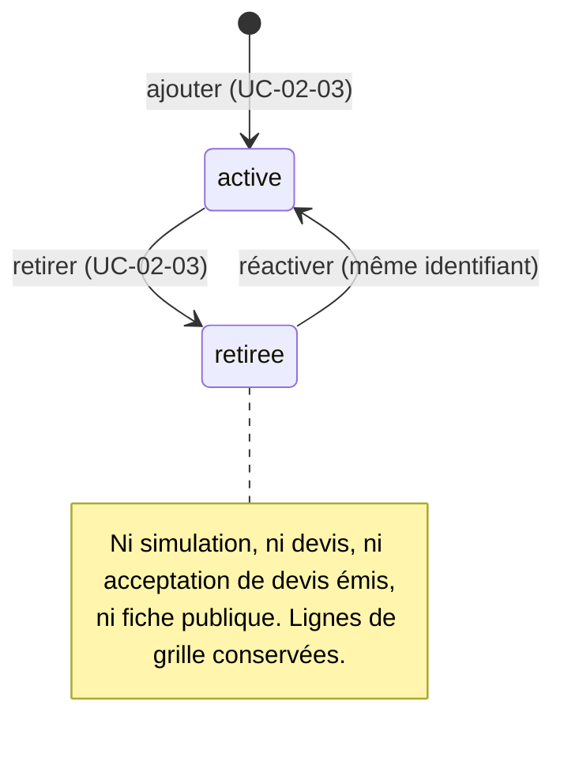

# UC-05-03 — Désactiver une zone

| Champ | Valeur |
|---|---|
| Statut | **Retrait déjà implémenté (B2.3, UC-02-03 flux A2)** ; seuls les effets tarifaires et publics de B3 sont spécifiés ici. Brouillon (en attente de Q-33, Q-34). |
| Priorité | Must |
| Domaine | `agencies` (retrait) ; `pricing` et `marketplace` (effets) |
| Tâche | B3.3 |
| Date | 2026-11-04 |
| Use cases liés | UC-02-03 (retrait, réactivation) ; UC-05-06, 07, 08 ; UC-03-03, 04 ; UC-06-01 (B5, nouvelles commandes) |
| Exigences couvertes | UC-05-03, RM-05-01, RM-05-02, EX-05-004, EX-05-008 |

## 0. Traçabilité

| Exigence | Source | Où elle est traitée |
|---|---|---|
| UC-05-03 | F05 §3 ; PH B3.3 ; D-15 | RG-05-03-01 ; renvoi à UC-02-03 |
| RM-05-02 | F05 §Règles | RG-05-03-02, 03, 06 ; scénarios 1, 2, 3, 6 ; partie « commandes » vérifiée en B5 (anomalie A-25) |
| RM-05-01 | F05 §Règles | RG-05-03-04 ; scénario 4 |
| EX-05-008 | ARC5 ; CL | RG-05-03-05 ; scénario 5 |
| EX-05-004 | F05 §3 | RG-05-03-07 ; scénario 7 |

## 1. Objectif

Quand une agence cesse de desservir une zone, plus aucun nouveau prix, devis ou commande ne doit être produit pour cette zone, sans effacer les tarifs ni les devis passés.

## 2. User story

> En tant que **propriétaire ou administrateur d'agence**, je veux **qu'une zone retirée ne puisse plus être chiffrée ni vendue**, afin de **ne pas m'engager sur un secteur que je ne couvre plus**.

## 3. Acteurs

Principal : propriétaire ou administrateur (retrait, UC-02-03). Secondaires : tout membre qui simule, émet ou fait accepter un devis ; visiteur public (fiche).

## 4. Déclencheur

Le responsable retire une zone (UC-02-03).

## 5. Préconditions

Celles du retrait de UC-02-03 (dont la règle de la dernière zone tant que la livraison est active).

## 6. Postconditions

- La zone est retirée et conservée ; ses lignes de grille sont conservées dans toutes les versions ; elle ne peut plus être chiffrée ; elle disparaît de la fiche publique et des filtres.
- Les devis déjà acceptés sont inchangés.

## 7. Règles métier

| ID | Règle | Exemple | Source |
|---|---|---|---|
| RG-05-03-01 | Désactiver une zone tarifaire = la retirer (UC-02-03) : mêmes droits, retrait logique, règle de la dernière zone active, réactivation avec le même identifiant. | Paul retire « Douala / Bonabéri ». | D-15 ; RAO §Retirer une zone |
| RG-05-03-02 | Une zone retirée ne peut plus être chiffrée : simulation et émission de devis vers elle sont refusées pour conflit (« zone retirée »). | Simulation vers « Douala / Bonabéri » retirée → refus. | RM-05-02 (étendue à la tarification, **[HYPOTHÈSE]**) |
| RG-05-03-03 | Un devis émis, non encore accepté, vers une zone retirée depuis ne peut plus être accepté **[HYPOTHÈSE]** (Q-33). | DEV-2026-000002 émis le 10/11 vers Bonabéri, zone retirée le 11/11 → acceptation refusée le 12/11. | RM-05-02 |
| RG-05-03-04 | Un devis déjà accepté n'est pas affecté : prix, zone et version restent ceux de l'acceptation. | DEV-2026-000001 accepté reste accepté à 1 500 FCFA. | RM-05-01 |
| RG-05-03-05 | Les lignes de grille de la zone sont conservées dans chaque version ; si la zone est réactivée, la ligne de la version en vigueur s'applique de nouveau. | Bonabéri réactivée → simulation 1 kg = 1 500 FCFA (version 1). | EX-05-008 ; UC-02-03 RG-02-03-04 |
| RG-05-03-06 | La zone retirée disparaît de la fiche publique, des tarifs indicatifs et des filtres de recherche (UC-03-03, 04). | La fiche « express-douala » ne mentionne plus Bonabéri. | RM-05-02 ; RM-03-01 |
| RG-05-03-07 | Retrait et émission de devis simultanés sur la même zone : jamais un devis émis **après** le retrait ; soit le devis est émis avant (et ne pourra plus être accepté), soit il est refusé. | — | EX-05-004 |
| RG-05-03-08 | L'interdiction des **nouvelles commandes** vers une zone retirée est vérifiée au lot 5 (UC-06-01). | — | RM-05-02 ; A-25 |

## 8. Flux nominal

1. Le responsable retire la zone (UC-02-03).
2. Toute simulation ou émission de devis ultérieure vers cette zone est refusée (RG-05-03-02).
3. La fiche publique ne l'affiche plus (RG-05-03-06).

## 9. Flux alternatifs

- A1 — Réactivation (UC-02-03) : la ligne de la version en vigueur s'applique de nouveau (RG-05-03-05).
- A2 — Devis accepté avant le retrait : inchangé (RG-05-03-04).

## 10. Flux d'exception

- E1 — Simulation ou devis vers une zone retirée : 409 `ZONE_RETIRED`.
- E2 — Acceptation d'un devis dont la zone a été retirée : 409 `ZONE_RETIRED`.

## 11. Workflow



## 12. Scénarios d'acceptation (Gherkin)

Copie conforme de [features/desactiver-zone.feature](features/desactiver-zone.feature).

```gherkin
# language: fr
@UC-05-03 @B3.3
Fonctionnalité: Désactiver une zone tarifaire
  Afin de ne plus m'engager sur un secteur que je ne couvre plus
  En tant que propriétaire ou administrateur d'agence
  Je veux qu'une zone retirée ne puisse plus être chiffrée ni vendue

  Contexte:
    Étant donné l'agence "Express Douala" soumise à vérification avec la livraison active
    Et "Paul Mbarga" administrateur actif de "Express Douala"
    Et "Céline Fotso" agente active de "Express Douala"
    Et "Express Douala" dessert les zones actives "Douala / Akwa" et "Douala / Bonabéri"
    Et la version 1 de la grille tarife "Douala / Bonabéri" à 1 500 FCFA jusqu'à 1 kg

  @erreur @RG-05-03-02 @RM-05-02
  Scénario: Une zone retirée ne peut plus être simulée
    Étant donné "Paul Mbarga" a retiré la zone "Douala / Bonabéri"
    Quand "Céline Fotso" simule le prix d'un colis de 1 kg vers "Douala / Bonabéri"
    Alors la simulation est refusée car la zone est retirée

  @erreur @RG-05-03-02 @RM-05-02
  Scénario: Aucun devis n'est émis vers une zone retirée
    Étant donné "Paul Mbarga" a retiré la zone "Douala / Bonabéri"
    Quand "Céline Fotso" émet un devis d'un colis de 1 kg vers "Douala / Bonabéri"
    Alors l'émission est refusée car la zone est retirée
    Et aucun devis n'est créé

  @erreur @RG-05-03-03 @RM-05-02
  Scénario: Un devis émis avant le retrait ne peut plus être accepté
    Étant donné le devis "DEV-2026-000002" émis vers "Douala / Bonabéri" et non accepté
    Et "Paul Mbarga" a retiré ensuite la zone "Douala / Bonabéri"
    Quand "Céline Fotso" enregistre l'acceptation du devis "DEV-2026-000002"
    Alors l'acceptation est refusée car la zone est retirée
    Et le devis "DEV-2026-000002" reste non accepté

  @alternatif @RG-05-03-04 @RM-05-01
  Scénario: Un devis accepté avant le retrait est inchangé
    Étant donné le devis "DEV-2026-000001" accepté à 1 500 FCFA vers "Douala / Bonabéri"
    Quand "Paul Mbarga" retire la zone "Douala / Bonabéri"
    Alors le devis "DEV-2026-000001" reste accepté à 1 500 FCFA

  @alternatif @RG-05-03-05 @EX-05-008
  Scénario: Une zone réactivée retrouve son tarif
    Étant donné "Paul Mbarga" a retiré puis réactivé la zone "Douala / Bonabéri"
    Quand "Céline Fotso" simule le prix d'un colis de 1 kg vers "Douala / Bonabéri"
    Alors le prix indicatif est de 1 500 FCFA selon la version 1

  @alternatif @RG-05-03-06
  Scénario: Une zone retirée disparaît de la fiche publique
    Étant donné la fiche publique "express-douala" publiée
    Quand "Paul Mbarga" retire la zone "Douala / Bonabéri"
    Alors la fiche publique "express-douala" ne mentionne plus "Douala / Bonabéri"
    Et elle mentionne toujours "Douala / Akwa"

  @concurrence @RG-05-03-07 @EX-05-004
  Scénario: Un retrait et une émission de devis simultanés ne produisent jamais de devis sur une zone déjà retirée
    Quand "Paul Mbarga" retire la zone "Douala / Bonabéri" pendant que "Céline Fotso" émet un devis vers cette zone
    Alors soit le devis est refusé, soit il a été émis avant le retrait et ne peut plus être accepté
```

## 13. Plan de tests TDD

| # | Niveau | Comportement | Étant donné | Quand | Alors | Règle |
|---|---|---|---|---|---|---|
| 1 | unit (domaine `pricing`) | Simulation sur zone retirée | zone au statut retiré (lue par le port de zones) | calculer | `conflict` `ZONE_RETIRED` | RG-05-03-02 |
| 2 | unit (application) | Émission refusée | fakes, zone retirée | émettre | `conflict`, aucun devis enregistré | RG-05-03-02 |
| 3 | unit (application) | Acceptation refusée | devis émis, zone retirée depuis | accepter | `conflict`, devis inchangé | RG-05-03-03 |
| 4 | unit (domaine) | Devis accepté inchangé | devis accepté | zone retirée | statut, total, version inchangés | RG-05-03-04 |
| 5 | unit (application) | Réactivation | zone réactivée, ligne dans la version 1 | simuler | 1 500 FCFA | RG-05-03-05 |
| 6 | feature (PostgreSQL) | Concurrence retrait / émission | zone active | retrait et émission simultanés | jamais `issued_at` > `retired_at` pour un devis de la zone (verrou partagé de la zone ou de l'agence lu par l'émission) | RG-05-03-07 |
| 7 | E2E | 409 `ZONE_RETIRED` | zone retirée | simuler, émettre, accepter | 409 ×3 ; réactivation → 200 | RG-05-03-02, 03, 05 |
| 8 | E2E | Fiche publique | fiche publiée | retirer une zone puis lire la fiche | la zone n'apparaît plus | RG-05-03-06 |

## 14. Données

Aucune nouvelle donnée.

## 15. Exigences non fonctionnelles

L'émission d'un devis lit le statut de la zone dans une transaction qui ne peut pas croiser un retrait concurrent (verrou partagé `FOR SHARE` sur la ligne de la zone ou de l'agence, à trancher en S2).

## 16. Hors périmètre

Blocage des commandes (B5) ; expiration automatique des devis d'une zone retirée (ils restent émis mais non acceptables).

## 17. Questions ouvertes

| # | Question | Hypothèse retenue | Impact si différent |
|---|---|---|---|
| Q-33 | Un devis émis puis dont la zone est retirée peut-il encore être accepté ? | Non. | L'agence devrait honorer des devis sur un secteur abandonné. |
| Q-34 | Un devis accepté vers une zone retirée depuis pourra-t-il devenir une commande (B5) ? | À décider en B5 ; B3 ne crée aucune commande. | Règle d'orchestration B5. |

## 18. Notes pour le tech lead

- Les effets de B3 se vérifient côté `pricing` (statut de zone lu par un port exposé par `agencies`) et côté `marketplace` (projection) ; le retrait lui-même n'est pas modifié.

Definition of Ready :
- [x] Chaque exigence de la section 0 a au moins un scénario
- [x] Chaque règle a un exemple
- [x] Chaque flux d'exception a un scénario
- [ ] Aucune question bloquante (Q-33)
- [x] Le plan TDD couvre chaque règle
- [x] Le `.feature` est synchronisé avec la section 12
