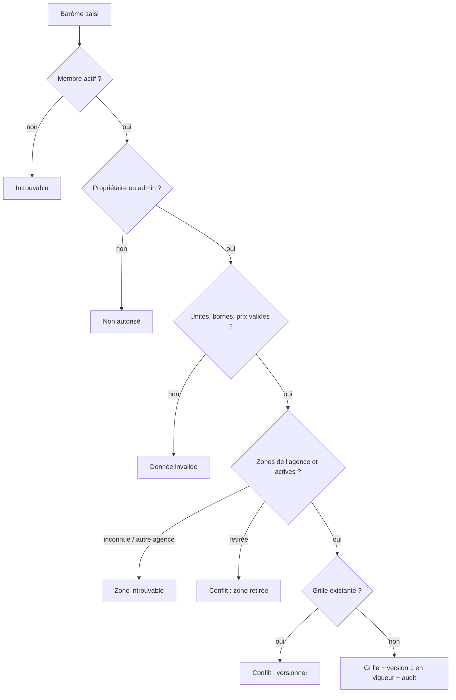

# UC-05-04 — Créer la grille tarifaire

| Champ | Valeur |
|---|---|
| Statut | Brouillon (en attente de D-05 : Q-20 à Q-25) |
| Priorité | Must |
| Domaine | `pricing` |
| Tâche | B3.4 |
| Date | 2026-11-04 |
| Use cases liés | UC-05-01 (zones) ; UC-05-05 (versions suivantes) ; UC-05-06, 07 (calcul) ; UC-03-04 (tarifs indicatifs publics) |
| Exigences couvertes | UC-05-04, RM-05-03, RM-05-04, RM-05-05, EX-05-001 à 009, EX-05-012 |

## 0. Traçabilité

| Exigence | Source | Où elle est traitée |
|---|---|---|
| UC-05-04 | F05 §4 ; PH B3.4 | §8 ; scénarios 1, 4 |
| RM-05-03 | F05 §Règles ; PH B3.4 | RG-05-04-03, 05 ; scénarios 2, 3, 5 |
| RM-05-04 | F05 §Règles | RG-05-04-04 ; scénario 7 |
| RM-05-05 | F05 §Règles ; PH B3 | RG-05-04-06 ; scénarios 13, 14 |
| EX-05-012 (D-05) | ARC1 §Points à valider ; PG D-05 | RG-05-04-02 à 05 en **[HYPOTHÈSE]** |
| EX-05-001, 002 | ARC3 | scénarios 12, 13, 14 |
| EX-05-004 | F05 §4 | scénario 11 |
| EX-05-005 | F05 §4 | scénario 15 |
| EX-05-009 | CL (historisation) | RG-05-04-09 |
| EX-05-003, 006, 007, 008 | CDX ; ARC5 | tests 13, 14 |

## 1. Objectif

Permettre à une agence de fixer ses propres prix de livraison par zone et par poids, avec des unités explicites, pour pouvoir ensuite simuler et émettre des devis cohérents.

## 2. User story

> En tant que **propriétaire ou administrateur d'agence**, je veux **saisir ma grille de prix de livraison par zone et par tranche de poids**, afin de **chiffrer mes livraisons de la même façon pour tous mes clients**.

## 3. Acteurs

Principal : propriétaire ou administrateur actif (même règle que la configuration, D-13). L'agent consulte la grille sans la modifier **[HYPOTHÈSE]**.

## 4. Déclencheur

L'agence n'a pas encore de grille et le responsable saisit son premier barème.

## 5. Préconditions

- P1 : session valide ; P2 : membre actif ; P3 : propriétaire ou administrateur.
- P4 : l'agence n'a pas encore de grille de livraison **[HYPOTHÈSE]** (Q-24).
- P5 : chaque zone citée est une zone **active** de l'agence.

## 6. Postconditions

- Succès : la grille existe avec sa **version 1**, en vigueur immédiatement ; trace « grille créée ».
- Échec : aucune grille, aucune version, aucune trace.

## 7. Règles métier

| ID | Règle | Exemple | Source |
|---|---|---|---|
| RG-05-04-01 | **[HYPOTHÈSE]** (Q-24) Une agence a **au plus une grille de livraison** ; la créer produit la version 1, en vigueur dès sa création (Q-26). Une seconde création est refusée : on versionne (UC-05-05). | « Express Douala » a déjà une grille → nouvelle création refusée pour conflit. | [HYPOTHÈSE] |
| RG-05-04-02 | **[HYPOTHÈSE] D-05** (Q-20) Le barème associe à chaque zone tarifée des **tranches de poids** contiguës : chaque tranche a une borne supérieure incluse et un prix ; la première commence à 0 ; les bornes sont strictement croissantes ; au-delà de la dernière borne, le colis est **hors barème**. Le prix ne dépend que de la zone de destination et du poids taxable (ni distance, ni origine). | Douala / Akwa : jusqu'à 1 kg = 1 000 ; 5 kg = 1 500 ; 10 kg = 2 500 ; 30 kg = 5 000. | D-05 ; ARC1 §Points à valider |
| RG-05-04-03 | **RM-05-03** Chaque borne de poids est saisie avec son **unité explicite** (`kg` ou `g`) ; sans unité ou avec une autre unité, la saisie est refusée. 1 kg = 1 000 g ; précision au gramme ; borne de 1 g à 1 000 kg **[HYPOTHÈSE]**. | « 1 kg » = « 1000 g » ; « 1 », « 1 lb », « 1 kilo » refusés ; « 0,5 g » refusé. | RM-05-03 |
| RG-05-04-04 | **[HYPOTHÈSE] D-05** (Q-22, Q-23) Les prix sont en **francs CFA (XAF)**, en **nombre entier** de francs, de 1 à 10 000 000 ; aucune autre devise ; aucun décimal. Le prix saisi est le prix facturé au client, **taxes comprises** : la plateforme ne calcule aucune taxe. | 1 000 accepté ; 0, -500, 1 000,50, 10 000 001 et « 10 EUR » refusés. | RM-05-04 ; D-05 |
| RG-05-04-05 | **[HYPOTHÈSE] D-05** (Q-21) Une version peut fixer un **diviseur volumétrique** (entier de 1 000 à 10 000, dimensions en centimètres) ; sans diviseur, seul le poids réel compte. | Diviseur 5 000 : un colis de 30 × 20 × 10 cm pèse 1,2 kg volumétrique. | RM-05-03 ; D-05 |
| RG-05-04-06 | **RM-05-05** Une grille appartient à une seule agence ; chaque ligne cite une zone **active** de cette agence. Zone retirée → conflit ; zone inconnue ou d'une autre agence → introuvable. | Ligne « Yaoundé / Bastos » (de Rapide Yaoundé) dans la grille d'Express Douala → introuvable. | RM-05-05 ; EX-05-001 |
| RG-05-04-07 | Une version contient de 1 à 100 lignes de zone, au plus une par zone, et de 1 à 20 tranches par zone **[HYPOTHÈSE]**. Une zone active sans ligne est « sans tarif ». | Deux lignes « Douala / Akwa » → refus ; « Douala / Deïdo » non citée → sans tarif. | [HYPOTHÈSE] |
| RG-05-04-08 | La grille peut être créée en brouillon comme après soumission, que la livraison soit active ou non **[HYPOTHÈSE]** : on prépare ses prix pendant l'onboarding. | « Express Douala » brouillon, livraison inactive → création acceptée. | [HYPOTHÈSE] |
| RG-05-04-09 | Une version est **immuable** : jamais modifiée ni supprimée ; tout changement passe par une nouvelle version (UC-05-05). | — | EX-05-009 ; CL |
| RG-05-04-10 | Propriétaire et administrateur créent ; agent refusé ; ancien membre ou autre agence → introuvable. | Céline → refus ; Jean Etoa → introuvable. | D-13 ; EX-05-002 |
| RG-05-04-11 | La création est auditée (« grille créée », version 1) sans les prix ni les zones dans la trace. | Trace « grille créée, version 1 » par Paul. | EX-05-005 |
| RG-05-04-12 | Deux créations simultanées produisent une seule grille ; l'autre est refusée pour conflit. | — | EX-05-004 |

## 8. Flux nominal

1. Le responsable saisit, pour chaque zone tarifée, ses tranches (borne avec unité, prix en FCFA) et, s'il le souhaite, un diviseur volumétrique.
2. Le système vérifie session, membership actif, rôle (P1 à P3).
3. Le système valide unités, bornes, prix et nombre de lignes (RG-05-04-02 à 05, 07).
4. Le système vérifie que chaque zone est une zone active de l'agence (RG-05-04-06).
5. Le système vérifie que l'agence n'a pas de grille (RG-05-04-01).
6. Le système crée la grille et sa version 1, en vigueur.
7. Le système écrit la trace et renvoie la grille (version 1, lignes normalisées en grammes et en francs).

## 9. Flux alternatifs

- A1 — Diviseur volumétrique fourni (étape 1) : il est enregistré dans la version 1.
- A2 — Agence en brouillon ou livraison inactive (étape 5) : création acceptée (RG-05-04-08).
- A3 — Consultation : tout membre actif lit la grille et sa version en vigueur (tâche B3.14, voir UC-05-05 §9).

## 10. Flux d'exception

- E1 — Session invalide : 401. E2 — Non membre, ancien membre, autre agence : 404. E3 — Agent : 403.
- E4 — Unité absente ou inconnue, borne hors bornes, bornes non croissantes, prix invalide, devise autre que XAF, plus de 100 zones ou 20 tranches, deux lignes pour une même zone, champ inconnu : 400.
- E5 — Zone inconnue ou d'une autre agence : 404 (« zone introuvable »). E6 — Zone retirée : 409 `ZONE_RETIRED`.
- E7 — Grille déjà existante : 409 `RATE_CARD_ALREADY_EXISTS`.

## 11. Workflow



## 12. Scénarios d'acceptation (Gherkin)

Copie conforme de [features/creer-grille-tarifaire.feature](features/creer-grille-tarifaire.feature).

```gherkin
# language: fr
@UC-05-04 @B3.4
Fonctionnalité: Créer la grille tarifaire
  Afin de chiffrer mes livraisons de la même façon pour tous mes clients
  En tant que propriétaire ou administrateur d'agence
  Je veux saisir mes prix de livraison par zone et par tranche de poids

  Contexte:
    Étant donné l'agence "Express Douala" soumise à vérification avec la livraison active
    Et "Awa Ngono" propriétaire active de "Express Douala"
    Et "Paul Mbarga" administrateur actif de "Express Douala"
    Et "Céline Fotso" agente active de "Express Douala"
    Et "Express Douala" dessert les zones actives "Douala / Akwa", "Douala / Bonabéri" et "Douala / Deïdo"
    Et "Express Douala" n'a pas encore de grille tarifaire

  @nominal @RG-05-04-01 @RG-05-04-02
  Scénario: Un administrateur crée la grille de l'agence
    Quand "Paul Mbarga" crée la grille de "Express Douala" avec le barème :
      | zone              | jusqu'à | prix (FCFA) |
      | Douala / Akwa     | 1 kg    | 1000        |
      | Douala / Akwa     | 5 kg    | 1500        |
      | Douala / Akwa     | 10 kg   | 2500        |
      | Douala / Akwa     | 30 kg   | 5000        |
      | Douala / Bonabéri | 1 kg    | 1500        |
      | Douala / Bonabéri | 5 kg    | 2000        |
      | Douala / Bonabéri | 10 kg   | 3000        |
    Alors "Express Douala" a une grille dont la version 1 est en vigueur
    Et la version 1 tarife les zones "Douala / Akwa" et "Douala / Bonabéri"

  @alternatif @RG-05-04-03 @RM-05-03
  Plan du scénario: Une borne en grammes équivaut à la même borne en kilogrammes
    Quand "Paul Mbarga" crée la grille avec la tranche "<borne>" à 1000 FCFA pour "Douala / Akwa"
    Alors la tranche de "Douala / Akwa" s'arrête à 1 000 grammes

    Exemples:
      | borne   |
      | 1 kg    |
      | 1000 g  |
      | 1,0 kg  |

  @alternatif @RG-05-04-05 @RM-05-03
  Scénario: Une grille peut appliquer un poids volumétrique
    Quand "Paul Mbarga" crée la grille avec un diviseur volumétrique de 5000 et la tranche "1 kg" à 1000 FCFA pour "Douala / Akwa"
    Alors la version 1 applique un poids volumétrique de diviseur 5000 aux dimensions en centimètres

  @alternatif @RG-05-04-07
  Scénario: Une zone active absente du barème reste sans tarif
    Quand "Paul Mbarga" crée la grille en tarifant seulement "Douala / Akwa"
    Alors la zone "Douala / Deïdo" est sans tarif dans la version 1

  @erreur @RG-05-04-03 @RM-05-03
  Plan du scénario: Une borne sans unité explicite est refusée
    Quand "Paul Mbarga" crée la grille avec la tranche "<borne>" à 1000 FCFA pour "Douala / Akwa"
    Alors la création est refusée comme invalide
    Et "Express Douala" n'a toujours pas de grille

    Exemples:
      | borne     |
      | 1         |
      | 1 lb      |
      | 1 kilo    |
      | 0,5 g     |
      | 1001 kg   |

  @erreur @RG-05-04-02
  Plan du scénario: Des tranches non croissantes sont refusées
    Quand "Paul Mbarga" crée la grille avec les tranches "<tranches>" pour "Douala / Akwa"
    Alors la création est refusée comme invalide

    Exemples:
      | tranches                          |
      | 5 kg à 1500 puis 1 kg à 1000      |
      | 1 kg à 1000 puis 1000 g à 1500    |

  @erreur @RG-05-04-04 @RM-05-04
  Plan du scénario: Un prix hors règle est refusé
    Quand "Paul Mbarga" crée la grille avec la tranche "1 kg" au prix "<prix>" pour "Douala / Akwa"
    Alors la création est refusée comme invalide

    Exemples:
      | prix          |
      | 0 FCFA        |
      | -500 FCFA     |
      | 1000,50 FCFA  |
      | 10000001 FCFA |
      | 10 EUR        |

  @erreur @RG-05-04-06
  Scénario: Une zone retirée ne peut pas être tarifée
    Étant donné la zone "Douala / Bépanda" retirée de "Express Douala"
    Quand "Paul Mbarga" crée la grille avec la tranche "1 kg" à 1000 FCFA pour "Douala / Bépanda"
    Alors la création est refusée car la zone est retirée

  @erreur @RG-05-04-07
  Scénario: Une zone ne peut figurer que sur une ligne
    Quand "Paul Mbarga" crée la grille avec deux lignes distinctes pour "Douala / Akwa"
    Alors la création est refusée comme invalide

  @erreur @RG-05-04-01
  Scénario: Une seconde grille est refusée
    Étant donné "Express Douala" a déjà une grille en version 1
    Quand "Awa Ngono" crée une nouvelle grille pour "Express Douala"
    Alors la création est refusée pour conflit
    Et la grille existante reste en version 1

  @concurrence @RG-05-04-12 @EX-05-004
  Scénario: Deux créations simultanées ne produisent qu'une grille
    Quand "Awa Ngono" et "Paul Mbarga" créent en même temps la grille de "Express Douala"
    Alors "Express Douala" n'a qu'une grille en version 1
    Et l'une des deux créations est refusée pour conflit

  @erreur @securite @RG-05-04-10 @EX-05-002
  Scénario: Une agente ne peut pas créer la grille
    Quand "Céline Fotso" crée la grille de "Express Douala"
    Alors l'action lui est refusée comme non autorisée
    Et "Express Douala" n'a toujours pas de grille

  @erreur @securite @RG-05-04-10 @EX-05-001
  Plan du scénario: Une personne sans accès actif ne trouve pas l'agence
    Étant donné <situation>
    Quand "<personne>" crée la grille de "Express Douala"
    Alors l'agence "Express Douala" lui est introuvable

    Exemples:
      | personne      | situation                                                   |
      | Ibrahim Bello | "Ibrahim Bello" propriétaire de "Rapide Yaoundé" uniquement |
      | Jean Etoa     | "Jean Etoa" ancien administrateur de "Express Douala"       |

  @erreur @securite @RG-05-04-06 @RM-05-05
  Scénario: La zone d'une autre agence ne peut pas être tarifée
    Étant donné l'agence "Rapide Yaoundé" dessert la zone "Yaoundé / Bastos"
    Quand "Paul Mbarga" crée la grille de "Express Douala" avec une ligne pour la zone "Yaoundé / Bastos"
    Alors la zone lui est introuvable
    Et "Express Douala" n'a toujours pas de grille

  @nominal @RG-05-04-11 @EX-05-005
  Scénario: La création de la grille est tracée sans les prix
    Quand "Paul Mbarga" crée la grille de "Express Douala"
    Alors le journal d'audit contient « grille créée, version 1 » par "Paul Mbarga"
    Et la trace ne contient ni prix ni zone
```

## 13. Plan de tests TDD

| # | Niveau | Comportement | Étant donné | Quand | Alors | Règle |
|---|---|---|---|---|---|---|
| 1 | unit (VO `Weight`) | Unité explicite | — | « 1 kg », « 1000 g », « 1,0 kg », « 1 », « 1 lb », « 0,5 g », « 1001 kg » | 1 000 g ×3 ; `invalid` ×4 | RG-05-04-03 |
| 2 | unit (VO `Money` XAF) | Montant entier | — | 1, 10 000 000, 0, -500, 1 000,50, 10 000 001, devise EUR | 2 acceptés ; `invalid` ×5 | RG-05-04-04 |
| 3 | unit (VO `WeightBrackets`) | Tranches | — | croissantes ; décroissantes ; égales ; 21 tranches | acceptées ; `invalid` ×3 | RG-05-04-02, 07 |
| 4 | unit (VO) | Diviseur volumétrique | — | 999, 1 000, 5 000, 10 000, 10 001 ; absent | bornes respectées ; absent = poids réel seul | RG-05-04-05 |
| 5 | unit (domaine) | Créer la version 1 | zones actives | créer | grille, version 1 en vigueur, événement `RateCardCreated` | RG-05-04-01 |
| 6 | unit (domaine) | Lignes | — | deux lignes même zone ; 101 zones | `invalid` | RG-05-04-07 |
| 7 | unit (application) | Zones | fakes | zone retirée ; zone inconnue ; zone d'une autre agence | `conflict` ; `not_found` ; `not_found` | RG-05-04-06 |
| 8 | unit (application) | Grille existante | grille v1 | créer | `conflict` `RATE_CARD_ALREADY_EXISTS` | RG-05-04-01 |
| 9 | unit (application) | Droits | fakes | chaque acteur | propriétaire, admin OK ; agent `forbidden` ; autres `not_found` | RG-05-04-10 |
| 10 | unit (application) | Brouillon, livraison inactive | agence brouillon | créer | accepté | RG-05-04-08 |
| 11 | unit (application) | Audit | fakes | créer ; refus | une trace sans prix ni zone ; aucune | RG-05-04-11 |
| 12 | feature (PostgreSQL) | Unicité et intégrité | — | deux créations simultanées ; ligne vers une zone d'une autre agence insérée directement | une seule grille (unique `agency_id`) ; clé étrangère composite `(agency_id, zone_id)` refuse la ligne | RG-05-04-06, 12 |
| 13 | E2E | 201, 400, 401 | — | création ; chaque cas invalide ; sans jeton | codes attendus ; Problem Details | RG-05-04-02 à 05 |
| 14 | E2E | 403, 404, 409 | — | agent ; autre agence ; ancien membre ; zone d'autrui ; zone retirée ; seconde grille | 403 ; 404 ×3 ; 409 ×2 | RG-05-04-01, 06, 10 |

## 14. Données

| Champ | Type métier | Obligatoire | Contraintes **[HYPOTHÈSE] D-05** |
|---|---|---|---|
| Diviseur volumétrique | entier | non | 1 000 à 10 000 |
| Lignes | liste | oui | 1 à 100, une par zone |
| Ligne · zone | identifiant de zone de l'agence | oui | zone active |
| Ligne · tranches | liste | oui | 1 à 20, bornes strictement croissantes |
| Tranche · borne | poids + unité (`kg`, `g`) | oui | 1 g à 1 000 kg, au gramme |
| Tranche · prix | montant XAF entier | oui | 1 à 10 000 000 |

Sortie : grille (identifiant), version en vigueur (numéro, date, auteur, diviseur), lignes (zone, libellé courant, tranches en grammes et en francs). Devise toujours `XAF`.

## 15. Exigences non fonctionnelles

- Unicité « une grille par agence » tenue par contrainte SQL (test 12).
- Les montants sont des entiers (jamais de flottant) dans le domaine et en base.

## 16. Hors périmètre

Tarifs de stockage (Q-25) ; distance, origine, suppléments (urgence, contre-remboursement, fragile) ; remises par client ; calcul de taxes ; plusieurs devises.

## 17. Questions ouvertes

| # | Question | Hypothèse retenue | Impact si différent |
|---|---|---|---|
| Q-20 (D-05) | Structure du barème ? | Tranches de poids par zone de destination ; pas de distance ni d'origine. | Modèle de version et calcul à refaire. |
| Q-21 (D-05) | Poids volumétrique ? | Facultatif, diviseur par version. | Supprimer ou rendre obligatoire. |
| Q-22 (D-05) | Devise et taxes ? | XAF entier, prix saisi taxes comprises, aucun calcul de taxe. | Champs de taxe, affichage HT/TTC. |
| Q-24 | Une ou plusieurs grilles par agence (par type de client, par capacité) ? | Une grille de livraison. | Choix de la grille applicable au calcul. |
| Q-25 | Tarifs de stockage en B3 ? | Non (hors B3). | Nouvel UC et nouvelle unité (m³ × jour). |
| Q-26 | Prise d'effet d'une version immédiate ou datée ? | Immédiate. | Version « programmée » et règle de sélection par date. |

## 18. Notes pour le tech lead

- Agrégat candidat `RateCard` (grille + versions immuables) dans `pricing` ; la version en vigueur est la dernière. Verrou de la ligne de grille pour le versionnement (UC-05-05).
- Les zones sont lues par un port exposé par `agencies` (statut, appartenance) ; clé étrangère composite vers `service_zones(agency_id, id)` comme prévu par D-15.
- Valeurs stockées en grammes et en francs entiers ; l'unité saisie n'est pas conservée, la sortie est normalisée.

Definition of Ready :
- [x] Chaque exigence de la section 0 a au moins un scénario
- [x] Chaque règle a un exemple
- [x] Chaque flux d'exception a un scénario (E1 : test 13)
- [ ] Aucune question bloquante (D-05)
- [x] Le plan TDD couvre chaque règle
- [x] Le `.feature` est synchronisé avec la section 12
