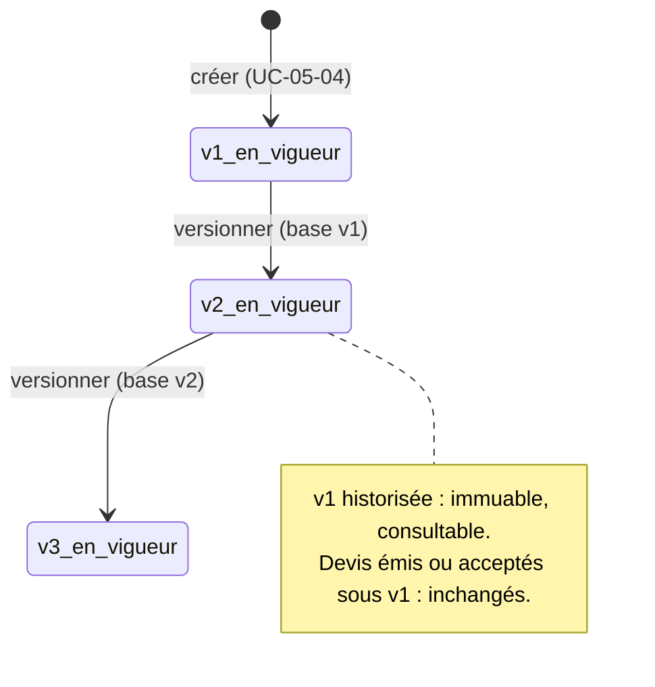

# UC-05-05 — Versionner la grille tarifaire

| Champ | Valeur |
|---|---|
| Statut | Brouillon (en attente de D-05 et Q-26) |
| Priorité | Must |
| Domaine | `pricing` |
| Tâche | B3.5 (+ B3.14 découverte : lire la grille et l'historique des versions) |
| Date | 2026-11-04 |
| Use cases liés | UC-05-04 (version 1) ; UC-05-06, 07, 08 (calcul et devis) ; UC-03-04 (tarifs indicatifs) |
| Exigences couvertes | UC-05-05, RM-05-01, RM-05-03, RM-05-04, RM-05-05, EX-05-001 à 009 |

## 0. Traçabilité

| Exigence | Source | Où elle est traitée |
|---|---|---|
| UC-05-05 | F05 §5 ; PH B3.5 (« crée une nouvelle version, l'ancienne reste historisée ») | §8 ; scénarios 1, 2, 5 |
| RM-05-01 | F05 §Règles ; consigne B3 (« une nouvelle version ne modifie jamais un devis accepté ») | RG-05-05-03 ; scénarios 3, 4 |
| RM-05-03, RM-05-04 | F05 §Règles | RG-05-05-04 ; scénario 9 |
| RM-05-05 | F05 §Règles | RG-05-05-08 ; scénario 11 |
| EX-05-004 | F05 §5 | RG-05-05-02 ; scénarios 7, 8 |
| EX-05-005 | F05 §5 | scénario 14 |
| EX-05-008, 009 | CL ; ARC5 | RG-05-05-01 ; test 9 |
| EX-05-001, 002, 003, 006, 007 | ARC3 ; ARC5 | scénarios 10, 11, 12 ; tests 10 à 12 |

## 1. Objectif

Changer ses prix sans réécrire le passé : chaque changement crée une nouvelle version, l'ancienne reste consultable, et aucun devis déjà émis ou accepté n'est recalculé.

## 2. User story

> En tant que **propriétaire ou administrateur d'agence**, je veux **publier une nouvelle version de ma grille**, afin d'**ajuster mes prix sans modifier ce que j'ai déjà promis à mes clients**.

## 3. Acteurs

Principal : propriétaire ou administrateur actif. Consultation de la grille et de l'historique : tout membre actif, agent compris **[HYPOTHÈSE]**.

## 4. Déclencheur

Le responsable modifie ses prix, ajoute ou retire une zone du barème, change le diviseur volumétrique.

## 5. Préconditions

- P1 : session valide ; P2 : membre actif ; P3 : propriétaire ou administrateur.
- P4 : l'agence a une grille ; le responsable indique le numéro de la version en vigueur sur laquelle il s'appuie.

## 6. Postconditions

- Succès : version n+1 en vigueur ; version n historisée, inchangée ; devis émis et acceptés inchangés ; trace « grille versionnée ».
- Échec : aucune version créée, aucune trace.

## 7. Règles métier

| ID | Règle | Exemple | Source |
|---|---|---|---|
| RG-05-05-01 | Une nouvelle version contient le **barème complet** ; elle reçoit le numéro suivant et entre en vigueur immédiatement **[HYPOTHÈSE]** (Q-26) ; la précédente est historisée : jamais modifiée, jamais supprimée, toujours consultable. | v2 : Akwa jusqu'à 1 kg = 1 200 (au lieu de 1 000) → v2 en vigueur, v1 consultable telle quelle. | PH B3.5 ; EX-05-009 |
| RG-05-05-02 | Versionner exige le numéro de la version en vigueur sur laquelle on s'appuie ; s'il n'est plus le bon, refus pour conflit, rien n'est écrit. | Paul et Awa partent de v1 ; Paul crée v2 ; Awa envoie sa version fondée sur v1 → refus. | ARC5 (`If-Match`) |
| RG-05-05-03 | **RM-05-01** Une nouvelle version ne modifie **aucun** devis : un devis émis garde sa version et son prix pendant sa validité ; un devis accepté les garde définitivement. | DEV-2026-000001 émis sous v1 à 2 500 → reste 2 500 après v2 et v3. | RM-05-01 ; A-22 |
| RG-05-05-04 | Mêmes validations que la création (UC-05-04 : unités explicites, XAF entier, tranches croissantes, zones actives de l'agence, limites). | v2 avec une borne « 5 » sans unité → refus, v1 reste en vigueur. | RM-05-03, 04 |
| RG-05-05-05 | Une version strictement identique à celle en vigueur ne crée rien : succès sans nouvelle version ni trace. | Paul renvoie la v1 telle quelle → toujours v1. | comme B2 (sans changement, sans trace) |
| RG-05-05-06 | Toute simulation ou émission de devis utilise la version **en vigueur au moment du calcul** et en indique le numéro. | Simulation après v2 → 1 200, « version 2 ». | RM-05-01 |
| RG-05-05-07 | Tout membre actif lit la grille en vigueur et l'historique des versions (numéro, date, auteur, barème), paginé par curseur (tâche B3.14). | Céline consulte v1 et v2. | A-35 ; EX-05-006 |
| RG-05-05-08 | Propriétaire et administrateur versionnent ; agent refusé ; ancien membre, autre agence, grille d'une autre agence → introuvable. Sans grille : introuvable (créer d'abord). | Ibrahim versionne la grille d'Express Douala → introuvable. | D-13 ; RM-05-05 |
| RG-05-05-09 | Chaque nouvelle version est auditée (« grille versionnée », numéro) sans prix ni zones. | Trace « grille versionnée, version 2 » par Paul. | EX-05-005 |

## 8. Flux nominal

1. Le responsable lit la version en vigueur (numéro n), prépare le barème complet et l'envoie en indiquant n.
2. Le système vérifie session, membership actif, rôle.
3. Le système verrouille la grille et vérifie que n est la version en vigueur (RG-05-05-02).
4. Le système valide le barème (RG-05-05-04).
5. Le système compare au barème en vigueur (RG-05-05-05).
6. Le système crée la version n+1, en vigueur, sans toucher à la version n ni aux devis.
7. Le système écrit la trace et renvoie la nouvelle version.

## 9. Flux alternatifs

- A1 — Barème identique (étape 5) : succès, version n inchangée, aucune trace.
- A2 — Consultation (B3.14) : tout membre actif lit la version en vigueur et la liste des versions, de la plus récente à la plus ancienne, paginée.

## 10. Flux d'exception

- E1 — Session invalide : 401. E2 — Non membre, ancien membre, autre agence, pas de grille : 404. E3 — Agent : 403.
- E4 — Barème invalide : 400 (comme UC-05-04). Zone inconnue ou d'autrui : 404. Zone retirée : 409.
- E5 — Version de base périmée : 409 `STALE_RATE_CARD_VERSION`. Numéro de base absent : 428 (convention `If-Match` de B2).

## 11. Workflow



## 12. Scénarios d'acceptation (Gherkin)

Copie conforme de [features/versionner-grille.feature](features/versionner-grille.feature).

```gherkin
# language: fr
@UC-05-05 @B3.5
Fonctionnalité: Versionner la grille tarifaire
  Afin d'ajuster mes prix sans modifier ce que j'ai déjà promis
  En tant que propriétaire ou administrateur d'agence
  Je veux publier une nouvelle version de ma grille

  Contexte:
    Étant donné l'agence "Express Douala" soumise à vérification avec la livraison active
    Et "Awa Ngono" propriétaire active de "Express Douala"
    Et "Paul Mbarga" administrateur actif de "Express Douala"
    Et "Céline Fotso" agente active de "Express Douala"
    Et la version 1 de la grille de "Express Douala" en vigueur, créée par "Paul Mbarga" :
      | zone              | jusqu'à | prix (FCFA) |
      | Douala / Akwa     | 1 kg    | 1000        |
      | Douala / Akwa     | 5 kg    | 1500        |
      | Douala / Bonabéri | 1 kg    | 1500        |

  @nominal @RG-05-05-01
  Scénario: Une nouvelle version entre en vigueur et l'ancienne est historisée
    Quand "Paul Mbarga" publie, sur la base de la version 1, un barème où "Douala / Akwa" jusqu'à 1 kg coûte 1200 FCFA
    Alors la version 2 est en vigueur
    Et la version 1 reste consultable avec "Douala / Akwa" jusqu'à 1 kg à 1000 FCFA

  @nominal @RG-05-05-06
  Scénario: Une simulation utilise la version en vigueur
    Étant donné la version 2 en vigueur où "Douala / Akwa" jusqu'à 1 kg coûte 1200 FCFA
    Quand "Céline Fotso" simule le prix d'un colis de 1 kg vers "Douala / Akwa"
    Alors le prix indicatif est de 1200 FCFA selon la version 2

  @alternatif @RG-05-05-03 @RM-05-01
  Scénario: Un devis émis garde son prix après une nouvelle version
    Étant donné le devis "DEV-2026-000001" émis sous la version 1 pour un total de 2500 FCFA
    Quand "Paul Mbarga" publie la version 2 où "Douala / Akwa" jusqu'à 1 kg coûte 1200 FCFA
    Alors le devis "DEV-2026-000001" reste à 2500 FCFA selon la version 1

  @alternatif @RG-05-05-03 @RM-05-01
  Scénario: Un devis accepté n'est jamais recalculé
    Étant donné le devis "DEV-2026-000001" accepté à 2500 FCFA sous la version 1
    Et "Paul Mbarga" a publié les versions 2 et 3
    Quand "Céline Fotso" consulte le devis "DEV-2026-000001"
    Alors le devis est accepté à 2500 FCFA selon la version 1

  @alternatif @RG-05-05-07
  Scénario: Une agente consulte l'historique des versions
    Étant donné "Paul Mbarga" a publié la version 2
    Quand "Céline Fotso" consulte l'historique de la grille de "Express Douala"
    Alors elle voit la version 2 puis la version 1, chacune avec sa date, son auteur et son barème

  @alternatif @RG-05-05-05
  Scénario: Un barème identique ne crée pas de version
    Quand "Paul Mbarga" publie, sur la base de la version 1, un barème identique à la version 1
    Alors la version 1 reste en vigueur
    Et aucune trace n'est ajoutée au journal d'audit

  @erreur @RG-05-05-02
  Scénario: Une version fondée sur une version périmée est refusée
    Étant donné "Paul Mbarga" a publié la version 2 sur la base de la version 1
    Quand "Awa Ngono" publie un barème sur la base de la version 1
    Alors la publication est refusée pour conflit de version
    Et la version 2 reste en vigueur

  @concurrence @RG-05-05-02 @EX-05-004
  Scénario: Deux versions simultanées sur la même base n'en produisent qu'une
    Quand "Awa Ngono" et "Paul Mbarga" publient en même temps un barème différent sur la base de la version 1
    Alors une seule version 2 existe
    Et l'autre publication est refusée pour conflit de version

  @erreur @RG-05-05-04 @RM-05-03
  Scénario: Une version invalide est refusée et la précédente reste en vigueur
    Quand "Paul Mbarga" publie, sur la base de la version 1, une tranche "5" sans unité pour "Douala / Akwa"
    Alors la publication est refusée comme invalide
    Et la version 1 reste en vigueur

  @erreur @securite @RG-05-05-08 @EX-05-002
  Scénario: Une agente ne peut pas versionner la grille
    Quand "Céline Fotso" publie un barème sur la base de la version 1
    Alors l'action lui est refusée comme non autorisée
    Et la version 1 reste en vigueur

  @erreur @securite @RG-05-05-08 @RM-05-05
  Scénario: La grille d'une autre agence est introuvable
    Quand "Ibrahim Bello", propriétaire de "Rapide Yaoundé" uniquement, publie un barème pour la grille de "Express Douala"
    Alors la grille lui est introuvable
    Et la version 1 reste en vigueur

  @erreur @securite @RG-05-05-08 @EX-05-001
  Scénario: Un ancien membre ne trouve plus la grille
    Étant donné "Jean Etoa" ancien administrateur de "Express Douala"
    Quand "Jean Etoa" consulte l'historique de la grille de "Express Douala"
    Alors la grille lui est introuvable

  @erreur @RG-05-05-08
  Scénario: Une agence sans grille ne peut pas versionner
    Étant donné l'agence "Rapide Yaoundé" sans grille tarifaire
    Quand "Ibrahim Bello" publie un barème sur la base de la version 1 pour "Rapide Yaoundé"
    Alors la grille lui est introuvable

  @nominal @RG-05-05-09 @EX-05-005
  Scénario: Une nouvelle version est tracée sans les prix
    Quand "Paul Mbarga" publie la version 2 sur la base de la version 1
    Alors le journal d'audit contient « grille versionnée, version 2 » par "Paul Mbarga"
    Et la trace ne contient ni prix ni zone
```

## 13. Plan de tests TDD

| # | Niveau | Comportement | Étant donné | Quand | Alors | Règle |
|---|---|---|---|---|---|---|
| 1 | unit (domaine) | Nouvelle version | grille v1 | versionner sur base 1 | v2 en vigueur ; v1 inchangée (instantané égal) ; événement `RateCardVersioned` | RG-05-05-01 |
| 2 | unit (domaine) | Base périmée | grille v2 | versionner sur base 1 | `conflict` `STALE_RATE_CARD_VERSION` | RG-05-05-02 |
| 3 | unit (domaine) | Sans changement | grille v1 | barème identique | aucun événement, toujours v1 | RG-05-05-05 |
| 4 | unit (domaine) | Validation réutilisée | grille v1 | barème invalide | `invalid` ; v1 en vigueur | RG-05-05-04 |
| 5 | unit (domaine `Quote`) | Devis figé | devis émis et devis accepté sous v1 | v2 puis v3 | totaux et numéros de version inchangés | RG-05-05-03 |
| 6 | unit (application) | Version utilisée | v2 en vigueur | simuler | numéro 2 et prix v2 | RG-05-05-06 |
| 7 | unit (application) | Droits et isolation | fakes | chaque acteur ; grille d'autrui ; sans grille | `forbidden` agent ; `not_found` sinon | RG-05-05-08 |
| 8 | unit (application) | Audit | fakes | version effective ; sans changement ; refus | une trace ; aucune ; aucune | RG-05-05-09 |
| 9 | feature (PostgreSQL) | Immuabilité | v1 enregistrée | tenter une écriture de la v1 par le repository | aucune méthode de mise à jour d'une version ; contrainte unique `(rate_card_id, number)` | RG-05-05-01 |
| 10 | feature (PostgreSQL) | Concurrence | v1 | deux versionnements simultanés sur base 1 | une seule v2 (verrou de la grille + unicité du numéro) | RG-05-05-02 |
| 11 | E2E | 201, 400, 401, 428 | — | version ; barème invalide ; sans jeton ; sans numéro de base | codes attendus | RG-05-05-01, 04 |
| 12 | E2E | 403, 404, 409, lecture | — | agent ; autre agence ; ancien membre ; base périmée ; historique paginé `{ items, nextCursor, hasMore }` | 403 ; 404 ×3 ; 409 ; liste | RG-05-05-02, 07, 08 |

## 14. Données

Entrée : numéro de la version de base (en-tête de version, comme `If-Match` en B2) + barème complet (mêmes champs que UC-05-04).
Sortie : version (numéro, date, auteur, diviseur, lignes). Historique : `{ items, nextCursor, hasMore }`, du plus récent au plus ancien, au plus 50 par page **[HYPOTHÈSE]**.

## 15. Exigences non fonctionnelles

- Une version écrite n'est jamais mise à jour (aucune méthode de repository ne le permet ; test 9).
- La lecture de la version en vigueur par la simulation ne bloque pas le versionnement (lecture sans verrou exclusif).

## 16. Hors périmètre

Versions programmées à une date future (Q-26) ; retour à une version antérieure (on republie son barème comme nouvelle version) ; comparaison visuelle de deux versions.

## 17. Questions ouvertes

| # | Question | Hypothèse retenue | Impact si différent |
|---|---|---|---|
| Q-26 | Prise d'effet immédiate ou datée ? | Immédiate. | Sélection de version par date, état « programmée ». |
| Q-46 | Lire la grille et l'historique des versions (routes absentes de la fiche, nécessaires à F1.5) ? | Oui, tâche B3.14, tout membre actif. | F1.5 sans écran d'historique. |

## 18. Notes pour le tech lead

- Route indicative de la fiche : `PATCH /rate-cards/{id}` ; elle **crée** une version : préférer une route d'action explicite (`POST …/rate-card/versions`) à fixer en S2, avec le numéro de base dans `If-Match`.
- Verrou de la ligne de grille au versionnement ; numéro calculé sous ce verrou.

Definition of Ready :
- [x] Chaque exigence de la section 0 a au moins un scénario
- [x] Chaque règle a un exemple
- [x] Chaque flux d'exception a un scénario (E1 et 428 : test 11)
- [ ] Aucune question bloquante (D-05, Q-26)
- [x] Le plan TDD couvre chaque règle
- [x] Le `.feature` est synchronisé avec la section 12
