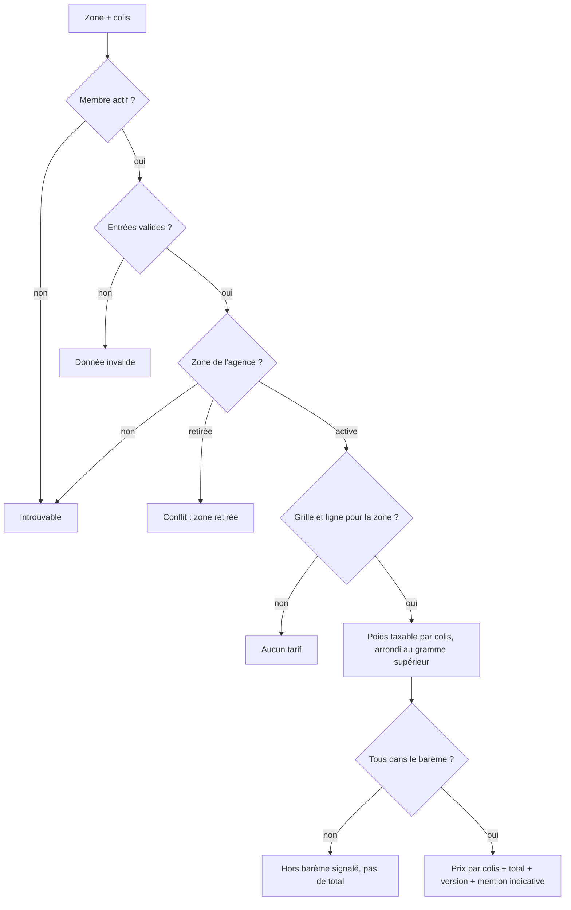

# UC-05-06 — Simuler un prix

| Champ | Valeur |
|---|---|
| Statut | Brouillon (en attente de D-05 : Q-20, Q-21, Q-23 ; Q-28) |
| Priorité | Must |
| Domaine | `pricing` |
| Tâche | B3.6 |
| Date | 2026-11-04 |
| Use cases liés | UC-05-04, 05 (barème) ; UC-05-07 (même calcul) ; UC-05-03 (zone retirée) |
| Exigences couvertes | UC-05-06, RM-05-03, RM-05-04, RM-05-05, RM-03-05, EX-05-001, 003, 006, 007, 012 |

## 0. Traçabilité

| Exigence | Source | Où elle est traitée |
|---|---|---|
| UC-05-06 | F05 §6 ; PH B3.6 (« arrondi monétaire FCFA cohérent ») | §8 ; scénario 1 |
| RM-05-03 | F05 §Règles | RG-05-06-07 ; scénarios 9, 12 |
| RM-05-04 | F05 §Règles | RG-05-06-03 ; scénarios 1, 2, 3 |
| RM-05-05 | F05 §Règles | RG-05-06-08 ; scénario 10 |
| RM-03-05 | F03 §Règles | RG-05-06-06 ; scénario 1 |
| EX-05-012 (D-05) | PG D-05 | RG-05-06-01 à 04 en **[HYPOTHÈSE]** |
| EX-05-001 | ARC3 | scénarios 10, 11 |
| EX-05-003, 006, 007 | CDX ; ARC5 | tests 11, 12 |

## 1. Objectif

Donner à un membre de l'agence un prix indicatif immédiat, calculé avec la version en vigueur, sans rien enregistrer, pour répondre à un client au téléphone ou au comptoir.

## 2. User story

> En tant que **membre d'agence**, je veux **obtenir le prix d'une livraison à partir de la zone et du poids des colis**, afin de **renseigner un client avant de lui émettre un devis**.

## 3. Acteurs

Principal : tout membre actif (propriétaire, administrateur, agent). Le visiteur public n'a **pas** de simulation en B3 **[HYPOTHÈSE]** (Q-28) : il voit les tarifs indicatifs de la fiche (UC-03-04).

## 4. Déclencheur

Un membre saisit une zone de destination et un ou plusieurs colis.

## 5. Préconditions

- P1 : session valide ; P2 : membre actif de l'agence.
- P3 : la zone est une zone de l'agence (active : voir UC-05-03).

## 6. Postconditions

- Succès : un résultat est renvoyé ; **rien n'est enregistré** (ni devis, ni trace d'audit).
- Échec : rien n'est enregistré.

## 7. Règles métier

| ID | Règle | Exemple | Source |
|---|---|---|---|
| RG-05-06-01 | **[HYPOTHÈSE] D-05** Le prix d'un colis est celui de la tranche dont la borne supérieure est la plus petite borne **supérieure ou égale** au poids taxable (borne incluse). | Akwa : 0,999 kg → 1 000 ; 1 kg → 1 000 ; 1,001 kg → 1 500 ; 30 kg → 5 000. | Q-20 |
| RG-05-06-02 | **[HYPOTHÈSE] D-05** Poids taxable = poids réel ; si la version a un diviseur et que les trois dimensions sont fournies, poids taxable = le plus grand du poids réel et de (L × l × h en cm ÷ diviseur) en kg. | Diviseur 5 000, 30 × 20 × 10 cm, 0,5 kg réel → 1,2 kg taxable → 1 500. 10 × 10 × 10 cm, 2 kg → 2 kg. | Q-21 |
| RG-05-06-03 | **RM-05-04 [HYPOTHÈSE]** (Q-23) Le poids taxable est arrondi **au gramme supérieur** ; tous les montants sont des francs entiers ; le total est la somme exacte des prix des colis ; la même règle sert à la simulation et au devis : mêmes entrées et même version → même total. | 0,0004 kg → 1 g. Deux colis 1 000 + 1 500 → 2 500. | RM-05-04 |
| RG-05-06-04 | Un colis dont le poids taxable dépasse la dernière borne est **hors barème** : il est signalé, et le résultat n'a **pas de total** (aucun total partiel trompeur) **[HYPOTHÈSE]**. | Akwa, 31 kg → hors barème. | [HYPOTHÈSE] |
| RG-05-06-05 | Zone sans ligne dans la version en vigueur, ou agence sans grille → « aucun tarif », sans erreur ; zone retirée → refus (UC-05-03). | Deïdo sans ligne → « aucun tarif ». | Q-20 ; RM-05-02 |
| RG-05-06-06 | La simulation n'enregistre rien ; son résultat indique le numéro de version utilisé et la mention « prix indicatif, non garanti sans devis ». | — | RM-03-05 ; RG-05-05-06 |
| RG-05-06-07 | **RM-05-03** Poids saisi avec unité explicite (`kg`, `g`), > 0 et ≤ 1 000 kg ; dimensions facultatives mais toutes les trois ou aucune, en `cm` explicite, de 1 à 500 cm **[HYPOTHÈSE]** ; de 1 à 20 colis. | « 2 » sans unité → refus ; deux dimensions sur trois → refus. | RM-05-03 |
| RG-05-06-08 | Tout membre actif simule ; ancien membre, autre agence, zone inconnue ou d'une autre agence → introuvable. | Ibrahim simule pour Express Douala → introuvable. | EX-05-001 ; RM-05-05 |

## 8. Flux nominal

1. Le membre choisit une zone de destination et décrit chaque colis (poids avec unité, dimensions facultatives).
2. Le système vérifie session et membership actif.
3. Le système valide les entrées (RG-05-06-07).
4. Le système vérifie la zone (agence, statut) et lit la version en vigueur.
5. Pour chaque colis : poids taxable (RG-05-06-02, 03), tranche, prix (RG-05-06-01).
6. Le système renvoie, par colis, le poids taxable et le prix, puis le total, la version et la mention indicative.

## 9. Flux alternatifs

- A1 — Colis hors barème (étape 5) : signalé, pas de total (RG-05-06-04).
- A2 — Zone sans tarif ou agence sans grille (étape 4) : « aucun tarif » (RG-05-06-05).
- A3 — Poids volumétrique (étape 5) : appliqué si diviseur et dimensions (RG-05-06-02).

## 10. Flux d'exception

- E1 — Session invalide : 401. E2 — Non membre, ancien membre, autre agence, zone inconnue ou d'autrui : 404.
- E3 — Entrée invalide (unité, bornes, dimensions incomplètes, 0 ou plus de 20 colis, champ inconnu) : 400.
- E4 — Zone retirée : 409 `ZONE_RETIRED`.

## 11. Workflow



## 12. Scénarios d'acceptation (Gherkin)

Copie conforme de [features/simuler-prix.feature](features/simuler-prix.feature).

```gherkin
# language: fr
@UC-05-06 @B3.6
Fonctionnalité: Simuler un prix
  Afin de renseigner un client avant de lui émettre un devis
  En tant que membre d'agence
  Je veux obtenir le prix d'une livraison à partir de la zone et du poids des colis

  Contexte:
    Étant donné l'agence "Express Douala" soumise à vérification avec la livraison active
    Et "Céline Fotso" agente active de "Express Douala"
    Et "Express Douala" dessert les zones actives "Douala / Akwa", "Douala / Bonabéri" et "Douala / Deïdo"
    Et la version 1 de la grille de "Express Douala" en vigueur :
      | zone              | jusqu'à | prix (FCFA) |
      | Douala / Akwa     | 1 kg    | 1000        |
      | Douala / Akwa     | 5 kg    | 1500        |
      | Douala / Akwa     | 10 kg   | 2500        |
      | Douala / Akwa     | 30 kg   | 5000        |
      | Douala / Bonabéri | 1 kg    | 1500        |

  @nominal @RG-05-06-01 @RG-05-06-03 @RG-05-06-06 @RM-03-05
  Scénario: Une agente simule le prix de deux colis
    Quand "Céline Fotso" simule une livraison vers "Douala / Akwa" de deux colis de 0,8 kg et de 3 kg
    Alors les prix indicatifs sont de 1000 FCFA et de 1500 FCFA
    Et le total indicatif est de 2500 FCFA selon la version 1
    Et le résultat porte la mention « prix indicatif, non garanti sans devis »

  @nominal @RG-05-06-01 @RG-05-06-03
  Plan du scénario: La borne d'une tranche est incluse
    Quand "Céline Fotso" simule une livraison vers "Douala / Akwa" d'un colis de <poids>
    Alors le prix indicatif est de <prix> FCFA

    Exemples:
      | poids     | prix |
      | 0,999 kg  | 1000 |
      | 1 kg      | 1000 |
      | 1000 g    | 1000 |
      | 1,001 kg  | 1500 |
      | 30 kg     | 5000 |

  @alternatif @RG-05-06-02
  Plan du scénario: Le poids volumétrique s'applique quand il dépasse le poids réel
    Étant donné la version en vigueur applique un diviseur volumétrique de 5000
    Quand "Céline Fotso" simule une livraison vers "Douala / Akwa" d'un colis de <poids> mesurant <dimensions>
    Alors le poids taxable est de <taxable>
    Et le prix indicatif est de <prix> FCFA

    Exemples:
      | poids  | dimensions         | taxable | prix |
      | 0,5 kg | 30 × 20 × 10 cm    | 1,2 kg  | 1500 |
      | 2 kg   | 10 × 10 × 10 cm    | 2 kg    | 1500 |

  @alternatif @RG-05-06-04
  Scénario: Un colis hors barème est signalé sans total
    Quand "Céline Fotso" simule une livraison vers "Douala / Akwa" de deux colis de 2 kg et de 31 kg
    Alors le colis de 31 kg est signalé hors barème
    Et aucun total indicatif n'est donné

  @alternatif @RG-05-06-05
  Scénario: Une zone sans tarif ne donne aucun prix
    Quand "Céline Fotso" simule une livraison vers "Douala / Deïdo" d'un colis de 1 kg
    Alors le résultat indique « aucun tarif pour cette zone »

  @alternatif @RG-05-06-05
  Scénario: Une agence sans grille ne donne aucun prix
    Étant donné l'agence "Rapide Yaoundé" sans grille tarifaire, dont "Ibrahim Bello" est propriétaire
    Quand "Ibrahim Bello" simule une livraison vers "Yaoundé" d'un colis de 1 kg
    Alors le résultat indique « aucun tarif pour cette zone »

  @alternatif @RG-05-06-06
  Scénario: Une simulation n'enregistre rien
    Quand "Céline Fotso" simule une livraison vers "Douala / Akwa" d'un colis de 1 kg
    Alors aucun devis n'est créé pour "Express Douala"
    Et aucune trace n'est ajoutée au journal d'audit

  @erreur @RG-05-06-07 @RM-05-03
  Plan du scénario: Un poids sans unité explicite ou hors bornes est refusé
    Quand "Céline Fotso" simule une livraison vers "Douala / Akwa" d'un colis de "<poids>"
    Alors la simulation est refusée comme invalide

    Exemples:
      | poids    |
      | 2        |
      | 2 lb     |
      | 0 kg     |
      | -1 kg    |
      | 1001 kg  |

  @erreur @RG-05-06-07
  Plan du scénario: Le nombre de colis est borné
    Quand "Céline Fotso" simule une livraison vers "Douala / Akwa" de <nombre> colis de 1 kg
    Alors la simulation est <résultat>

    Exemples:
      | nombre | résultat           |
      | 0      | refusée            |
      | 1      | acceptée           |
      | 20     | acceptée           |
      | 21     | refusée            |

  @erreur @securite @RG-05-06-08 @RM-05-05
  Scénario: La zone d'une autre agence est introuvable
    Étant donné l'agence "Rapide Yaoundé" dessert la zone "Yaoundé / Bastos"
    Quand "Céline Fotso" simule, au nom de "Express Douala", une livraison vers "Yaoundé / Bastos"
    Alors la zone lui est introuvable

  @erreur @securite @RG-05-06-08 @EX-05-001
  Plan du scénario: Une personne sans accès actif ne trouve pas l'agence
    Étant donné <situation>
    Quand "<personne>" simule une livraison vers "Douala / Akwa" pour "Express Douala"
    Alors l'agence "Express Douala" lui est introuvable

    Exemples:
      | personne      | situation                                                   |
      | Ibrahim Bello | "Ibrahim Bello" propriétaire de "Rapide Yaoundé" uniquement |
      | Jean Etoa     | "Jean Etoa" ancien administrateur de "Express Douala"       |

  @erreur @RG-05-06-07 @RM-05-03
  Scénario: Des dimensions incomplètes sont refusées
    Quand "Céline Fotso" simule une livraison vers "Douala / Akwa" d'un colis de 1 kg mesurant 30 × 20 cm
    Alors la simulation est refusée comme invalide
```

## 13. Plan de tests TDD

| # | Niveau | Comportement | Étant donné | Quand | Alors | Règle |
|---|---|---|---|---|---|---|
| 1 | unit (domaine, calculateur) | Choix de la tranche | barème Akwa | 0,999 ; 1 ; 1,001 ; 30 ; 31 kg | 1 000 ; 1 000 ; 1 500 ; 5 000 ; hors barème | RG-05-06-01, 04 |
| 2 | unit (domaine) | Poids volumétrique | diviseur 5 000 ; puis sans diviseur | 30 × 20 × 10 cm 0,5 kg ; 10 × 10 × 10 cm 2 kg | 1 200 g ; 2 000 g ; sans diviseur : poids réel | RG-05-06-02 |
| 3 | unit (domaine) | Arrondi | — | 0,0004 kg ; volumétrique 1 199,6 g | 1 g ; 1 200 g | RG-05-06-03 |
| 4 | unit (domaine) | Total | deux colis ; un hors barème | calculer | 2 500 entier ; pas de total | RG-05-06-03, 04 |
| 5 | unit (domaine) | Aucun tarif | sans grille ; sans ligne | calculer | « aucun tarif », pas d'exception | RG-05-06-05 |
| 6 | unit (VO `Weight` saisi) | Unité | — | « 2 », « 2 lb », « 0 kg », « -1 kg », « 1001 kg », « 1000 g » | `invalid` ×5 ; 1 000 g | RG-05-06-07 |
| 7 | unit (VO `Dimensions`) | Dimensions | — | 3 valeurs en cm ; 2 valeurs ; 0 cm ; 501 cm ; sans unité | acceptée ; `invalid` ×4 | RG-05-06-07 |
| 8 | unit (application) | Nombre de colis | — | 0, 1, 20, 21 | `invalid`, OK, OK, `invalid` | RG-05-06-07 |
| 9 | unit (application) | Droits et isolation | fakes | agent ; non-membre ; ancien membre ; zone d'autrui | OK ; `not_found` ×3 | RG-05-06-08 |
| 10 | unit (application) | Rien n'est écrit | fakes | simuler | aucun devis, aucune trace, aucun événement | RG-05-06-06 |
| 11 | E2E | 200, 400, 401 | — | simulation ; entrées invalides ; sans jeton | codes ; résultat avec `version`, `indicative: true` | RG-05-06-01 à 07 |
| 12 | E2E | 404, 409 | — | autre agence ; zone d'autrui ; zone retirée | 404 ×2 ; 409 | RG-05-06-08 ; UC-05-03 |

## 14. Données

| Champ | Type métier | Obligatoire | Contraintes **[HYPOTHÈSE]** |
|---|---|---|---|
| Zone | identifiant de zone de l'agence | oui | zone active |
| Colis | liste | oui | 1 à 20 |
| Colis · poids | valeur + unité (`kg`, `g`) | oui | > 0, ≤ 1 000 kg |
| Colis · dimensions | longueur, largeur, hauteur + unité `cm` | non (les trois ou aucune) | 1 à 500 cm |

Sortie : par colis (poids taxable en grammes, prix en francs ou « hors barème ») ; total en francs ou absent ; devise `XAF` ; numéro de version ; mention indicative.

## 15. Exigences non fonctionnelles

- Calcul en entiers (grammes, francs) : aucun flottant dans le domaine.
- Une seule implémentation du calcul, partagée par la simulation, le devis et les tarifs indicatifs publics.

## 16. Hors périmètre

Simulation publique (Q-28) ; distance, origine, suppléments ; taxes ; remises.

## 17. Questions ouvertes

| # | Question | Hypothèse retenue | Impact si différent |
|---|---|---|---|
| Q-20, Q-21, Q-23 (D-05) | Barème, volumétrique, arrondi | Voir UC-05-04 et RG ci-dessus. | Calcul à refaire. |
| Q-28 | Simulation ouverte aux visiteurs sur la fiche publique ? | Non en B3 ; tarifs indicatifs seulement. | Route publique supplémentaire (CRITIQUE), limitation de débit. |

## 18. Notes pour le tech lead

- Route indicative `POST /quotes/preview` : rattacher à l'agence du chemin (par exemple `POST /agencies/{id}/quotes/preview`), à fixer en S2. Lecture pure : pas de transaction d'écriture.

Definition of Ready :
- [x] Chaque exigence de la section 0 a au moins un scénario
- [x] Chaque règle a un exemple
- [x] Chaque flux d'exception a un scénario (E1 : test 11 ; E4 : UC-05-03)
- [ ] Aucune question bloquante (D-05)
- [x] Le plan TDD couvre chaque règle
- [x] Le `.feature` est synchronisé avec la section 12
