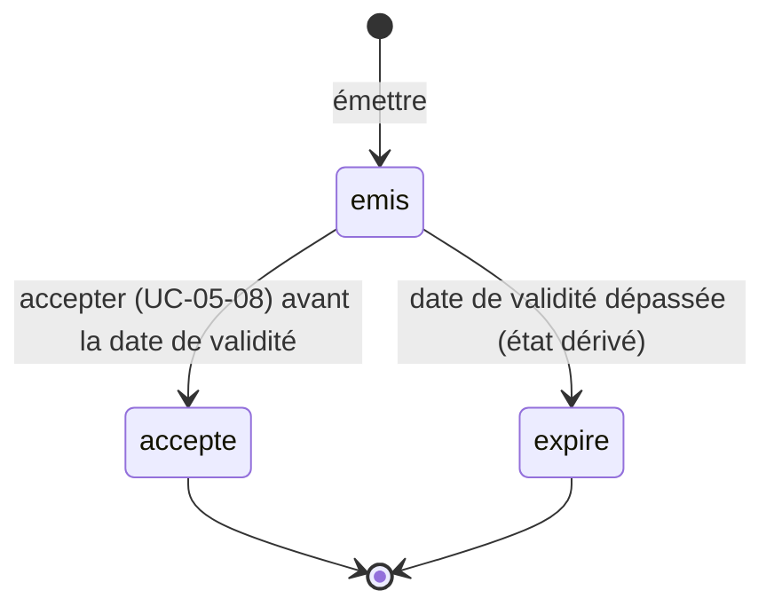

# UC-05-07 — Émettre un devis

| Champ | Valeur |
|---|---|
| Statut | Brouillon (en attente de Q-29 à Q-32, Q-35 et D-05) |
| Priorité | Must |
| Domaine | `pricing` |
| Tâche | B3.7 (+ B3.15 découverte : lister et consulter les devis) |
| Date | 2026-11-04 |
| Use cases liés | UC-05-06 (même calcul) ; UC-05-08 (acceptation) ; UC-05-03 (zone retirée) ; UC-03-05 (B4, demande) ; UC-06-02 (B5, commande) |
| Exigences couvertes | UC-05-07, RM-05-01, RM-05-02, RM-05-04, RM-05-05, EX-05-001, 003 à 008, 010, 011 |

## 0. Traçabilité

| Exigence | Source | Où elle est traitée |
|---|---|---|
| UC-05-07 | F05 §7 ; PH B3.7 | §8 ; scénarios 1, 2 |
| RM-05-01 | F05 §Règles | RG-05-07-01 ; scénario 1 (instantané) |
| RM-05-02 | F05 §Règles | RG-05-07-04 ; UC-05-03 scénario 2 |
| RM-05-04 | F05 §Règles | RG-05-07-02 ; scénario 2 |
| RM-05-05 | F05 §Règles | RG-05-07-08 ; scénarios 12, 14 |
| EX-05-010 | ARC5 (idempotence des créations à risque de doublon) | RG-05-07-07 ; scénarios 9, 10 |
| EX-05-004 | F05 §7 | scénario 11 |
| EX-05-005 | F05 §7 | scénario 16 |
| EX-05-011 | CL Hors périmètre | §16 ; aucun envoi au client |
| EX-05-001, 003, 006, 007, 008 | ARC3 ; ARC5 | scénarios 12, 13, 14 ; tests 14 à 16 |

## 1. Objectif

Remettre au client une proposition chiffrée et datée, qui engage l'agence pendant sa validité, même si la grille change entre-temps.

## 2. User story

> En tant que **membre d'agence**, je veux **émettre un devis daté pour un client**, afin de **lui garantir un prix pendant une durée connue**.

## 3. Acteurs

Principal : tout membre actif (propriétaire, administrateur, agent) **[HYPOTHÈSE]** (Q-32). Le client destinataire n'a pas de compte dans ce parcours : le devis lui est remis hors plateforme (aucune notification, EX-05-011).

## 4. Déclencheur

Un client demande un prix ferme (au comptoir, par téléphone).

## 5. Préconditions

- P1 : session valide ; P2 : membre actif.
- P3 : zone active de l'agence ; capacité livraison active **[HYPOTHÈSE]** (RM-02-03).

## 6. Postconditions

- Succès : devis au statut « émis », avec référence, instantané complet du calcul, date de validité ; trace « devis émis ».
- Échec : aucun devis, aucune trace.

## 7. Règles métier

| ID | Règle | Exemple | Source |
|---|---|---|---|
| RG-05-07-01 | Le devis **fige à l'émission** : numéro de version, libellé de zone, colis (poids saisis, poids taxables), prix par colis, total, devise XAF, date d'émission, date de validité. Aucun changement ultérieur (version, zone) ne le recalcule. | DEV-2026-000001 : Akwa, 0,8 kg → 1 000, 3 kg → 1 500, total 2 500, version 1. | RM-05-01 |
| RG-05-07-02 | Le prix calculé suit exactement la règle de la simulation (UC-05-06) : mêmes entrées, même version → même total. | Simulation 2 500 → devis 2 500. | RM-05-04 |
| RG-05-07-03 | **[HYPOTHÈSE]** (Q-31) Le membre peut retenir un **prix manuel** différent du calcul (négociation, colis hors barème, zone sans tarif), avec un motif obligatoire (3 à 300 caractères) ; le prix calculé (ou son absence) et le prix retenu sont conservés. Sans prix calculable et sans prix manuel → refus. | 2 500 calculé, 2 000 retenu, « client régulier » ; 31 kg hors barème, 7 000 retenu, « gros colis ». | A-22 |
| RG-05-07-04 | Émettre exige une zone active (RM-05-02) et la capacité livraison active **[HYPOTHÈSE]** (une capacité suspendue n'accepte pas de nouvel engagement, RM-02-03). | Livraison suspendue → refus. | RM-05-02 ; RM-02-03 |
| RG-05-07-05 | **[HYPOTHÈSE]** (Q-30) Validité : 7 jours à partir de l'émission ; ensuite le devis est **expiré** (état dérivé de la date, aucune écriture). | Émis le 2026-11-10 à 09:00 → valable jusqu'au 2026-11-17 à 09:00. | [HYPOTHÈSE] |
| RG-05-07-06 | **[HYPOTHÈSE]** (Q-35) Référence lisible unique dans l'agence : `DEV-<année>-<numéro sur 6 chiffres>`, croissante ; deux émissions simultanées ne reçoivent jamais la même référence. | DEV-2026-000001, DEV-2026-000002. | ARC3 §Concurrence (`unique(agency_id, …)`) |
| RG-05-07-07 | **[HYPOTHÈSE]** Une référence d'envoi (clé d'idempotence) facultative protège du double envoi : même clé, même contenu → même devis ; même clé, autre contenu → conflit (comme D-14). | Double clic → un seul DEV-2026-000003. | ARC5 ; D-14 |
| RG-05-07-08 | **[HYPOTHÈSE]** (Q-29) Destinataire : nom (2 à 120 caractères) et téléphone facultatif (`+237` + 9 chiffres) ; donnée personnelle **privée à l'agence** : jamais publique, jamais dans l'audit, jamais dans un événement. Le rattachement à un client d'agence arrive en B4. | « Jean Kamga », +237 699 00 11 22. | ARC3 ; CL Sensibilité |
| RG-05-07-09 | Tout membre actif émet, lit et liste les devis de son agence (liste paginée par curseur, B3.15) ; ancien membre, autre agence, devis ou zone d'une autre agence → introuvable. | Awa lit un devis de Rapide Yaoundé → introuvable. | EX-05-001 ; RM-05-05 |
| RG-05-07-10 | L'émission est auditée (« devis émis », identifiant du devis) sans destinataire ni montant. | — | EX-05-005 |

## 8. Flux nominal

1. Le membre saisit le destinataire, la zone et les colis (comme une simulation), et éventuellement une clé d'idempotence.
2. Le système vérifie session et membership actif.
3. Le système valide les entrées (RG-05-07-08, RG-05-06-07).
4. Le système vérifie la zone (active, de l'agence) et la capacité livraison (RG-05-07-04), sans laisser un retrait concurrent s'intercaler (UC-05-03 RG-05-03-07).
5. Le système calcule le prix avec la version en vigueur (RG-05-07-02).
6. Le système attribue la référence (RG-05-07-06), fixe la validité (RG-05-07-05) et enregistre l'instantané (RG-05-07-01).
7. Le système écrit la trace et renvoie le devis.

## 9. Flux alternatifs

- A1 — Prix manuel motivé (étape 5) : prix retenu = prix manuel ; prix calculé conservé (RG-05-07-03).
- A2 — Rejeu avec la même clé et le même contenu (étape 1) : le devis d'origine est renvoyé, rien n'est écrit.
- A3 — Consultation : tout membre actif lit un devis et la liste des devis (récents d'abord), avec l'état « émis », « accepté » ou « expiré ».

## 10. Flux d'exception

- E1 — Session invalide : 401. E2 — Non membre, ancien membre, autre agence, zone ou devis d'autrui : 404.
- E3 — Entrée invalide, prix manuel sans motif, aucun prix calculable sans prix manuel (`QUOTE_NOT_PRICEABLE`) : 400.
- E4 — Zone retirée (`ZONE_RETIRED`) ou livraison non active (`DELIVERY_NOT_ACTIVE`) : 409.
- E5 — Clé d'idempotence réutilisée avec un autre contenu : 409.

## 11. Workflow



## 12. Scénarios d'acceptation (Gherkin)

Copie conforme de [features/emettre-devis.feature](features/emettre-devis.feature).

```gherkin
# language: fr
@UC-05-07 @B3.7
Fonctionnalité: Émettre un devis
  Afin de garantir un prix à un client pendant une durée connue
  En tant que membre d'agence
  Je veux émettre un devis daté

  Contexte:
    Étant donné l'agence "Express Douala" soumise à vérification avec la livraison active
    Et "Awa Ngono" propriétaire active de "Express Douala"
    Et "Céline Fotso" agente active de "Express Douala"
    Et la version 1 de la grille de "Express Douala" en vigueur :
      | zone              | jusqu'à | prix (FCFA) |
      | Douala / Akwa     | 1 kg    | 1000        |
      | Douala / Akwa     | 5 kg    | 1500        |
      | Douala / Akwa     | 30 kg   | 5000        |
    Et nous sommes le 2026-11-10 à 09:00

  @nominal @RG-05-07-01 @RG-05-07-05 @RG-05-07-06 @RM-05-01
  Scénario: Une agente émet un devis daté
    Quand "Céline Fotso" émet pour "Jean Kamga" un devis de deux colis de 0,8 kg et de 3 kg vers "Douala / Akwa"
    Alors le devis "DEV-2026-000001" est émis pour un total de 2500 FCFA selon la version 1
    Et il est valable jusqu'au 2026-11-17 à 09:00

  @nominal @RG-05-07-02 @RM-05-04
  Scénario: Le devis reprend exactement le prix de la simulation
    Étant donné "Céline Fotso" a simulé deux colis de 0,8 kg et de 3 kg vers "Douala / Akwa" pour 2500 FCFA
    Quand "Céline Fotso" émet pour "Jean Kamga" un devis pour ces mêmes colis
    Alors le total du devis est de 2500 FCFA

  @alternatif @RG-05-07-03
  Scénario: Un prix négocié est retenu avec son motif
    Quand "Céline Fotso" émet pour "Jean Kamga" un devis de deux colis de 0,8 kg et de 3 kg vers "Douala / Akwa" au prix retenu de 2000 FCFA avec le motif "client régulier"
    Alors le devis indique un prix calculé de 2500 FCFA et un prix retenu de 2000 FCFA
    Et le motif "client régulier" est conservé

  @alternatif @RG-05-07-03
  Scénario: Un colis hors barème peut être chiffré à la main
    Quand "Céline Fotso" émet pour "Jean Kamga" un devis d'un colis de 31 kg vers "Douala / Akwa" au prix retenu de 7000 FCFA avec le motif "gros colis"
    Alors le devis est émis pour un total de 7000 FCFA
    Et il indique que le colis était hors barème

  @erreur @RG-05-07-03
  Plan du scénario: Un devis sans prix possible ou sans motif est refusé
    Quand "Céline Fotso" émet pour "Jean Kamga" un devis <situation>
    Alors l'émission est refusée comme invalide
    Et aucun devis n'est créé

    Exemples:
      | situation                                                          |
      | d'un colis de 31 kg vers "Douala / Akwa" sans prix retenu          |
      | d'un colis de 1 kg vers "Douala / Deïdo" sans tarif ni prix retenu |
      | au prix retenu de 2000 FCFA sans motif                             |

  @erreur @RG-05-07-04
  Scénario: Aucun devis n'est émis quand la livraison est suspendue
    Étant donné la capacité livraison de "Express Douala" est suspendue
    Quand "Céline Fotso" émet pour "Jean Kamga" un devis d'un colis de 1 kg vers "Douala / Akwa"
    Alors l'émission est refusée car la livraison n'est pas active

  @erreur @RG-05-07-08
  Plan du scénario: Un destinataire invalide est refusé
    Quand "Céline Fotso" émet un devis pour le destinataire "<nom>" au téléphone "<téléphone>"
    Alors l'émission est refusée comme invalide

    Exemples:
      | nom         | téléphone         |
      | J           | +237699001122     |
      | Jean Kamga  | +33612345678      |

  @alternatif @RG-05-07-07 @EX-05-010
  Scénario: Un double envoi avec la même référence ne crée qu'un devis
    Étant donné "Céline Fotso" a émis le devis "DEV-2026-000003" avec la référence d'envoi "k-2026-11-10-01"
    Quand "Céline Fotso" renvoie le même devis avec la référence d'envoi "k-2026-11-10-01"
    Alors le devis "DEV-2026-000003" lui est renvoyé
    Et aucun autre devis n'est créé

  @erreur @RG-05-07-07 @EX-05-010
  Scénario: La même référence d'envoi pour un autre devis est refusée
    Étant donné "Céline Fotso" a émis un devis avec la référence d'envoi "k-2026-11-10-01"
    Quand "Céline Fotso" émet un devis différent avec la référence d'envoi "k-2026-11-10-01"
    Alors l'émission est refusée pour conflit

  @concurrence @RG-05-07-06 @EX-05-004
  Scénario: Deux devis émis en même temps reçoivent des références distinctes
    Quand "Awa Ngono" et "Céline Fotso" émettent chacune un devis en même temps
    Alors deux devis sont émis avec des références différentes

  @erreur @securite @RG-05-07-09 @RM-05-05
  Scénario: La zone d'une autre agence est introuvable
    Étant donné l'agence "Rapide Yaoundé" dessert la zone "Yaoundé / Bastos"
    Quand "Céline Fotso" émet, au nom de "Express Douala", un devis vers "Yaoundé / Bastos"
    Alors la zone lui est introuvable
    Et aucun devis n'est créé

  @erreur @securite @RG-05-07-09 @EX-05-001
  Plan du scénario: Une personne sans accès actif ne trouve pas l'agence
    Étant donné <situation>
    Quand "<personne>" émet un devis pour "Express Douala"
    Alors l'agence "Express Douala" lui est introuvable

    Exemples:
      | personne      | situation                                                   |
      | Ibrahim Bello | "Ibrahim Bello" propriétaire de "Rapide Yaoundé" uniquement |
      | Jean Etoa     | "Jean Etoa" ancien administrateur de "Express Douala"       |

  @erreur @securite @RG-05-07-09 @RM-05-05
  Scénario: Le devis d'une autre agence est introuvable
    Étant donné le devis "DEV-2026-000001" émis par "Rapide Yaoundé"
    Quand "Awa Ngono" consulte, au nom de "Express Douala", ce devis de "Rapide Yaoundé"
    Alors le devis lui est introuvable

  @alternatif @RG-05-07-05
  Scénario: Un devis dont la validité est dépassée apparaît expiré
    Étant donné le devis "DEV-2026-000001" émis le 2026-11-10 à 09:00 et non accepté
    Quand "Céline Fotso" consulte le devis le 2026-11-17 à 09:01
    Alors le devis apparaît comme expiré

  @nominal @RG-05-07-10 @RG-05-07-08 @EX-05-005
  Scénario: L'émission est tracée sans données du destinataire
    Quand "Céline Fotso" émet pour "Jean Kamga" un devis d'un colis de 1 kg vers "Douala / Akwa"
    Alors le journal d'audit contient « devis émis » par "Céline Fotso" pour ce devis
    Et la trace ne contient ni le nom ni le téléphone du destinataire, ni aucun montant
```

## 13. Plan de tests TDD

| # | Niveau | Comportement | Étant donné | Quand | Alors | Règle |
|---|---|---|---|---|---|---|
| 1 | unit (domaine `Quote`) | Instantané | calcul 2 500, v1 | émettre | instantané complet ; statut émis ; événement `QuoteIssued` | RG-05-07-01 |
| 2 | unit (domaine) | Validité et expiration | émis 2026-11-10 09:00 | état à 2026-11-17 09:00 et 09:01 | émis ; expiré | RG-05-07-05 |
| 3 | unit (domaine) | Prix manuel | calcul 2 500 ; hors barème | prix 2 000 avec / sans motif ; aucun prix | conservé ; `invalid` ; `invalid` `QUOTE_NOT_PRICEABLE` | RG-05-07-03 |
| 4 | unit (VO `QuoteReference`) | Format | — | année 2026, numéro 1 ; 1 000 000 | `DEV-2026-000001` ; borne | RG-05-07-06 |
| 5 | unit (VO `Recipient`) | Destinataire | — | nom 1, 2, 120, 121 ; téléphone étranger | bornes ; `invalid` | RG-05-07-08 |
| 6 | unit (application) | Cohérence avec la simulation | fakes | simuler puis émettre mêmes entrées | même total | RG-05-07-02 |
| 7 | unit (application) | Préconditions | fakes | zone retirée ; livraison suspendue | `conflict` ×2, aucun devis | RG-05-07-04 |
| 8 | unit (application) | Droits et isolation | fakes | agent ; non-membre ; ancien membre ; zone d'autrui ; lecture d'un devis d'autrui | OK ; `not_found` ×4 | RG-05-07-09 |
| 9 | unit (application) | Idempotence | fakes | même clé même contenu ; autre contenu | même devis ; `conflict` | RG-05-07-07 |
| 10 | unit (application) | Audit | fakes | émettre | trace avec `resource_id`, sans destinataire ni montant | RG-05-07-10 |
| 11 | feature (PostgreSQL) | Références uniques | — | 2 émissions simultanées | références distinctes ; contrainte `unique(agency_id, reference)` | RG-05-07-06 |
| 12 | feature (PostgreSQL) | Rejeu concurrent | — | 2 envois simultanés même clé | un seul devis (table `idempotency_keys`) | RG-05-07-07 |
| 13 | feature (PostgreSQL) | Montants entiers | — | insertion d'un total non entier | refusée (types et `CHECK`) | RG-05-07-01 |
| 14 | E2E | 201, 400, 401 | — | émission ; entrées invalides ; sans jeton | codes attendus ; Problem Details | RG-05-07-01 à 08 |
| 15 | E2E | 404, 409 | — | autre agence ; ancien membre ; zone d'autrui ; zone retirée ; livraison suspendue ; clé réutilisée | 404 ×3 ; 409 ×3 | RG-05-07-04, 07, 09 |
| 16 | E2E | Lecture et liste | 3 devis, un d'une autre agence | lire ; lister `limit=2` | devis visible ; liste paginée sans le devis d'autrui ; devis d'autrui → 404 | RG-05-07-09 |

## 14. Données

| Champ | Type métier | Obligatoire | Contraintes **[HYPOTHÈSE]** |
|---|---|---|---|
| Destinataire · nom | texte | oui | 2 à 120 caractères, sans caractère de contrôle ni de format |
| Destinataire · téléphone | téléphone | non | `+237` + 9 chiffres (2 ou 6) |
| Zone, colis | comme UC-05-06 | oui | — |
| Prix retenu | montant XAF entier | non | 1 à 10 000 000 |
| Motif du prix retenu | texte | si prix retenu | 3 à 300 caractères |
| Référence d'envoi | clé d'idempotence (en-tête) | non | 8 à 128 caractères ASCII visibles (comme B2) |

Sortie : devis (identifiant, référence, statut, destinataire, zone figée, colis, prix calculé, prix retenu, motif, total, devise, version, dates d'émission et de validité, auteur).

## 15. Exigences non fonctionnelles

- Le destinataire n'apparaît ni dans les journaux techniques, ni dans l'audit, ni dans un événement.
- Liste des devis : index `(agency_id, issued_at, id)` à vérifier par EXPLAIN (agent `query-perf`).

## 16. Hors périmètre

Envoi du devis au client (e-mail, SMS, WhatsApp, PDF) ; paiement ou acompte ; annulation ou refus d'un devis ; rattachement à un client d'agence (B4) ou à une demande marketplace (B4).

## 17. Questions ouvertes

| # | Question | Hypothèse retenue | Impact si différent |
|---|---|---|---|
| Q-29 | Destinataire d'un devis avant B4 ? | Nom + téléphone facultatif, privé à l'agence. | Attendre B4 (client d'agence obligatoire). |
| Q-30 | Durée de validité ? | 7 jours. | Constante ou réglage par agence. |
| Q-31 | Prix manuel motivé ? | Oui. | Hors barème non chiffrable par devis. |
| Q-32 | Qui émet et enregistre l'acceptation ? | Tout membre actif, agent compris. | Matrice des droits. |
| Q-35 | Référence lisible `DEV-AAAA-NNNNNN` par agence ? | Oui. | Identifiant seul. |

## 18. Notes pour le tech lead

- Agrégat candidat `Quote` (un par devis) ; référence calculée sous un compteur par agence verrouillé, ou séquence par agence ; unicité garantie en base.
- Idempotence : réutiliser `IdempotencyKeys` (portée « émission de devis » par acteur).
- Données personnelles : prévoir dès S2 leur durée de conservation (question générale de B4).

Definition of Ready :
- [x] Chaque exigence de la section 0 a au moins un scénario
- [x] Chaque règle a un exemple
- [x] Chaque flux d'exception a un scénario (E1 : test 14 ; E4 zone retirée : UC-05-03)
- [ ] Aucune question bloquante (Q-29, Q-31, Q-32)
- [x] Le plan TDD couvre chaque règle
- [x] Le `.feature` est synchronisé avec la section 12
