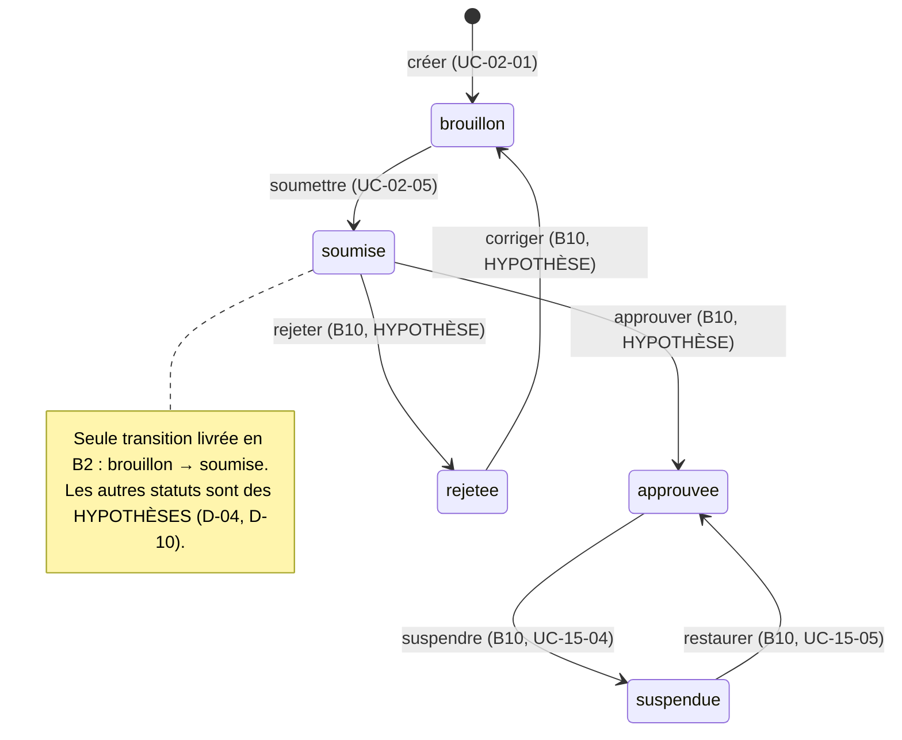
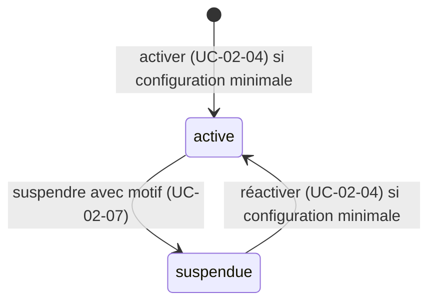

# Use cases — index

Spécifications exécutables (BDD/TDD) produites à l'étape **S1** de chaque phase backend. Inventaire, anomalies et traçabilité : [exigences.md](exigences.md).

| Phase | Module | Dossier | Statut |
|---|---|---|---|
| B2 | 02 — Agences et onboarding | [02-agences-onboarding/](02-agences-onboarding/) | En attente de réponses (D-04) |

---

## B2 — Agences et onboarding

| ID | Titre | Acteur principal | Tâche | Exigences couvertes | Fichier | Gherkin |
|---|---|---|---|---|---|---|
| UC-02-01 | Créer un brouillon d'agence | Personne connectée (particulier ou commerçant) | B2.1 | UC-02-01, RM-02-01, EX-02-001, 003, 004, 005, 008, 009, 010, 011, 013 | [UC-02-01](02-agences-onboarding/UC-02-01-creer-brouillon-agence.md) | [creer-brouillon-agence.feature](02-agences-onboarding/features/creer-brouillon-agence.feature) |
| UC-02-02 | Compléter l'identité de l'agence | Propriétaire ou administrateur | B2.2 | UC-02-02, RM-02-01, EX-02-001, 002, 003, 005, 011, 012, 013 | [UC-02-02](02-agences-onboarding/UC-02-02-completer-identite-agence.md) | [completer-identite-agence.feature](02-agences-onboarding/features/completer-identite-agence.feature) |
| UC-02-03 | Renseigner les zones desservies | Propriétaire ou administrateur | B2.3 | UC-02-03, RM-02-02, EX-02-001 à 007, 011, 013 | [UC-02-03](02-agences-onboarding/UC-02-03-renseigner-zones-desservies.md) | [renseigner-zones-desservies.feature](02-agences-onboarding/features/renseigner-zones-desservies.feature) |
| UC-02-04 | Activer une capacité livraison ou stockage | Propriétaire ou administrateur | B2.4 | UC-02-04, RM-02-02, EX-02-001 à 006, 010, 011, 013 | [UC-02-04](02-agences-onboarding/UC-02-04-activer-capacite.md) | [activer-capacite.feature](02-agences-onboarding/features/activer-capacite.feature) |
| UC-02-05 | Soumettre l'agence à vérification | Propriétaire | B2.5 | UC-02-05, RM-02-01, 02, 04, EX-02-001 à 006, 010, 011, 013 | [UC-02-05](02-agences-onboarding/UC-02-05-soumettre-verification.md) | [soumettre-verification.feature](02-agences-onboarding/features/soumettre-verification.feature) |
| UC-02-06 | Modifier le profil de l'agence | Propriétaire ou administrateur | B2.6 | UC-02-06, EX-02-001, 002, 003, 005, 011, 012, 013 | [UC-02-06](02-agences-onboarding/UC-02-06-modifier-profil-agence.md) | [modifier-profil-agence.feature](02-agences-onboarding/features/modifier-profil-agence.feature) |
| UC-02-07 | Suspendre une capacité | Propriétaire ou administrateur | B2.7 | UC-02-07, RM-02-03, EX-02-001 à 007, 010, 011, 013 | [UC-02-07](02-agences-onboarding/UC-02-07-suspendre-capacite.md) | [suspendre-capacite.feature](02-agences-onboarding/features/suspendre-capacite.feature) |
| UC-02-08 | Gérer les sites de l'agence | Propriétaire ou administrateur (consultation : tout membre) | B2.8 | UC-02-08, RM-02-02, EX-02-001 à 007, 011, 012, 013 | [UC-02-08](02-agences-onboarding/UC-02-08-gerer-sites.md) | [gerer-sites.feature](02-agences-onboarding/features/gerer-sites.feature) |
| UC-02-09 | Consulter l'état d'onboarding *(ajouté, hors liste de la fiche — anomalie A-01)* | Tout membre actif | B2.9 | UC-02-09, RM-02-01 à 04, EX-02-001, 003, 011, 013 | [UC-02-09](02-agences-onboarding/UC-02-09-consulter-etat-onboarding.md) | [consulter-etat-onboarding.feature](02-agences-onboarding/features/consulter-etat-onboarding.feature) |

Déjà implémenté, non réécrit : l'équipe de l'agence (inviter, accepter une invitation, changer un rôle, retirer un accès, lister mes agences — UC-01-05 à UC-01-09, `backend/docs/domains.md` §Agences). La liste des membres d'une agence n'existe pas encore (anomalie A-09).

### Acteurs

| Acteur | Rôle dans le lot | Source |
|---|---|---|
| Personne connectée (compte particulier ou commerçant) | Crée une agence et en devient propriétaire. | ARC3 §Identités (rôles contextuels) ; RIA |
| Propriétaire (`owner`) | Configure l'agence et la soumet à vérification. | DOM §Agences |
| Administrateur d'agence (`admin`) | Configure l'agence, ne la soumet pas **[HYPOTHÈSE]**. | DOM §Agences |
| Agent (`agent`) | Consulte l'état d'onboarding et les sites, ne modifie rien **[HYPOTHÈSE]**. | DOM §Agences |
| Ancien membre (membership désactivé) | Traité comme un étranger à l'agence : « introuvable ». | DOM §Agences |
| Membre d'une autre agence | « Introuvable ». | ARC3 §Sécurité |
| Visiteur non connecté | Aucun accès ; connexion demandée. | RIA |
| Admin plateforme | **Hors périmètre B2** : examine, approuve ou rejette en B10 (UC-15-01 à 03). | F15 |
| Livreur (mobile), commerçant en tant que client | Aucune action dans ce lot. Le parcours mobile « réseau intermittent, action rejouée » ne s'applique pas ; seul le rejeu d'une création ou d'une action par le back-office est traité (UC-02-01, 04, 05, 07). | — |

### Distribution des exemples (commune à tous les scénarios)

| Personne | Situation |
|---|---|
| Awa Ngono | Propriétaire active de « Express Douala » |
| Paul Mbarga | Administrateur actif de « Express Douala » |
| Céline Fotso | Agente active de « Express Douala » |
| Jean Etoa | Ancien administrateur de « Express Douala », accès retiré |
| Ibrahim Bello | Propriétaire actif de « Rapide Yaoundé » uniquement |
| Marie Tchoua | Compte commerçant, membre d'aucune agence |

### Matrice des droits — [HYPOTHÈSE] (question Q-05, à valider)

| Action | Propriétaire | Administrateur | Agent | Ancien membre / autre agence | Non connecté |
|---|---|---|---|---|---|
| Créer une agence | toute personne connectée | — | — | — | refus (401) |
| Compléter l'identité, modifier le profil | oui | oui | refus (403) | introuvable (404) | refus (401) |
| Zones, capacités (activer, suspendre), sites (créer, modifier, désactiver, réactiver) | oui | oui | refus (403) | introuvable (404) | refus (401) |
| Soumettre à vérification | oui | refus (403) | refus (403) | introuvable (404) | refus (401) |
| Consulter l'état d'onboarding, la liste des sites | oui | oui | oui | introuvable (404) | refus (401) |

Motif proposé : la soumission engage l'agence auprès de la plateforme ; seul le propriétaire en répond, comme pour la gestion des administrateurs en B1.

### Cycle de vie de l'agence

### Ce qui reste modifiable selon le statut — [HYPOTHÈSE] (question Q-03)

| Opération | Brouillon | Soumise |
|---|---|---|
| Compléter l'identité (UC-02-02) | oui | **non** : l'identité est ce qui est vérifié |
| Modifier le profil (UC-02-06) | oui | oui |
| Zones (UC-02-03), capacités (UC-02-04, 07), sites (UC-02-08) | oui | oui |
| Soumettre (UC-02-05) | oui | non (déjà soumise) |

### Cycle de vie d'une capacité

### Hors périmètre du lot

- Approbation, rejet, demande de justificatif, suspension d'agence par l'admin plateforme (B10, UC-15-01 à 07).
- Dépôt de documents justificatifs (upload, stockage D-08) ; critères de certification et expiration (EX-02-015).
- Publication de la fiche publique et projection marketplace (B3, UC-03-01) ; blocage effectif des nouvelles demandes (B4, UC-03-05).
- Zones tarifaires et grilles (B3, UC-05-01 et suivants).
- Paiements, commissions, abonnements facturés, quotas d'abonnement.
- Notifications (e-mail, SMS, push), messagerie, WhatsApp : aucune confirmation n'est envoyée à la création, à la soumission ou à la suspension.
- Suppression physique d'une agence, d'un site, d'une zone ou d'une capacité.

### Questions ouvertes du lot (regroupées)

Chaque use case reprend les questions qui le concernent. Les hypothèses par défaut permettent de planifier S2 ; aucune ne devient une règle ferme sans réponse.

| # | Question | Hypothèse par défaut | Décision | UC |
|---|---|---|---|---|
| Q-01 | Quels champs d'identité et quels documents sont obligatoires pour soumettre ? RCCM et NIU sont-ils exigés ? | Obligatoires : raison sociale, ville et adresse du siège, téléphone principal. Facultatifs : e-mail de contact, RCCM, NIU. Aucun document en B2. | D-04 | 02, 05, 09 |
| Q-02 | Quelle est la configuration minimale de chaque capacité ? | Livraison : ≥ 1 zone desservie active. Stockage : ≥ 1 site actif. | D-04 | 03, 04, 05, 08 |
| Q-03 | Que peut encore modifier une agence soumise ? Peut-elle retirer sa soumission ? | Identité verrouillée ; profil, zones, capacités, sites modifiables ; pas de retrait. | D-04 | 02, 05, 06 |
| Q-04 | Quels statuts suivent `soumise` et qui décide ? | `approuvée`, `rejetée` (retour en brouillon pour correction), `suspendue` ; décision par l'admin plateforme en B10. | D-04, D-10 | 05 |
| Q-05 | Qui peut configurer et qui peut soumettre ? | Matrice ci-dessus : propriétaire + administrateur configurent ; propriétaire seul soumet ; agent en lecture. | nouvelle (D-12 proposée) | 02 à 09 |
| Q-06 | Faut-il protéger la création d'agence contre le double envoi ? | Oui : clé d'idempotence facultative ; même clé et même contenu → même agence. | nouvelle | 01 |
| Q-07 | La zone desservie de l'onboarding et la zone tarifaire du lot 3 sont-elles le même objet ? | Non en B2 ; rapprochement décidé au lot 3. | D-05 | 03 |
| Q-08 | Un brouillon peut-il être abandonné ou archivé ? Un nombre maximal d'agences par compte ? | Non traité en B2 ; aucune limite. | nouvelle | 01 |
| Q-09 | Une capacité suspendue affecte-t-elle les demandes et commandes déjà acceptées ? | Non ; seules les nouvelles demandes sont bloquées (vérifié en B4). | D-06 | 07 |
| Q-10 | `AgencyRegistered` est-il émis à la création ou à la soumission ? | À la création ; la soumission émet `AgencySubmittedForVerification`. | nouvelle | 01, 05 |
| Q-11 | Un second envoi d'une action déjà faite (soumettre, activer, suspendre) : conflit ou succès sans effet ? | Conflit (« déjà soumise », « déjà active », « déjà suspendue »), aucun second effet ni seconde trace. | nouvelle | 04, 05, 07 |
| Q-12 | Ajouter une route de liste des membres d'une agence (manque pour F1.3) ? | Oui, tâche backend à ajouter hors B2 ou en B2.10. | nouvelle | — |
| Q-13 | Accepter des numéros de téléphone étrangers ? | Non : `+237` + 9 chiffres commençant par 2 ou 6. | D-04 | 02, 08 |
| Q-14 | Villes et quartiers en texte libre ou référentiel ? | Texte libre normalisé. | D-04 | 02, 03, 08 |
| Q-15 | Nombre maximal de zones actives ? | 100. | nouvelle | 03 |
| Q-16 | Contenu du profil (logo, horaires…) ? | Nom commercial et description seulement, aucun upload. | D-04 | 06 |
| Q-17 | Motif de suspension obligatoire ? Fin de suspension programmée ? | Motif obligatoire (3 à 500 caractères) ; pas de date de fin. | nouvelle | 07 |
| Q-18 | Contenu d'un site (type, GPS, horaires) ? | Nom, ville, adresse, téléphone facultatif ; pas de GPS. | D-04, D-08 | 08 |
| Q-19 | Auditer les lectures (état d'onboarding) ? | Non en B2. | nouvelle | 09 |

### Volumétrie de la spécification B2

| UC | Scénarios | dont nominal / alternatif / erreur / concurrence | Tests TDD prévus (unit / feature / E2E) |
|---|---|---|---|
| UC-02-01 | 12 | 3 / 3 / 5 / 1 | 16 (10 / 2 / 4) |
| UC-02-02 | 13 | 3 / 2 / 8 / 0 | 13 (10 / 1 / 2) |
| UC-02-03 | 15 | 3 / 4 / 7 / 1 | 14 (11 / 1 / 2) |
| UC-02-04 | 13 | 3 / 3 / 5 / 2 | 13 (10 / 1 / 2) |
| UC-02-05 | 11 | 3 / 0 / 7 / 1 | 12 (9 / 1 / 2) |
| UC-02-06 | 11 | 3 / 2 / 6 / 0 | 10 (7 / 1 / 2) |
| UC-02-07 | 12 | 3 / 3 / 5 / 1 | 11 (8 / 1 / 2) |
| UC-02-08 | 15 | 3 / 3 / 8 / 1 | 14 (9 / 2 / 3) |
| UC-02-09 | 9 | 4 / 3 / 2 / 0 | 9 (2 / 0 / 7) |
| **Total** | **111** | **28 / 23 / 53 / 7** | **112 (76 / 10 / 26)** |
