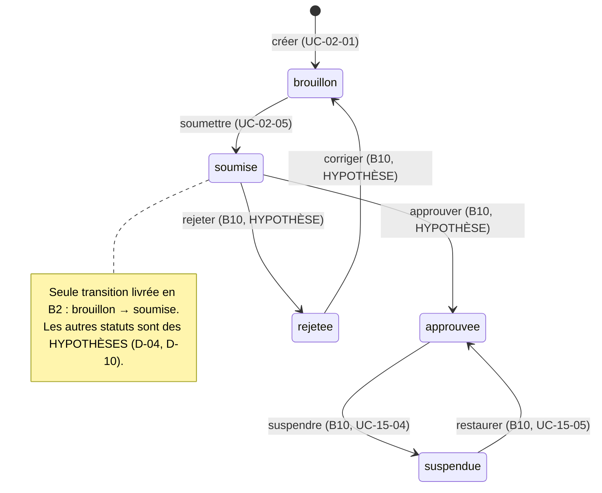
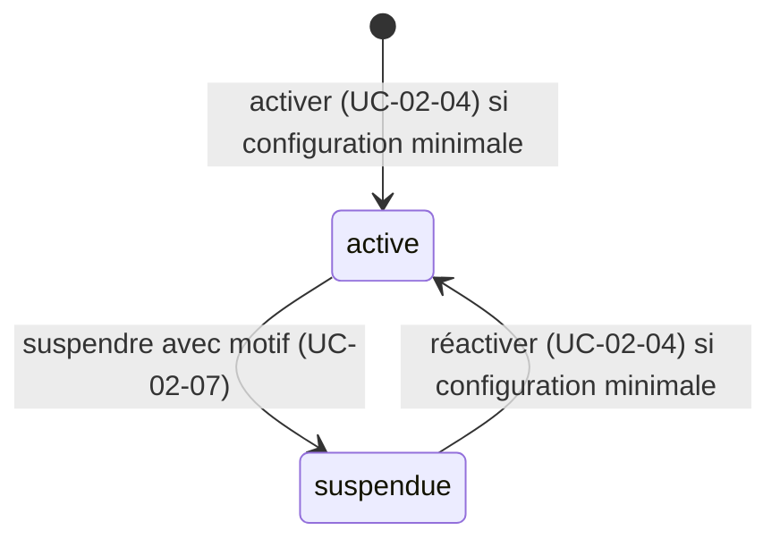
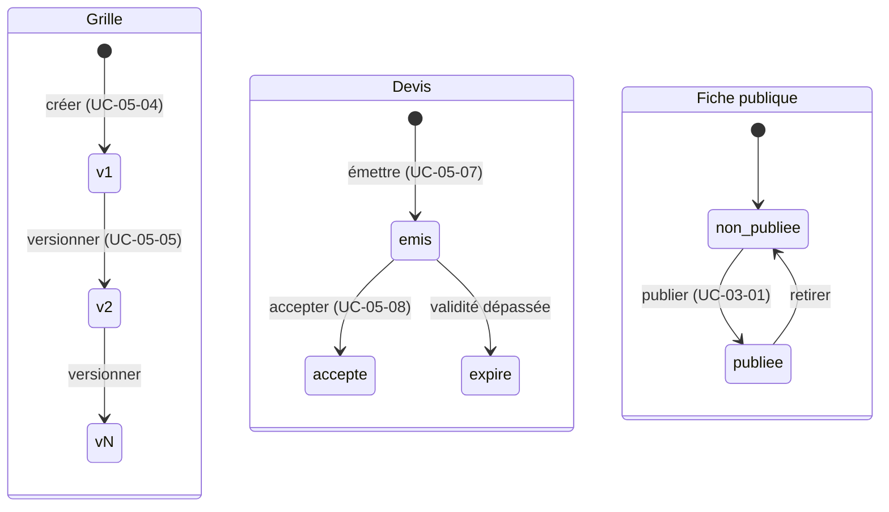

# Use cases — index

Spécifications exécutables (BDD/TDD) produites à l'étape **S1** de chaque phase backend. Inventaire, anomalies et traçabilité : [exigences.md](exigences.md).

| Phase | Module | Dossier | Statut |
|---|---|---|---|
| B2 | 02 — Agences et onboarding | [02-agences-onboarding/](02-agences-onboarding/) | Livré (B2 terminé le 2026-11-04 ; D-04, D-13 à D-15, D-17, D-19, D-20 tranchées) |
| B3 | 05 — Tarifs et zones | [05-tarifs-zones/](05-tarifs-zones/) | En attente de réponses (D-05 barèmes, devis) |
| B3 | 03 — Marketplace publique (UC-03-01 à 04) | [03-marketplace-publique/](03-marketplace-publique/) | En attente de réponses (fiche publique, recherche) |

---

## B2 — Agences et onboarding

| ID | Titre | Acteur principal | Tâche | Exigences couvertes | Fichier | Gherkin |
|---|---|---|---|---|---|---|
| UC-02-01 | Créer un brouillon d'agence | Personne connectée (particulier ou commerçant) | B2.1 | UC-02-01, RM-02-01, EX-02-001, 003, 004, 005, 008, 009, 010, 011, 013 | [UC-02-01](02-agences-onboarding/UC-02-01-creer-brouillon-agence.md) | [creer-brouillon-agence.feature](02-agences-onboarding/features/creer-brouillon-agence.feature) |
| UC-02-02 | Compléter l'identité de l'agence | Propriétaire ou administrateur | B2.2 | UC-02-02, RM-02-01, EX-02-001, 002, 003, 005, 011, 012, 013 | [UC-02-02](02-agences-onboarding/UC-02-02-completer-identite-agence.md) | [completer-identite-agence.feature](02-agences-onboarding/features/completer-identite-agence.feature) |
| UC-02-03 | Renseigner les zones desservies | Propriétaire ou administrateur | B2.3 | UC-02-03, RM-02-02, EX-02-001 à 007, 011, 013 | [UC-02-03](02-agences-onboarding/UC-02-03-renseigner-zones-desservies.md) | [renseigner-zones-desservies.feature](02-agences-onboarding/features/renseigner-zones-desservies.feature) |
| UC-02-04 | Activer une capacité livraison ou stockage | Propriétaire ou administrateur | B2.4 | UC-02-04, RM-02-02, EX-02-001 à 006, 010, 011, 013 | [UC-02-04](02-agences-onboarding/UC-02-04-activer-capacite.md) | [activer-capacite.feature](02-agences-onboarding/features/activer-capacite.feature) |
| UC-02-05 | Soumettre l'agence à vérification | Propriétaire | B2.5 | UC-02-05, RM-02-01, 02, 04, EX-02-001 à 006, 010, 011, 013 | [UC-02-05](02-agences-onboarding/UC-02-05-soumettre-verification.md) | [soumettre-verification.feature](02-agences-onboarding/features/soumettre-verification.feature) |
| UC-02-06 | Modifier le profil de l'agence | Propriétaire ou administrateur | B2.6 | UC-02-06, EX-02-001, 002, 003, 005, 011, 012, 013 | [UC-02-06](02-agences-onboarding/UC-02-06-modifier-profil-agence.md) | [modifier-profil-agence.feature](02-agences-onboarding/features/modifier-profil-agence.feature) |
| UC-02-07 | Suspendre une capacité | Propriétaire ou administrateur | B2.7 | UC-02-07, RM-02-03, EX-02-001 à 007, 010, 011, 013 | [UC-02-07](02-agences-onboarding/UC-02-07-suspendre-capacite.md) | [suspendre-capacite.feature](02-agences-onboarding/features/suspendre-capacite.feature) |
| UC-02-08 | Gérer les sites de l'agence | Propriétaire ou administrateur (consultation : tout membre) | B2.8 | UC-02-08, RM-02-02, EX-02-001 à 007, 011, 012, 013 | [UC-02-08](02-agences-onboarding/UC-02-08-gerer-sites.md) | [gerer-sites.feature](02-agences-onboarding/features/gerer-sites.feature) |
| UC-02-09 | Consulter l'état d'onboarding *(ajouté, hors liste de la fiche — anomalie A-01)* | Tout membre actif | B2.9 | UC-02-09, RM-02-01 à 04, EX-02-001, 003, 011, 013 | [UC-02-09](02-agences-onboarding/UC-02-09-consulter-etat-onboarding.md) | [consulter-etat-onboarding.feature](02-agences-onboarding/features/consulter-etat-onboarding.feature) |

Déjà implémenté, non réécrit : l'équipe de l'agence (inviter, accepter une invitation, changer un rôle, retirer un accès, lister mes agences — UC-01-05 à UC-01-09, `backend/docs/domains.md` §Agences). La liste des membres d'une agence n'existe pas encore (anomalie A-09).

### Acteurs

| Acteur | Rôle dans le lot | Source |
|---|---|---|
| Personne connectée (compte particulier ou commerçant) | Crée une agence et en devient propriétaire. | ARC3 §Identités (rôles contextuels) ; RIA |
| Propriétaire (`owner`) | Configure l'agence et la soumet à vérification. | DOM §Agences |
| Administrateur d'agence (`admin`) | Configure l'agence, ne la soumet pas **[HYPOTHÈSE]**. | DOM §Agences |
| Agent (`agent`) | Consulte l'état d'onboarding et les sites, ne modifie rien **[HYPOTHÈSE]**. | DOM §Agences |
| Ancien membre (membership désactivé) | Traité comme un étranger à l'agence : « introuvable ». | DOM §Agences |
| Membre d'une autre agence | « Introuvable ». | ARC3 §Sécurité |
| Visiteur non connecté | Aucun accès ; connexion demandée. | RIA |
| Admin plateforme | **Hors périmètre B2** : examine, approuve ou rejette en B10 (UC-15-01 à 03). | F15 |
| Livreur (mobile), commerçant en tant que client | Aucune action dans ce lot. Le parcours mobile « réseau intermittent, action rejouée » ne s'applique pas ; seul le rejeu d'une création ou d'une action par le back-office est traité (UC-02-01, 04, 05, 07). | — |

### Distribution des exemples (commune à tous les scénarios)

| Personne | Situation |
|---|---|
| Awa Ngono | Propriétaire active de « Express Douala » |
| Paul Mbarga | Administrateur actif de « Express Douala » |
| Céline Fotso | Agente active de « Express Douala » |
| Jean Etoa | Ancien administrateur de « Express Douala », accès retiré |
| Ibrahim Bello | Propriétaire actif de « Rapide Yaoundé » uniquement |
| Marie Tchoua | Compte commerçant, membre d'aucune agence |

### Matrice des droits — [HYPOTHÈSE] (question Q-05, à valider)

| Action | Propriétaire | Administrateur | Agent | Ancien membre / autre agence | Non connecté |
|---|---|---|---|---|---|
| Créer une agence | toute personne connectée | — | — | — | refus (401) |
| Compléter l'identité, modifier le profil | oui | oui | refus (403) | introuvable (404) | refus (401) |
| Zones, capacités (activer, suspendre), sites (créer, modifier, désactiver, réactiver) | oui | oui | refus (403) | introuvable (404) | refus (401) |
| Soumettre à vérification | oui | refus (403) | refus (403) | introuvable (404) | refus (401) |
| Consulter l'état d'onboarding, la liste des sites | oui | oui | oui | introuvable (404) | refus (401) |

Motif proposé : la soumission engage l'agence auprès de la plateforme ; seul le propriétaire en répond, comme pour la gestion des administrateurs en B1.

### Cycle de vie de l'agence

### Ce qui reste modifiable selon le statut — [HYPOTHÈSE] (question Q-03)

| Opération | Brouillon | Soumise |
|---|---|---|
| Compléter l'identité (UC-02-02) | oui | **non** : l'identité est ce qui est vérifié |
| Modifier le profil (UC-02-06) | oui | oui |
| Zones (UC-02-03), capacités (UC-02-04, 07), sites (UC-02-08) | oui | oui |
| Soumettre (UC-02-05) | oui | non (déjà soumise) |

### Cycle de vie d'une capacité

### Hors périmètre du lot

- Approbation, rejet, demande de justificatif, suspension d'agence par l'admin plateforme (B10, UC-15-01 à 07).
- Dépôt de documents justificatifs (upload, stockage D-08) ; critères de certification et expiration (EX-02-015).
- Publication de la fiche publique et projection marketplace (B3, UC-03-01) ; blocage effectif des nouvelles demandes (B4, UC-03-05).
- Zones tarifaires et grilles (B3, UC-05-01 et suivants).
- Paiements, commissions, abonnements facturés, quotas d'abonnement.
- Notifications (e-mail, SMS, push), messagerie, WhatsApp : aucune confirmation n'est envoyée à la création, à la soumission ou à la suspension.
- Suppression physique d'une agence, d'un site, d'une zone ou d'une capacité.

### Questions ouvertes du lot (regroupées)

Chaque use case reprend les questions qui le concernent. Les hypothèses par défaut permettent de planifier S2 ; aucune ne devient une règle ferme sans réponse.

| # | Question | Hypothèse par défaut | Décision | UC |
|---|---|---|---|---|
| Q-01 | Quels champs d'identité et quels documents sont obligatoires pour soumettre ? RCCM et NIU sont-ils exigés ? | Obligatoires : raison sociale, ville et adresse du siège, téléphone principal. Facultatifs : e-mail de contact, RCCM, NIU. Aucun document en B2. | D-04 | 02, 05, 09 |
| Q-02 | Quelle est la configuration minimale de chaque capacité ? | Livraison : ≥ 1 zone desservie active. Stockage : ≥ 1 site actif. | D-04 | 03, 04, 05, 08 |
| Q-03 | Que peut encore modifier une agence soumise ? Peut-elle retirer sa soumission ? | Identité verrouillée ; profil, zones, capacités, sites modifiables ; pas de retrait. | D-04 | 02, 05, 06 |
| Q-04 | Quels statuts suivent `soumise` et qui décide ? | `approuvée`, `rejetée` (retour en brouillon pour correction), `suspendue` ; décision par l'admin plateforme en B10. | D-04, D-10 | 05 |
| Q-05 | Qui peut configurer et qui peut soumettre ? | Matrice ci-dessus : propriétaire + administrateur configurent ; propriétaire seul soumet ; agent en lecture. | nouvelle (D-12 proposée) | 02 à 09 |
| Q-06 | Faut-il protéger la création d'agence contre le double envoi ? | Oui : clé d'idempotence facultative ; même clé et même contenu → même agence. | nouvelle | 01 |
| Q-07 | La zone desservie de l'onboarding et la zone tarifaire du lot 3 sont-elles le même objet ? | Non en B2 ; rapprochement décidé au lot 3. | **D-15 : même objet** | 03 |
| Q-08 | Un brouillon peut-il être abandonné ou archivé ? Un nombre maximal d'agences par compte ? | Non traité en B2 ; aucune limite. | nouvelle | 01 |
| Q-09 | Une capacité suspendue affecte-t-elle les demandes et commandes déjà acceptées ? | Non ; seules les nouvelles demandes sont bloquées (vérifié en B4). | D-06 | 07 |
| Q-10 | `AgencyRegistered` est-il émis à la création ou à la soumission ? | À la création ; la soumission émet `AgencySubmittedForVerification`. | nouvelle | 01, 05 |
| Q-11 | Un second envoi d'une action déjà faite (soumettre, activer, suspendre) : conflit ou succès sans effet ? | Conflit (« déjà soumise », « déjà active », « déjà suspendue »), aucun second effet ni seconde trace. | nouvelle | 04, 05, 07 |
| Q-12 | Ajouter une route de liste des membres d'une agence (manque pour F1.3) ? | Oui, tâche backend à ajouter hors B2 ou en B2.10. | nouvelle | — |
| Q-13 | Accepter des numéros de téléphone étrangers ? | Non : `+237` + 9 chiffres commençant par 2 ou 6. | D-04 | 02, 08 |
| Q-14 | Villes et quartiers en texte libre ou référentiel ? | Texte libre normalisé. | D-04 | 02, 03, 08 |
| Q-15 | Nombre maximal de zones actives ? | 100. | nouvelle | 03 |
| Q-16 | Contenu du profil (logo, horaires…) ? | Nom commercial et description seulement, aucun upload. | D-04 | 06 |
| Q-17 | Motif de suspension obligatoire ? Fin de suspension programmée ? | Motif obligatoire (3 à 500 caractères) ; pas de date de fin. | nouvelle | 07 |
| Q-18 | Contenu d'un site (type, GPS, horaires) ? | Nom, ville, adresse, téléphone facultatif ; pas de GPS. | D-04, D-08 | 08 |
| Q-19 | Auditer les lectures (état d'onboarding) ? | Non en B2. | nouvelle | 09 |

### Volumétrie de la spécification B2

| UC | Scénarios | dont nominal / alternatif / erreur / concurrence | Tests TDD prévus (unit / feature / E2E) |
|---|---|---|---|
| UC-02-01 | 12 | 3 / 3 / 5 / 1 | 16 (10 / 2 / 4) |
| UC-02-02 | 13 | 3 / 2 / 8 / 0 | 13 (10 / 1 / 2) |
| UC-02-03 | 15 | 3 / 4 / 7 / 1 | 14 (11 / 1 / 2) |
| UC-02-04 | 13 | 3 / 3 / 5 / 2 | 13 (10 / 1 / 2) |
| UC-02-05 | 11 | 3 / 0 / 7 / 1 | 12 (9 / 1 / 2) |
| UC-02-06 | 11 | 3 / 2 / 6 / 0 | 10 (7 / 1 / 2) |
| UC-02-07 | 12 | 3 / 3 / 5 / 1 | 11 (8 / 1 / 2) |
| UC-02-08 | 15 | 3 / 3 / 8 / 1 | 14 (9 / 2 / 3) |
| UC-02-09 | 9 | 4 / 3 / 2 / 0 | 9 (2 / 0 / 7) |
| **Total** | **111** | **28 / 23 / 53 / 7** | **112 (76 / 10 / 26)** |

---

## B3 — Tarifs, zones et marketplace publique

Rédigé le 2026-11-04 (S1, mode light). Inventaire, anomalies (A-18 à A-36) et traçabilité : [exigences.md §B3](exigences.md#b3--tarifs-zones-et-marketplace-publique).

### Use cases

| ID | Titre | Acteur principal | Tâche | Exigences couvertes | Fichier | Gherkin |
|---|---|---|---|---|---|---|
| UC-05-01 | Créer une zone tarifaire — **déjà livrée par UC-02-03 (D-15)**, seul le complément B3 est spécifié | Propriétaire ou administrateur | B3.1 | UC-05-01, RM-05-05, EX-05-001, 003 | [UC-05-01](05-tarifs-zones/UC-05-01-creer-zone.md) | [creer-zone.feature](05-tarifs-zones/features/creer-zone.feature) |
| UC-05-02 | Modifier une zone (corriger son libellé) | Propriétaire ou administrateur | B3.2 | UC-05-02, RM-05-01, 05, EX-05-001 à 007 | [UC-05-02](05-tarifs-zones/UC-05-02-modifier-zone.md) | [modifier-zone.feature](05-tarifs-zones/features/modifier-zone.feature) |
| UC-05-03 | Désactiver une zone — **retrait déjà livré par UC-02-03**, effets tarifaires et publics spécifiés | Propriétaire ou administrateur ; tout membre (effets) | B3.3 | UC-05-03, RM-05-01, 02, EX-05-004, 008 | [UC-05-03](05-tarifs-zones/UC-05-03-desactiver-zone.md) | [desactiver-zone.feature](05-tarifs-zones/features/desactiver-zone.feature) |
| UC-05-04 | Créer la grille tarifaire | Propriétaire ou administrateur | B3.4 | UC-05-04, RM-05-03, 04, 05, EX-05-001 à 009, 012 | [UC-05-04](05-tarifs-zones/UC-05-04-creer-grille-tarifaire.md) | [creer-grille-tarifaire.feature](05-tarifs-zones/features/creer-grille-tarifaire.feature) |
| UC-05-05 | Versionner la grille (et consulter l'historique, B3.14) | Propriétaire ou administrateur (lecture : tout membre) | B3.5, B3.14 | UC-05-05, RM-05-01, 03, 04, 05, EX-05-001 à 009 | [UC-05-05](05-tarifs-zones/UC-05-05-versionner-grille.md) | [versionner-grille.feature](05-tarifs-zones/features/versionner-grille.feature) |
| UC-05-06 | Simuler un prix | Tout membre actif | B3.6 | UC-05-06, RM-05-03, 04, 05, RM-03-05, EX-05-001, 003, 006, 007, 012 | [UC-05-06](05-tarifs-zones/UC-05-06-simuler-prix.md) | [simuler-prix.feature](05-tarifs-zones/features/simuler-prix.feature) |
| UC-05-07 | Émettre un devis (et lister, consulter, B3.15) | Tout membre actif | B3.7, B3.15 | UC-05-07, RM-05-01, 02, 04, 05, EX-05-001, 003 à 008, 010, 011 | [UC-05-07](05-tarifs-zones/UC-05-07-emettre-devis.md) | [emettre-devis.feature](05-tarifs-zones/features/emettre-devis.feature) |
| UC-05-08 | Accepter un devis | Tout membre actif, au nom du client | B3.8 | UC-05-08, RM-05-01, 02, EX-05-001, 003 à 007, 009, 011 | [UC-05-08](05-tarifs-zones/UC-05-08-accepter-devis.md) | [accepter-devis.feature](05-tarifs-zones/features/accepter-devis.feature) |
| UC-03-01 | Publier (et retirer) la fiche publique | Propriétaire | B3.9 | UC-03-01, RM-03-01, 05, RM-02-04, EX-03-002, 003, 005 à 008, 010 à 014 | [UC-03-01](03-marketplace-publique/UC-03-01-publier-fiche-publique.md) | [publier-fiche-publique.feature](03-marketplace-publique/features/publier-fiche-publique.feature) |
| UC-03-02 | Rechercher des agences | Visiteur public | B3.10, B3.13 | UC-03-02, RM-03-01, EX-03-001 à 004, 006, 007, 009, 012 | [UC-03-02](03-marketplace-publique/UC-03-02-rechercher-agences.md) | [rechercher-agences.feature](03-marketplace-publique/features/rechercher-agences.feature) |
| UC-03-03 | Filtrer par zone et capacité | Visiteur public | B3.11, B3.13 | UC-03-03, RM-03-01, RM-02-03, RM-05-02, EX-03-001, 003, 004, 006, 009 | [UC-03-03](03-marketplace-publique/UC-03-03-filtrer-zone-capacite.md) | [filtrer-zone-capacite.feature](03-marketplace-publique/features/filtrer-zone-capacite.feature) |
| UC-03-04 | Consulter la fiche publique | Visiteur public | B3.12, B3.13 | UC-03-04, RM-03-01, 05, RM-02-04, EX-03-001, 002, 003, 005, 008, 010 à 012 | [UC-03-04](03-marketplace-publique/UC-03-04-consulter-fiche-publique.md) | [consulter-fiche-publique.feature](03-marketplace-publique/features/consulter-fiche-publique.feature) |

Hors de ce lot : UC-03-05 à UC-03-07 (demandes de prestation) et RM-03-02 à 04 relèvent de B4. B3.13 (index, EXPLAIN, limitation de débit) n'est pas un use case : ses exigences (EX-03-001, EX-03-009) sont portées par UC-03-02 à 04.

Déjà implémenté, non réécrit : ajout, retrait, réactivation et liste des zones (UC-02-03, `backend/docs/routes/agences-onboarding.md` §Zones desservies). D-15 fait de ces zones les zones tarifaires.

### Acteurs

| Acteur | Rôle dans le lot | Source |
|---|---|---|
| Propriétaire (`owner`) | Configure zones et grille ; **seul à publier et retirer la fiche** (D-05). | D-05 ; D-13 |
| Administrateur d'agence (`admin`) | Configure zones et grille ; simule, émet, fait accepter des devis ; ne publie pas **[HYPOTHÈSE]** (Q-39). | D-13 |
| Agent (`agent`) | Consulte grille et historique ; simule ; émet et enregistre l'acceptation des devis **[HYPOTHÈSE]** (Q-32). | [HYPOTHÈSE] |
| Ancien membre, membre d'une autre agence | « Introuvable » (404) pour toute ressource privée (zone, grille, devis, agence). | ARC3 |
| Visiteur public (connecté ou non) | Recherche, filtre, consulte les fiches visibles ; aucune donnée privée ; débit limité. | F03 ; ADR-10 |
| Client destinataire d'un devis | Sans compte dans ce parcours : nom et téléphone facultatif saisis par l'agence, donnée privée **[HYPOTHÈSE]** (Q-29). | A-23 |
| Commerçant (web ou mobile) | Visiteur public en B3 ; ses demandes et devis à lui arrivent en B4. | RDM |
| Livreur (mobile) | Aucune action. Le parcours « réseau intermittent, action rejouée » ne concerne ici que le double envoi d'un devis (clé d'idempotence, UC-05-07) et les actions uniques (publier, accepter : 409). | — |
| Admin plateforme | **Hors B3** : approbation (fait passer « non vérifiée » à « vérifiée »), suspension, modération (B10). | F15 |

### Distribution des exemples

Celle de B2 (Awa Ngono, Paul Mbarga, Céline Fotso, Jean Etoa, Ibrahim Bello, Marie Tchoua), plus :

| Élément | Situation |
|---|---|
| « Express Douala » | Soumise, non approuvée ; livraison active ; zones « Douala / Akwa », « Douala / Bonabéri » (« Douala / Deïdo » sans tarif) ; site « Agence Akwa » à Douala ; slug `express-douala`. |
| Grille d'Express Douala, version 1 | Akwa : jusqu'à 1 kg 1 000 ; 5 kg 1 500 ; 10 kg 2 500 ; 30 kg 5 000 FCFA. Bonabéri : 1 kg 1 500 ; 5 kg 2 000 ; 10 kg 3 000 FCFA. Version 2 : Akwa jusqu'à 1 kg 1 200 FCFA. |
| « Rapide Yaoundé » | Agence d'Ibrahim Bello ; zone « Yaoundé » entière ; sans grille. |
| « Stock Plus Douala », « Logi Hybride » | Stockage seul (site à Douala, aucune zone) ; hybride (zone « Douala / Bonapriso », site à Douala). |
| « Colis Bafoussam », « Taxi Colis » | Brouillon ; soumise non publiée. |
| « Jean Kamga » | Client destinataire de DEV-2026-000001 (2 colis, 2 500 FCFA). |

### Matrice des droits — [HYPOTHÈSE] (Q-32, Q-39)

| Action | Propriétaire | Administrateur | Agent | Ancien membre / autre agence | Non connecté |
|---|---|---|---|---|---|
| Ajouter, retirer une zone (B2) ; corriger une zone (UC-05-02) | oui | oui | 403 | 404 | 401 |
| Créer, versionner la grille | oui | oui | 403 | 404 | 401 |
| Consulter la grille et son historique | oui | oui | oui | 404 | 401 |
| Simuler un prix | oui | oui | oui | 404 | 401 |
| Émettre, consulter, lister les devis ; enregistrer une acceptation | oui | oui | oui | 404 | 401 |
| Publier, retirer la fiche publique | oui | 403 | 403 | 404 | 401 |
| Rechercher, filtrer, consulter une fiche publique | oui | oui | oui | oui | oui (sans connexion, débit limité) |

### Cycles de vie

Versions de grille et devis acceptés sont immuables ; un devis fige son prix à l'émission et définitivement à l'acceptation (RM-05-01) ; la fiche publiée est visible seulement si l'agence est soumise, a une capacité active et un nom publiable.

### Hors périmètre du lot

- Demandes de prestation, acceptation par le client lui-même, commande issue d'un devis (B4, B5).
- Approbation, rejet, suspension, modération des agences et des fiches (B10).
- Tarification du stockage (Q-25), distance, suppléments, remises, calcul de taxes.
- Simulation publique (Q-28) ; contact public de l'agence.
- Paiements, acomptes, factures, commissions, abonnements.
- Notifications (e-mail, SMS, push), messagerie, WhatsApp, envoi de devis en PDF.
- Suppression physique d'une zone, d'une grille, d'une version, d'un devis ou d'une fiche.

### Questions ouvertes du lot (Q-20 à Q-47)

| # | Question | Hypothèse par défaut | Décision | UC |
|---|---|---|---|---|
| Q-20 | Structure du barème | Tranches de poids (borne incluse) par zone de destination ; ni distance ni origine ; zone sans ligne = « aucun tarif ». | D-05 | 05-01, 04, 06 |
| Q-21 | Poids volumétrique | Facultatif ; diviseur par version (1 000 à 10 000), dimensions en cm. | D-05 | 05-04, 06 |
| Q-22 | Devise et taxes | XAF en francs entiers (1 à 10 000 000) ; prix saisi taxes comprises ; aucun calcul de taxe. | D-05 | 05-04 |
| Q-23 | Arrondi | Poids taxable au gramme supérieur ; montants entiers ; total = somme exacte ; même règle simulation et devis. | D-05 | 05-06 |
| Q-24 | Nombre de grilles par agence | Une grille de livraison. | nouvelle (D-22 proposée) | 05-04 |
| Q-25 | Tarifs de stockage | Hors B3. | nouvelle | 05-04 |
| Q-26 | Prise d'effet d'une version | Immédiate. | D-22 proposée | 05-04, 05 |
| Q-27 | Sens de « modifier une zone » | Correction du libellé, même identifiant ; refus si égal à une zone active ou retirée. | D-25 proposée | 05-02 |
| Q-28 | Simulation publique | Non en B3. | D-23 proposée | 05-06 |
| Q-29 | Destinataire d'un devis avant B4 | Nom (2-120) + téléphone `+237` facultatif, privé à l'agence. | D-22 proposée | 05-07 |
| Q-30 | Validité d'un devis | 7 jours, borne incluse. | D-22 proposée | 05-07, 08 |
| Q-31 | Prix manuel | Autorisé avec motif (3-300) ; prix calculé conservé. | D-22 proposée | 05-07 |
| Q-32 | Qui émet et enregistre l'acceptation | Tout membre actif, agent compris, au nom du client. | D-22 proposée | 05-07, 08 |
| Q-33 | Acceptation après retrait de zone ou suspension de la livraison | Refusée. | D-22 proposée | 05-03, 08 |
| Q-34 | Devis accepté → commande | Jamais en B3 ; action distincte en B5. | D-07 / B5 | 05-03, 08 |
| Q-35 | Référence lisible | `DEV-AAAA-NNNNNN` unique par agence. | D-22 proposée | 05-07 |
| Q-36 | Liste fermée de la fiche publique | Slug, nom, description, mention de vérification, capacités, zones, villes des sites, tarifs « à partir de », date de publication ; ni raison sociale, ni contact, ni identifiant interne. | D-23 proposée | 03-01, 04 |
| Q-37 | Forme des tarifs indicatifs | Prix le plus bas par zone + mention « non garantis sans devis » ; « tarifs sur devis » sinon. | D-23 proposée | 03-04 |
| Q-38 | Slug | Calculé à la 1re publication, unique, stable, jamais réattribué. | D-23 proposée | 03-01 |
| Q-39 | L'administrateur publie-t-il ? | Non : propriétaire seul (lecture littérale de D-05). | D-23 proposée | 03-01 |
| Q-40 | Capacité active exigée ; fiche masquée sans capacité active | Oui ; oui. | D-23 proposée | 03-01, 02, 04 |
| Q-41 | Nom provisoire | « Agence » + espace + 8 premiers caractères de l'identifiant. | D-23 proposée | 03-01 |
| Q-42 | Ordre et portée de la recherche | Alphabétique (nom normalisé, puis slug) ; texte sur le nom seul. | D-24 proposée | 03-02 |
| Q-43 | Filtre ville et sites | La ville d'un site actif compte (pas le quartier). | D-24 proposée | 03-03 |
| Q-44 | Limite de débit et cache publics | 60 requêtes / minute / adresse ; pas de cache public partagé. | D-24 proposée | 03-02, 04 |
| Q-45 | Nom devenu non publiable après publication | Fiche masquée ; livrer B2.13 avant ou avec B3.9. | nouvelle | 03-01 |
| Q-46 | Routes de lecture des grilles et des devis | Oui : tâches B3.14 et B3.15. | nouvelle | 05-05, 07 |
| Q-47 | Corrections simultanées d'une même zone | Dernière gagnante (corps complet). | D-25 proposée | 05-02 |

### Volumétrie de la spécification B3

| UC | Scénarios | dont nominal / alternatif / erreur / concurrence | Tests TDD prévus (unit / feature / E2E) |
|---|---|---|---|
| UC-05-01 | 3 | 1 / 1 / 1 / 0 | 2 (1 / 0 / 1) |
| UC-05-02 | 13 | 3 / 2 / 7 / 1 | 10 (8 / 1 / 1) |
| UC-05-03 | 7 | 0 / 3 / 3 / 1 | 8 (5 / 1 / 2) |
| UC-05-04 | 15 | 2 / 3 / 9 / 1 | 14 (11 / 1 / 2) |
| UC-05-05 | 14 | 3 / 4 / 6 / 1 | 12 (8 / 2 / 2) |
| UC-05-06 | 12 | 2 / 5 / 5 / 0 | 12 (10 / 0 / 2) |
| UC-05-07 | 15 | 3 / 4 / 7 / 1 | 16 (10 / 3 / 3) |
| UC-05-08 | 11 | 2 / 2 / 6 / 1 | 10 (7 / 1 / 2) |
| UC-03-01 | 17 | 3 / 5 / 7 / 2 | 15 (9 / 2 / 4) |
| UC-03-02 | 12 | 3 / 4 / 5 / 0 | 11 (2 / 1 / 8) |
| UC-03-03 | 11 | 3 / 5 / 3 / 0 | 10 (3 / 1 / 6) |
| UC-03-04 | 8 | 2 / 5 / 1 / 0 | 8 (2 / 0 / 6) |
| **Total** | **138** | **27 / 43 / 60 / 8** | **128 (76 / 13 / 39)** |
